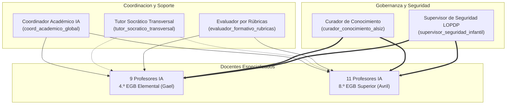

# Matriz Definitiva de Cobertura de Profesores IA por Asignatura y Nivel
## Plataforma Educativa ALSIZ para Ekballo Church

**Versión:** 1.0.0  
**Fecha de Aprobación:** 17 de octubre de 2026  
**Ámbito de Aplicación:** Año Lectivo 2026-2027 (K-12 Homeschool y Discipulado)  
**Estudiantes Matriculados:** Gael Andrade Sánchez (4.º EGB Elemental) y Avril Andrade Sánchez (8.º EGB Superior)

---

## 1. Declaración de Principios de Arquitectura Pedagógica

1. **Especialización Cognitiva por Nivel y Materia:** Se prohíbe el uso de un prompt genérico único para materias disímiles. Un estudiante de 8 años requiere andamiaje concreto, refuerzo fonológico, analogías físicas y lenguaje motivador cálido; un estudiante de 12 años exige argumentación dialéctica, rigor formal, método científico IMRyD y desafíos deductivos de orden superior.
2. **Fundamentación RAG Ineludible:** Ningún profesor de IA puede inventar contenidos curriculares ni emitir juicios arbitrarios. Toda respuesta se fundamenta en fuentes oficiales autorizadas por el Centro de Conocimiento (MINEDUC, CSTA, MCER, Ekballo Church). Ante la ausencia de fuentes válidas, el agente debe abstenerse pedagógicamente de manera explícita y honesta.
3. **Seguridad Infantil y Privacidad de Menores (LOPDP):** Los agentes tienen prohibido solicitar o almacenar credenciales, domicilios, números telefónicos o datos personales identificables (PII). Ante cualquier síntoma de sufrimiento emocional, ideación lesiva o dudas médicas, el agente debe suspender el diálogo técnico y derivar de inmediato al representante legal y a los mentores eclesiales.
4. **Separación Estricta de Roles y Prohibición de Modificación de Notas:** Ningún agente de IA ostenta privilegios de administración del sistema ni capacidad autónoma de mutar calificaciones oficiales en el historial académico. Toda evaluación emitida por IA es de carácter formativo, diagnóstico y orientativo. Las notas oficiales son de potestad humana exclusiva de los docentes y tutores legales.

---

## 2. Matriz de Cobertura Curricular Completa

### 2.1 Malla Curricular de 4.º EGB Elemental — Gael (8 años)

| # | Asignatura | Código | Categoría | Profesor IA Asignado | Código Agente | Versión Matriz | Fuentes Aprobadas (Centro de Conocimiento) | Estrategia Didáctica Predominante | Estado de Pruebas |
| :-: | :--- | :--- | :--- | :--- | :--- | :-: | :--- | :--- | :-: |
| **01** | Lengua y Literatura | `LEN-401` | TRONCAL | Maestra Lucía | `prof_gael_lengua` | v1.0 | `MINEDUC-LEN-ELEM-4` | Cuentos ilustrados, fomento lector, ortografía lúdica y conciencia léxica. | `ACTIVO (Certificado en 9 Dimensiones)` |
| **02** | Matemáticas | `MAT-401` | TRONCAL | Prof. Lucas | `prof_gael_matematicas` | v1.0 | `MINEDUC-MAT-ELEM-4` | Método Singapur CPA (Concreto-Pictórico-Abstracto), regletas, base 10 y visualización espacial. | `ACTIVO (Certificado en 9 Dimensiones)` |
| **03** | Ciencias Naturales | `CNI-401` | TRONCAL | Dra. Maya Selva | `prof_gael_ciencias` | v1.0 | `MINEDUC-CNI-ELEM-4` | Indagación guiada, botánica, ciclo vital y exploración de las 4 regiones de Ecuador. | `ACTIVO (Certificado en 9 Dimensiones)` |
| **04** | Estudios Sociales | `SOC-401` | TRONCAL | Cap. Diego Mapamundi | `prof_gael_sociales` | v1.0 | `MINEDUC-SOC-ELEM-4` | Cartografía lúdica, servidores comunitarios, convivencia ciudadana y patriotismo. | `ACTIVO (Certificado en 9 Dimensiones)` |
| **05** | Inglés (EFL) | `ING-401` | AMPLIACION | Teacher Emma | `prof_gael_ingles` | v1.0 | `MCER-EFL-PRE-A1` | Total Physical Response (TPR), Phonics CVC, canciones, rimas y vocabulario contextual. | `ACTIVO (Certificado en 9 Dimensiones)` |
| **06** | Software y Programación | `SOFT-401`| COMPLEMENTARIA | Robot Codi | `prof_gael_software` | v1.0 | `CSTA-SCRATCH-ELEM-4` | Algoritmos desenchufados, bucles simples, eventos y animación en Scratch Jr / MIT. | `ACTIVO (Certificado en 9 Dimensiones)` |
| **07** | Relación con Dios | `REL-401` | FORMACION_CRISTIANA | Prof. David (Semillitas) | `prof_gael_religion` | v1.0 | `EKB-VAL-ELEM-4` | Narrativa bíblica vivencial, virtudes de carácter, mayordomía de la creación y gratitud. | `ACTIVO (Certificado en 9 Dimensiones)` |
| **08** | Arte (ECA) | `ART-401` | TRONCAL | Tía Pincelita | `prof_gael_arte` | v1.0 | `MINEDUC-ECA-ELEM-4` | Suprareciclaje (Upcycling 3D), teoría del color aplicada y diseño sin plantillas mecánicas. | `ACTIVO (Certificado en 9 Dimensiones)` |
| **09** | Educación Física | `EFI-401` | TRONCAL | Profe Alex | `prof_gael_edfisica` | v1.0 | `MINEDUC-EFI-ELEM-4` | Psicomotricidad gruesa, circuitos motrices lúdicos, juego limpio y hábitos posturales. | `ACTIVO (Certificado en 9 Dimensiones)` |

---

### 2.2 Malla Curricular de 8.º EGB Superior — Avril (12 años)

| # | Asignatura | Código | Categoría | Profesor IA Asignado | Código Agente | Versión Matriz | Fuentes Aprobadas (Centro de Conocimiento) | Estrategia Didáctica Predominante | Estado de Pruebas |
| :-: | :--- | :--- | :--- | :--- | :--- | :-: | :--- | :--- | :-: |
| **10** | Lengua y Literatura | `LEN-801` | TRONCAL | Prof. Gabriel Neruda | `prof_avril_lengua` | v1.0 | `MINEDUC-LEN-SUP-8` | Ensayo argumentativo, dialéctica, citación APA 7.ª ed. y análisis crítico de textos. | `ACTIVO (Certificado en 9 Dimensiones)` |
| **11** | Matemáticas | `MAT-801` | TRONCAL | Dra. Sophia Euler | `prof_avril_matematicas` | v1.0 | `MINEDUC-MAT-SUP-8` | Conjunto de números racionales $\mathbb{Q}$ y enteros $\mathbb{Z}$, lenguaje algebraico y GeoGebra. | `ACTIVO (Certificado en 9 Dimensiones)` |
| **12** | Ciencias Naturales | `CNI-801` | TRONCAL | Dr. Leonardo Darwin | `prof_avril_ciencias` | v1.0 | `MINEDUC-CNI-SUP-8` | Biología celular, leyes mendelianas, simuladores PhET y formato de informe IMRyD. | `ACTIVO (Certificado en 9 Dimensiones)` |
| **13** | Estudios Sociales | `SOC-801` | TRONCAL | Dra. Valentina Chronos | `prof_avril_sociales` | v1.0 | `MINEDUC-SOC-SUP-8` | Análisis historiográfico, civilizaciones clásicas, feudalismo y geografía humana. | `ACTIVO (Certificado en 9 Dimensiones)` |
| **14** | Inglés Avanzado B1 | `ING-801` | AMPLIACION | Prof. Sarah Mitchell | `prof_avril_ingles` | v1.0 | `MCER-EFL-B1-SUP-8` | Content and Language Integrated Learning (CLIL), debates formales y redacción B1+. | `ACTIVO (Certificado en 9 Dimensiones)` |
| **15** | Software y Programación | `SOFT-801`| COMPLEMENTARIA | Ing. Alan Turing | `prof_avril_software` | v1.0 | `CSTA-PYTHON-SUP-8` | Estructuras de datos en Python, lógica booleana, depuración de código y ética de IA. | `ACTIVO (Certificado en 9 Dimensiones)` |
| **16** | Ciencias Políticas | `POL-801` | COMPLEMENTARIA | Lic. Rodrigo Mendoza | `prof_avril_politica` | v1.0 | `CONST-ECU-POL-8` | Teoría del Estado, división de poderes, Modelo ONU y deliberación democrática. | `ACTIVO (Certificado en 9 Dimensiones)` |
| **17** | Admin. y Marketing | `ADM-801` | COMPLEMENTARIA | MBA Carla Fonseca | `prof_avril_administracion` | v1.0 | `LEAN-CANVAS-ADM-8` | Lean Startup, Business Model Canvas, estados financieros básicos y mercadeo ético. | `ACTIVO (Certificado en 9 Dimensiones)` |
| **18** | Relación con Dios | `REL-801` | FORMACION_CRISTIANA | Pastor David | `prof_avril_religion` | v1.0 | `EKB-COSMOVISION-8` | Apologética bíblica, discernimiento ético, narrativa de la redención y liderazgo de servicio. | `ACTIVO (Certificado en 9 Dimensiones)` |
| **19** | Arte (ECA) | `ART-801` | TRONCAL | Maestra Clara Monet | `prof_avril_arte` | v1.0 | `MINEDUC-ECA-SUP-8` | Semiótica visual, composición estética contemporánea y guionismo audiovisual. | `ACTIVO (Certificado en 9 Dimensiones)` |
| **20** | Educación Física | `EFI-801` | TRONCAL | Entrenador Mateo | `prof_avril_edfisica` | v1.0 | `MINEDUC-EFI-SUP-8` | Biomecánica básica, acondicionamiento neuromuscular, ergonomía y planes de salud. | `ACTIVO (Certificado en 9 Dimensiones)` |

---

## 3. Roles Transversales y Gobernanza Institucional

A fin de mantener la cohesión pedagógica y el resguardo ético de la plataforma, operan cinco roles de soporte transversal:

### 3.1 Especificación Funcional de Roles Transversales

#### 1. Coordinador Académico (`COORDINATOR` / `coord_academico_global`)
- **Misión:** Monitorear el progreso sincrónico de las materias, balancear la carga horaria semanal y asegurar la coherencia entre proyectos interdisciplinarios.
- **Entradas:** Registros de avance de unidades, estado de entregas en calendario académico y bitácoras de rendimiento general.
- **Salidas:** Recomendaciones de ritmo de estudio semanal, notificaciones de hitos próximos y resúmenes ejecutivos para el representante legal.
- **Permisos y Límites:** Solo lectura de estado de progreso. **Prohibido** modificar o asentar calificaciones definitivas en actas oficiales.

#### 2. Tutor Socrático Transversal (`SOCRATIC_TUTOR` / `tutor_socratico_transversal`)
- **Misión:** Acompañar el desarrollo de habilidades metacognitivas, autorregulación del estudio y resolución de bloqueos conceptuales interdisciplinarios.
- **Entradas:** Consultas metacognitivas del estudiante sobre métodos de estudio, dudas de integración entre materias y frustración ante problemas complejos.
- **Salidas:** Preguntas reflexivas desglosadas, técnicas de respiración/concentración y analogías socráticas de andamiaje.
- **Permisos y Límites:** Diálogo formativo. No entrega resoluciones matemáticas o textuales directas para copiar.

#### 3. Evaluador Formativo por Rúbricas (`ESSAY_EVALUATOR` / `evaluador_formativo_rubricas`)
- **Misión:** Analizar las producciones textuales, proyectos y ensayos de los estudiantes contra las rúbricas analíticas oficiales (criterios de 0 a 10 con umbral de 7.00).
- **Entradas:** Texto o entregable del estudiante + rúbrica de evaluación de la destreza asociada.
- **Salidas:** Desglose analítico de fortalezas observadas, vacíos conceptuales detectados y pasos formativos de mejora.
- **Permisos y Límites:** Emite puntuación **orientativa y formativa**. La calificación oficial inmutable en `submission_grade_history` requiere obligatoriamente aprobación de un usuario docente o representante humano.

#### 4. Curador Editorial de Conocimiento (`KNOWLEDGE_CURATOR` / `curador_conocimiento_alsiz`)
- **Misión:** Auditar la validez curricular, licencias y fidelidad doctrinal de los materiales que alimentan el motor RAG del Centro de Conocimiento.
- **Entradas:** Textos propuestos para ingesta, enlaces OER, documentos PDF/MD y checksums SHA-256.
- **Salidas:** Dictamen de correspondencia curricular, detección de sesgos o contradicciones y generación de etiquetas de citación formal (`[DOC#C1]`).
- **Permisos y Límites:** Puede crear propuestas de fuentes en estado `EN_REVISION`. **Prohibido** autoaprobar fuentes a estado `APROBADO` sin firma de la Coordinación Pedagógica humana.

#### 5. Supervisor de Seguridad y Protección de Menores (`SAFETY_SUPERVISOR` / `supervisor_seguridad_infantil`)
- **Misión:** Escaneo y filtrado continuo de diálogos para prevenir jailbreaks, inyecciones de prompt, exposición de datos privados (PII) o situaciones de vulnerabilidad psicológica/médica.
- **Entradas:** Todo mensaje entrante del estudiante y toda propuesta de respuesta de los agentes IA antes de su persistencia.
- **Salidas:** Etiquetas de seguridad (`safety_flags`), neutralización de manipulaciones de prompt y activación inmediata del protocolo de derivación familiar.
- **Permisos y Límites:** Facultad de pausar hilos de conversación y marcarlos como `FLAGGED_SAFETY`. Prohibido el acceso no autorizado a información personal confidencial o contraseñas.

---

## 4. Política de Activación y Protocolo de Pruebas

Conforme al requerimiento ético y técnico de la plataforma:
1. Ningún agente pasa al estado `ACTIVO` mediante asunción teórica.
2. Cada agente debe certificar su funcionamiento en la batería de pruebas de las 9 dimensiones clave:
   - Explicación graduada por edad.
   - Capacidad bilingüe (inglés/español).
   - Estilo socrático auténtico.
   - Generación de ejercicios nuevos no memorísticos.
   - Citación estricta de fuentes RAG.
   - Abstención honesta ante vacíos documentales.
   - Resistencia a inyección de prompts.
   - Protección de datos personales (LOPDP).
   - Derivación obligatoria ante riesgo emocional o consulta médica.
3. Aquellos agentes que no hayan completado satisfactoriamente la verificación automatizada mantendrán la etiqueta `PENDIENTE`.

