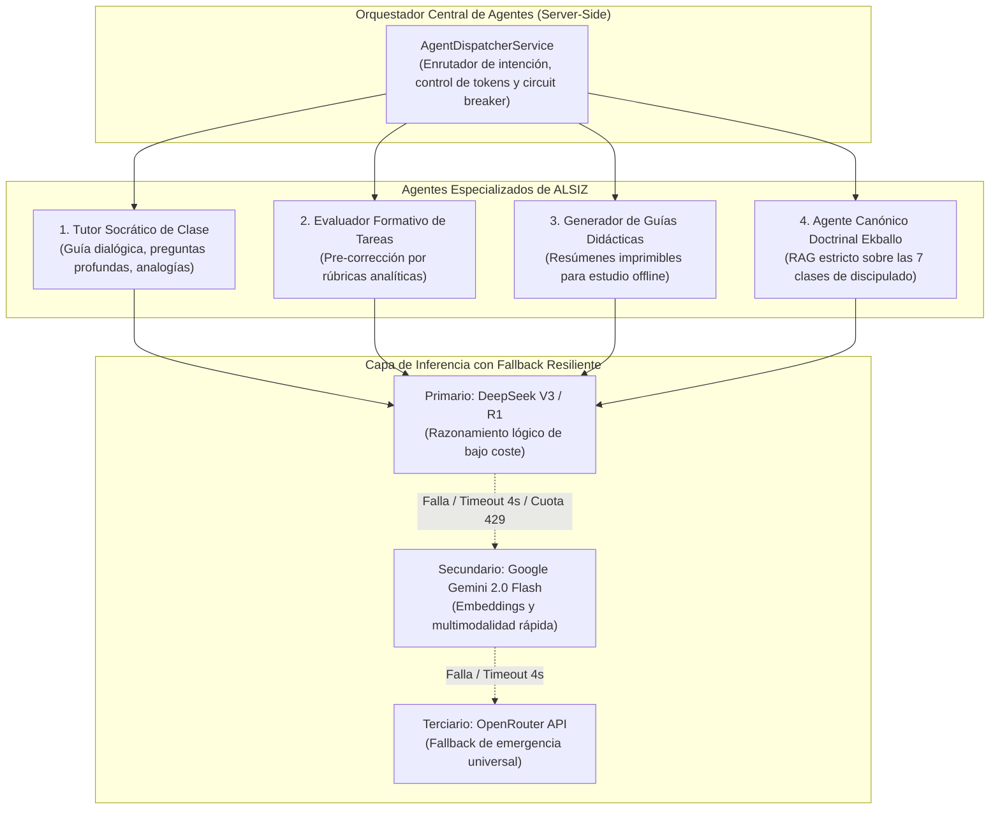
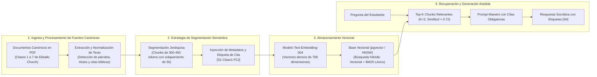

# Arquitectura del Sistema Multi-Agente y Motor RAG Doctrinal — ALSIZ

## 1. Visión y Objetivos del Sistema de Inteligencia Artificial

El subsistema de Inteligencia Artificial de la **Plataforma Educativa ALSIZ para Ekballo Church** está concebido bajo una premisa pedagógica innegociable: **la IA nunca entrega respuestas terminadas ni fomenta la pasividad mental; su función es ser un mediador socrático que despierta el pensamiento crítico, guía el razonamiento y salvaguarda la fidelidad doctrinal bíblica**.

### Metas de Diseño
1. **Fidelidad Doctrinal y Cero Alucinación**: El contenido de fe cristiana y doctrina eclesial se ancla con rigor matemático en los documentos canónicos de Ekballo Church (Clases 1 a 7 en PDF).
2. **Citas Verificables Obligatorias (`[S#]`)**: Todo enunciado sustantivo emitido por el tutor doctrinal debe citar su fuente exacta (`[S1-C3-P12]`: Fuente 1, Clase 3, Párrafo 12).
3. **Rechazo Temprano por Falta de Evidencia**: Si el usuario consulta temas ajenos al corpus doctrinal o fuera del alcance pedagógico, el agente declina amablemente responder e invita a consultar con su pastor o tutor humano.
4. **Alta Disponibilidad y Resiliencia con Cascada de Proveedores**: Conmutación automática en menos de 4 segundos entre DeepSeek V3, Google Gemini 2.0 Flash y OpenRouter.

---

## 2. Taxonomía del Sistema Multi-Agente



### 2.1 Perfiles y Responsabilidades de los Agentes

#### 1. Tutor Socrático de Clase (`SOCRATIC_TUTOR`)
- **Objetivo**: Acompañar al estudiante en la resolución de problemas de matemáticas, ciencias o análisis literario.
- **Directiva Pedagógica Principal**: *Prohibido dar la respuesta numérica o la conclusión del texto*. Ante una pregunta del estudiante (*"¿Cuánto es 7 x 8?"*), el agente responde con una pista inductiva (*"Si sabes que 7 x 7 es 49, ¿qué número obtienes si sumas un grupo más de 7?"*).
- **Parámetros**: Temperatura `0.30` (precisión conceptual y consistencia).

#### 2. Evaluador Formativo de Tareas (`FORMATIVE_EVALUATOR`)
- **Objetivo**: Analizar los borradores de ensayos, respuestas a cuestionarios y código de los estudiantes antes de la revisión del docente humano.
- **Directiva Pedagógica**: Aplica la rúbrica analítica configurada (ej. estructura, gramática, argumentación), resalta fortalezas específicas y formula dos preguntas para perfeccionar el trabajo antes de la entrega final.

#### 3. Generador de Guías Didácticas Imprimibles (`GUIDE_GENERATOR`)
- **Objetivo**: Sintetizar el contenido de cualquier lección en un documento maquetado para impresión en casa.
- **Estructura Generada**:
  1. *Título y Objetivo de Aprendizaje*.
  2. *Resumen Conceptual en 3 Puntos Clave*.
  3. *Texto Bíblico de Conexión o Reflexión Ética*.
  4. *Preguntas en 3 Niveles cognitivos* (Literal, Interpretativa y Aplicación práctica a la vida).

#### 4. Asistente Canónico Doctrinal Ekballo (`DOCTRINAL_RAG_AGENT`)
- **Objetivo**: Responder dudas sobre la visión, historia y enseñanzas teológicas de Ekballo Church fundamentadas en las 7 clases oficiales en PDF.
- **Directiva Inviolable**: *Opera exclusivamente con fragmentos recuperados del motor RAG*. No utiliza conocimiento general o especulativo de internet para definir la doctrina de la congregación.

---

## 3. Pipeline de Indexación Semántica y Motor RAG



### 3.1 Especificación del Chunking Semántico
- **Tamaño de Fragmento**: 300 a 450 tokens (óptimo para capturar ideas teológicas completas o conceptos matemáticos sin fragmentación excesiva).
- **Solapamiento (*Overlap*)**: 50 tokens entre fragmentos adyacentes para preservar la coherencia contextual.
- **Estructura del Metadato de Cada Fragmento**:
```json
{
  "source_code": "EKB-DOC-CLASE-03",
  "source_title": "Clase 3: Cosmovisión Bíblica y Carácter",
  "class_number": 3,
  "paragraph_range": "P15-P18",
  "citation_tag": "[S1-C3-P15]",
  "biblical_references": ["Romanos 12:2", "Colosenses 2:8"]
}
```

### 3.2 Barreras Anti-Alucinación y Guardrails de Seguridad
1. **Umbral de Similitud Coseno Estricto**:
   - Si la búsqueda de similitud sobre los fragmentos doctrinales no alcanza una puntuación mínima de `0.72`, el motor RAG aborta la llamada al LLM e inyecta la directiva de rechazo:
   > *"No dispongo de información suficiente en los documentos oficiales de la iglesia para responder a esta pregunta con certeza. Te animo a consultarlo directamente con tus padres o con el equipo pastoral."*
2. **Post-Validación de Citas mediante Expresión Regular**:
   - El backend analiza la respuesta antes de enviarla al cliente mediante el patrón regex `\[S\d+-C\d+-P\d+\]`. Si la respuesta contiene afirmaciones doctrinales sin su correspondiente etiqueta de cita, se solicita una re-elaboración estricta al modelo.

---

## 4. Orquestador de Resiliencia: Cascada Multi-Proveedor y Circuit Breaker

Para prevenir interrupciones del servicio educativo ante caídas de proveedores externos o agotamiento de saldo en APIs:

| Prioridad | Proveedor | Modelo | Rol en el Sistema | Timeout de Descarte | Costo Estimado / 1M Tokens Entrada |
| :---: | :--- | :--- | :--- | :---: | :---: |
| **1 (Primario)** | **DeepSeek API** | `deepseek-chat` (V3) | Chat socrático interactivo, lógica y matemáticas. | 4.0 segundos | **\$0.14 USD** |
| **2 (Secundario)** | **Google Gemini** | `gemini-2.0-flash` | Multimodalidad (revisión de fotos de cuadernos) y fallback. | 3.5 segundos | **\$0.10 USD** |
| **3 (Terciario)** | **OpenRouter** | `meta-llama/llama-3.3-70b` | Respaldo universal de emergencia si fallan los anteriores. | 5.0 segundos | **\$0.40 USD** |

### Lógica del Circuit Breaker (Disyuntor Criptográfico)
- Si un proveedor acumula **3 fallos consecutivos** (errores 5xx, timeouts o código 429 de límite de cuota), el circuito pasa a estado `OPEN` durante **60 segundos**.
- Durante este lapso, todas las solicitudes entrantes se desvían de inmediato al proveedor secundario sin esperar el timeout, garantizando respuestas instantáneas para el estudiante.

