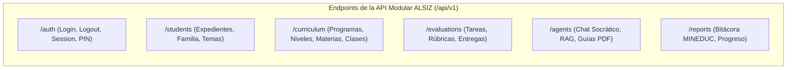

# Contratos de API e Interfaces de Módulos — ALSIZ

## 1. Convenciones y Estándares de la API

La API RESTful de la **Plataforma Educativa ALSIZ para Ekballo Church** sigue especificaciones estrictas para garantizar consistencia, seguridad y facilidad de integración con el frontend React 19:

- **Protocolo y Formato**: HTTPS obligatorio, codificación UTF-8, payloads en formato JSON.
- **URL Base**: `/api/v1` (versionamiento explícito en la ruta).
- **Mecanismo de Autenticación**: Sesión segura gestionada mediante cookie `HttpOnly` con flag `SameSite=Lax` y `Secure` en producción (token JWT firmado con secreto de servidor). Como alternativa para clientes API autorizados, se admite cabecera `Authorization: Bearer <token>`.
- **Estructura Estándar de Respuesta (Envelope Pattern)**:

```typescript
// Respuesta exitosa genérica
export interface ApiResponse<T> {
  success: true;
  data: T;
  meta?: {
    page?: number;
    pageSize?: number;
    totalRecords?: number;
    timestamp: string;
  };
}

// Respuesta de error estándar
export interface ApiErrorResponse {
  success: false;
  error: {
    code: string;           // Código de máquina (ej. 'AUTH_INVALID_CREDENTIALS')
    message: string;        // Mensaje amigable para el usuario
    details?: Array<{       // Lista de fallos de validación (Zod)
      field: string;
      issue: string;
    }>;
  };
  timestamp: string;
}
```

---

## 2. Códigos de Estado y Errores Esperados

| Código HTTP | Significado | Escenario de Disparo Típico |
| :---: | :--- | :--- |
| **`200 OK`** | Operación exitosa | Consulta o actualización completada. |
| **`201 Created`** | Recurso creado | Entrega de tarea, registro de alumno o nueva matrícula. |
| **`400 Bad Request`** | Solicitud malformada | Falla de validación en el esquema Zod (campos requeridos ausentes). |
| **`401 Unauthorized`** | No autenticado | Cookie o token ausente, expirado o con firma inválida. |
| **`403 Forbidden`** | No autorizado | Usuario autenticado intentando ver expedientes de otra familia. |
| **`404 Not Found`** | Recurso inexistente | Identificador de clase, materia o estudiante no encontrado. |
| **`422 Unprocessable`** | Error de lógica de negocio | Intentar matricular a un estudiante en un programa ya completado. |
| **`429 Too Many Req`** | Límite de tasa excedido | Más de 20 mensajes al tutor IA en un minuto (*rate limiting*). |
| **`503 Service Unavail`** | Proveedores IA agotados | Falla simultánea de todos los proveedores LLM en cascada. |

---

## 3. Catálogo de Endpoints Principales por Módulo



---

### 3.1 Módulo: Autenticación y Sesión (`/auth`)

#### 1. Iniciar Sesión con Credenciales (`POST /api/v1/auth/login`)
- **Descripción**: Autentica a un usuario y emite una cookie de sesión segura `HttpOnly`. **Elimina el bypass por solo ID de Wisdom School**.
- **Autorización Requerida**: Pública.
- **Validación de Entrada (Zod Schema)**:
```typescript
export interface LoginRequestDto {
  identifier: string; // Correo o username (min 3 caracteres)
  password: string;   // Contraseña (min 6 caracteres)
}
```
- **Respuesta Exitosa (`200 OK`)**:
```typescript
export interface LoginResponseDto {
  user: {
    id: string;
    username: string;
    firstName: string;
    lastName: string;
    role: 'STUDENT' | 'REPRESENTATIVE' | 'TEACHER' | 'ADMIN';
    avatarUrl?: string;
  };
  linkedStudents?: Array<{ // Si es representante, lista sus hijos
    id: string;
    firstName: string;
    currentGrade: string;
  }>;
}
```

#### 2. Iniciar Sesión Rápida por PIN de Alumno (`POST /api/v1/auth/pin-login`)
- **Descripción**: Permite a niños pequeños (ej. Gael en iPad) acceder con su código identificador y un PIN de 4 dígitos.
- **Validación de Entrada**:
```typescript
export interface PinLoginRequestDto {
  studentCode: string; // Ej. 'GAEL-2026'
  pinCode: string;     // Exactamente 4 dígitos numéricos
}
```

#### 3. Cerrar Sesión (`POST /api/v1/auth/logout`)
- **Descripción**: Invalida la sesión actual y elimina la cookie `HttpOnly`.

---

### 3.2 Módulo: Estudiantes y Familia (`/students`)

#### 1. Obtener Perfil del Estudiante (`GET /api/v1/students/:studentId`)
- **Autorización Requerida**: `STUDENT` (propio perfil), `REPRESENTATIVE` (padre verificado) o `ADMIN`.
- **Respuesta Exitosa (`200 OK`)**:
```typescript
export interface StudentProfileDto {
  id: string;
  studentCode: string;
  firstName: string;
  lastName: string;
  age: number;
  motto?: string;
  colorTheme: {
    primary: string;
    accent: string;
    gradient: string;
  };
  activeEnrollments: Array<{
    enrollmentId: string;
    programName: string;
    levelName: string;
    schoolYear: string;
  }>;
}
```

#### 2. Listar Hijos del Representante (`GET /api/v1/representatives/my-family`)
- **Autorización Requerida**: `REPRESENTATIVE`.
- **Respuesta Exitosa (`200 OK`)**: Retorna la lista de estudiantes bajo su tutela con porcentajes de avance agregado.

---

### 3.3 Módulo: Currículo y LMS (`/curriculum`)

#### 1. Obtener Malla de Asignaturas del Estudiante (`GET /api/v1/students/:studentId/subjects`)
- **Descripción**: Retorna las asignaturas cursadas por el alumno en sus programas activos (incluyendo troncales MINEDUC y Discipulado Ekballo).
- **Autorización Requerida**: `STUDENT`, `REPRESENTATIVE` o `TEACHER`.
- **Respuesta Exitosa (`200 OK`)**:
```typescript
export interface StudentSubjectDto {
  id: string;
  code: string;
  name: string;
  category: 'TRONCAL_MINEDUC' | 'FORMACION_CRISTIANA' | 'COMPLEMENTARIA' | 'AMPLIACION_INTERNACIONAL';
  colorTheme: string;
  iconName: string;
  weeklyHours: number;
  progressPercentage: number;
  classesCompleted: number;
  totalClasses: number;
  assignedTeacher: {
    name: string;
    title: string;
    avatarUrl?: string;
  };
}
```

#### 2. Obtener Detalle de Clase Diaria (`GET /api/v1/classes/:classId`)
- **Descripción**: Entrega el contenido didáctico de la lección, pregunta socrática, taller práctico y recursos descargables.
- **Respuesta Exitosa (`200 OK`)**:
```typescript
export interface DailyClassDetailDto {
  id: string;
  classNumber: number;
  dayNumber: number;
  title: string;
  socraticQuestion: string;
  dynamicActivity: string;
  contentMarkdown: string;
  labType?: string;
  resources: Array<{
    title: string;
    type: 'PDF_GUIDE' | 'VIDEO' | 'SIMULATION' | 'LINK';
    downloadUrl: string;
    fileSizeBytes?: number;
  }>;
  evaluation?: {
    id: string;
    title: string;
    type: string;
    maxScore: number;
  };
}
```

---

### 3.4 Módulo: Agentes IA y Tutoría Socrática (`/agents`)

#### 1. Conversar con el Tutor Socrático (`POST /api/v1/agents/chat`)
- **Descripción**: Envía una duda del estudiante. El backend inyecta las directivas del agente, consulta el motor RAG para citas doctrinales o curriculares y ejecuta la cascada LLM con circuit-breaker.
- **Autorización Requerida**: `STUDENT`, `TEACHER` o `REPRESENTATIVE`.
- **Validación de Entrada**:
```typescript
export interface AgentChatRequestDto {
  agentCode: 'SOCRATIC_TUTOR' | 'ESSAY_EVALUATOR' | 'STUDY_GUIDE_GEN';
  classId?: string;       // Clase activa para contextualización
  subjectId?: string;     // Materia activa
  userMessage: string;    // Texto del alumno (min 2, max 2000 caracteres)
  conversationContext?: Array<{
    role: 'user' | 'assistant';
    content: string;
  }>;
}
```
- **Respuesta Exitosa (`200 OK`)**:
```typescript
export interface AgentChatResponseDto {
  message: string;        // Respuesta socrática con preguntas guía
  citations?: Array<{     // Citas obligatorias [S#] de documentos fuente
    tag: string;          // Ej. '[S1-C1-P4]'
    sourceTitle: string;  // 'Clase 1: Historia de Ekballo Church'
    page?: number;
  }>;
  followUpQuestions?: string[]; // 2 o 3 preguntas socráticas sugeridas
  providerUsed: 'DEEPSEEK' | 'GEMINI' | 'OPENROUTER';
  latencyMs: number;
}
```

#### 2. Generar Guía Didáctica en PDF (`POST /api/v1/agents/generate-guide`)
- **Descripción**: Genera una guía de estudio imprimible para trabajo desconectado (*offline*), conteniendo resumen temático, versículos clave y preguntas en 3 niveles de comprensión.
- **Validación de Entrada**: `{ classId: string; targetGrade: string; }`.
- **Respuesta Exitosa (`200 OK`)**: Retorna HTML estructurado listo para imprimir o URL firmada para descarga de PDF.

---

### 3.5 Módulo: Evaluación y Portafolio (`/evaluations`)

#### 1. Entregar Tarea o Evidencia de Aprendizaje (`POST /api/v1/evaluations/:evalId/submissions`)
- **Autorización Requerida**: `STUDENT` titular.
- **Validación de Entrada**:
```typescript
export interface SubmitTaskRequestDto {
  submissionText?: string;
  attachmentKey?: string; // Clave devuelta tras subir archivo a S3/R2
}
```
- **Respuesta Exitosa (`201 Created`)**: Registra la entrega y dispara en segundo plano la pre-evaluación formativa de la IA.

#### 2. Validar Calificación Docente (`PUT /api/v1/submissions/:submissionId/grade`)
- **Autorización Requerida**: `TEACHER` o `ADMIN`.
- **Validación de Entrada**:
```typescript
export interface GradeSubmissionRequestDto {
  score: number;                // 0.00 a 10.00
  qualitativeFeedback: string;  // Retroalimentación pedagógica humana
  isApproved: boolean;
}
```

---

### 3.6 Módulo: Reportes y Bitácora MINEDUC (`/reports`)

#### 1. Exportar Bitácora de Acompañamiento Homeschool (`GET /api/v1/reports/students/:studentId/homeschool-log`)
- **Descripción**: Genera el informe consolidado de destrezas con criterio de desempeño cubiertas y horas pedagógicas cumplidas para la convalidación ante el MINEDUC (Acuerdo 2023-00069-A).
- **Autorización Requerida**: `REPRESENTATIVE` acreditado o `ADMIN`.
- **Parámetros**: `?schoolYear=2026-2027&format=pdf`.

