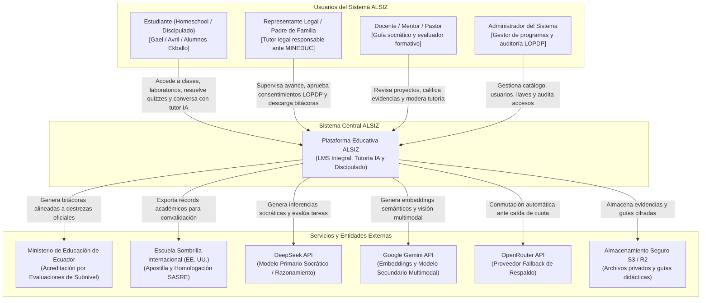
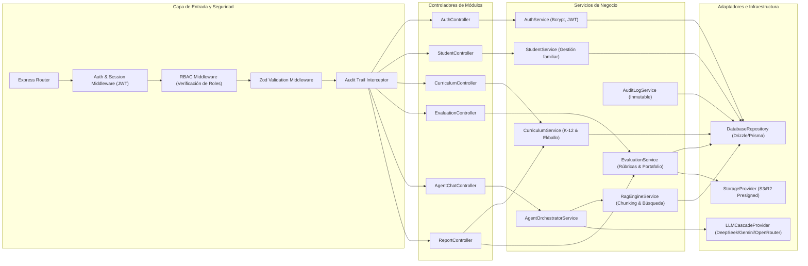
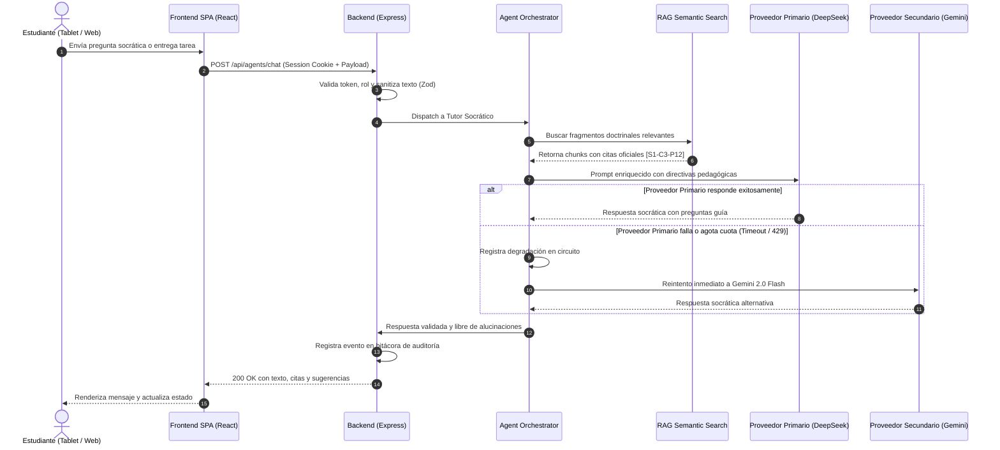

# Diagrama de Arquitectura Modular C4 — Plataforma Educativa ALSIZ

## 1. Visión General de la Arquitectura

La arquitectura de la **Plataforma Educativa ALSIZ para Ekballo Church** evoluciona desde el prototipo heredado monolítico de Wisdom School (centrado en el cliente con `localStorage` y llamadas directas de IA) hacia una **arquitectura modular de servicios desacoplados**, orientada a la privacidad, la resiliencia en conectividad intermitente (*offline-first / async*) y el cumplimiento normativo ecuatoriano (LOPDP y MINEDUC).

### Principios Arquitectónicos
1. **Preservación y Rentabilización de Activos**: Se conserva el núcleo frontend React 19 + TypeScript + Vite 6 + Tailwind CSS 4, aprovechando la rica interfaz táctil probada en iPads y la biblioteca de componentes interactivos.
2. **Backend de Orquestación y Seguridad Centralizada**: Unificación de servicios en una capa de backend modular en Node.js/Express (con soporte serverless para Vercel o proceso standalone en contenedor Docker), eliminando toda exposición de claves o lógica crítica en el navegador.
3. **Persistencia Híbrida y Resiliencia ante Desconexión**: Modo *Offline-First* con sincronización bidireccional basada en eventos. Los estudiantes en zonas rurales de Ecuador pueden descargar guías didácticas y materiales, registrar progreso localmente y sincronizar al recuperar conectividad.
4. **Capa IA Aislada con Cascada de Proveedores y Circuit Breaker**: Orquestación en servidor que conmuta entre DeepSeek V3, Google Gemini 2.0/1.5 Flash y OpenRouter de forma transparente, garantizando alta disponibilidad a costes operativos reducidos.
5. **Seguridad y Privacidad por Diseño (LOPDP Art. 22)**: Cero exposición pública de expedientes o imágenes de menores; autenticación basada en credenciales robustas y tokens de sesión con cookies `HttpOnly` y protección CSRF.

---

## 2. Diagrama C4 — Nivel 1: Contexto del Sistema

El diagrama de contexto ilustra cómo los diferentes actores humanos y sistemas externos interactúan con la Plataforma ALSIZ.



---

## 3. Diagrama C4 — Nivel 2: Contenedores del Sistema

El diagrama de contenedores describe las aplicaciones de alto nivel, bases de datos y almacenes de datos que conforman la solución técnica.

```mermaid
flowchart TB
    subgraph Cliente["Navegador del Usuario (Dispositivos Móviles, Tablets, Escritorio)"]
        SPA["Single Page Application (SPA)<br/>[React 19, TypeScript, Vite, Tailwind CSS]<br/>Interfaz socrática, visor de clases, quizzes y estado offline"]
        SW["Service Worker / Cache Storage<br/>[PWA Cache & Local Storage]<br/>Almacén temporal de progreso offline y guías PDF"]
        SPA <--> SW
    end

    subgraph Servidor["Servidor de Aplicación ALSIZ (Node.js / Express Modular)"]
        API["API Gateway & Middleware de Seguridad<br/>[Express 4 + Helmet + CORS + RateLimit]<br/>Autenticación JWT HttpOnly, validación Zod y RBAC"]
        
        subgraph Modulos_Servicio["Módulos de Servicio del Backend"]
            MOD_AUTH["Módulo de Identidad y Permisos"]
            MOD_CURR["Módulo Curricular y LMS"]
            MOD_EVAL["Módulo de Evaluación y Evidencias"]
            MOD_AI["Orquestador Multi-Agente e IA"]
            MOD_RAG["Motor de Indexación Semántica (RAG)"]
            MOD_AUDIT["Módulo de Auditoría y Cumplimiento"]
        end

        API --> MOD_AUTH & MOD_CURR & MOD_EVAL & MOD_AI & MOD_RAG & MOD_AUDIT
    end

    subgraph Persistencia["Capa de Persistencia de Datos"]
        DB[(Base de Datos Relacional<br/>[PostgreSQL 16 / SQLite en dev]<br/>Expedientes, matrículas, notas, auditoría)]
        VEC[(Almacén Vectorial<br/>[pgvector / HNSW Memory Index]<br/>Embeddings de las 7 clases Ekballo y currículo)]
        OBJ[(Almacenamiento de Objetos Seguro<br/>[S3 / Cloudflare R2 privado]<br/>PDFs de guías, evidencias de alumnos cifradas)]
    end

    subgraph Proveedores_IA["Servicios Externos de Inteligencia Artificial"]
        P_DEEPSEEK["DeepSeek V3 / R1 (Chat socrático y código)"]
        P_GEMINI["Google Gemini 2.0 Flash / Text-Embedding-004"]
        P_OPENROUTER["OpenRouter (Fallback multi-modelo)"]
    end

    SPA -->|"HTTPS / JSON REST API<br/>(Cookies HttpOnly seguras)"| API
    MOD_AUTH & MOD_CURR & MOD_EVAL & MOD_AUDIT -->|"SQL / ORM Seguro (Prisma / Drizzle)"| DB
    MOD_RAG -->|"Consultas vectoriales similitud coseno"| VEC
    MOD_EVAL & MOD_CURR -->|"URLs firmadas temporales (Presigned URLs)"| OBJ
    MOD_AI -->|"Inferencia HTTPS con Circuit Breaker"| P_DEEPSEEK & P_GEMINI & P_OPENROUTER
```

---

## 4. Diagrama C4 — Nivel 3: Componentes del Backend Modular

Desglose de los componentes internos de la capa de backend de ALSIZ:



---

## 5. Procesamiento Asíncrono y Tolerancia a Fallos



---

## 6. Justificación Técnica de Migraciones Propuestas

| Componente Actual (Wisdom School) | Componente Destino (ALSIZ) | Justificación Técnica y de Negocio |
| :--- | :--- | :--- |
| **`localStorage` exclusivo** | **Base de Datos Relacional (PostgreSQL / SQLite) + Sync Local** | `localStorage` tiene límite de 5 MB, se borra al limpiar caché y no permite acceso multi-dispositivo ni supervisión remota de los representantes legales. La BD relacional garantiza integridad referencial, seguridad LOPDP y trazabilidad para el MINEDUC. |
| **Llamadas directas de IA desde el cliente** (`aiService.ts` con fallback `VITE_*`) | **Orquestador Centralizado en Backend** (`/api/agents/chat`) | Impedir la fuga de credenciales API en el bundle JavaScript del navegador (vulnerabilidad crítica de seguridad), implementar *rate-limiting* por usuario y aplicar políticas de contención de costes. |
| **Bypass de autenticación por ID** (`cleanId === found.id`) | **Autenticación robusta con Argon2 / Bcrypt + Tokens JWT HttpOnly** | Cerrar la brecha de acceso no autorizado, cumplir con la LOPDP en datos de menores y permitir sesiones independientes para padres, docentes y alumnos. |
| **Imágenes estáticas públicas** en `/public/students/` | **Almacenamiento de Objetos Cifrado con URLs Firmadas** | Los rostros y datos de menores de edad son categorías especiales protegidas por el Art. 22 de la LOPDP; no pueden servirse de forma pública e indexable en internet. |

