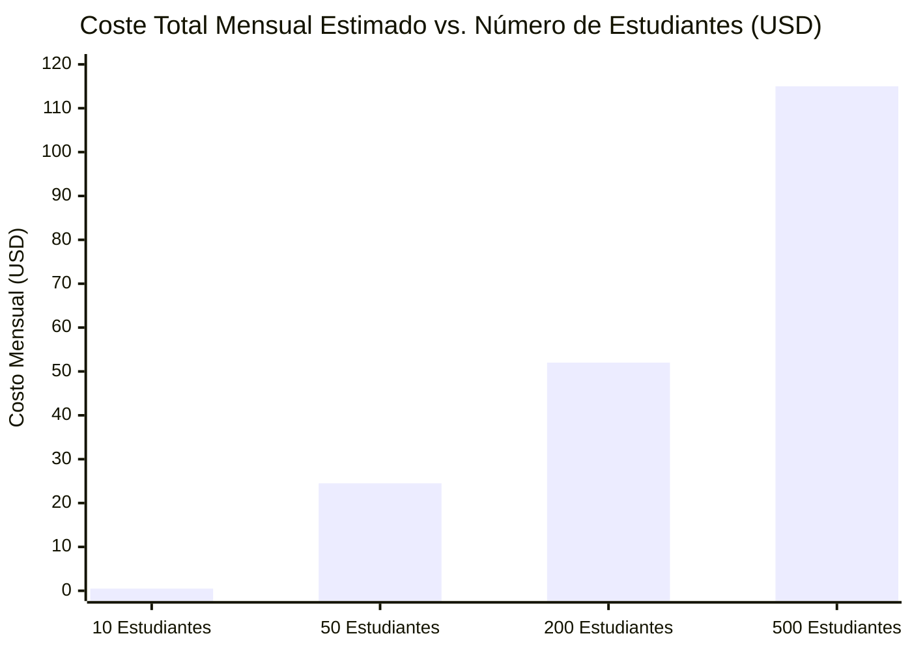

# Estimación de Costes Operativos de Infraestructura e IA — ALSIZ

## 1. Declaración Explicita de Alcance Financiero

> [!IMPORTANT]
> **Aviso de Estimación Técnica (No Cotización Vinculante)**:
> Las cifras y rangos presentados en este documento constituyen **proyecciones técnicas de ingeniería y modelos de dimensionamiento de consumo** elaborados a partir de las tarifas públicas oficiales vigentes al año 2026 de los proveedores de nube y APIs de Inteligencia Artificial. No representan cotizaciones comerciales contractuales ni garantizan precios fijos ante eventuales variaciones arancelarias de los proveedores externos.

---

## 2. Supuestos de Uso y Dimensionamiento por Estudiante

Para modelar los costes con rigor matemático, se establecen los siguientes parámetros de uso promedio mensual por estudiante:

| Variable de Consumo | Valor Promedio Estimado | Justificación Pedagógica |
| :--- | :---: | :--- |
| **Días Lectivos Mensuales** | 20 días | Régimen escolar regular de lunes a viernes. |
| **Interacciones Socráticas Diarias** | 8 a 12 consultas / día | 2 consultas socráticas por cada una de las 5 materias diarias. |
| **Interacciones Mensuales por Alumno** | **200 consultas / mes** | Volumen suficiente para guiar el estudio activo. |
| **Longitud Media por Petición (Prompt)** | 250 tokens entrada | Contexto de la lección + pregunta del estudiante. |
| **Longitud Media por Respuesta (Completion)** | 350 tokens salida | Respuesta socrática breve, preguntas guía y citas `[S#]`. |
| **Volumen Mensual de Tokens por Alumno** | **120.000 tokens / mes** | ~50.000 tokens entrada + ~70.000 tokens salida. |
| **Almacenamiento de Evidencias y Tareas** | 50 MB / alumno / año | Fotos comprimidas de cuadernos y archivos PDF de tareas. |
| **Transferencia de Datos de Salida (Egress)** | 1.5 GB / alumno / mes | Navegación en la SPA y descarga de guías didácticas en PDF. |

---

## 3. Tarifas Unitarias de Referencia (Vigentes 2026)

| Servicio / Proveedor | Concepto | Tarifa Unitaria Pública (USD) |
| :--- | :--- | :---: |
| **DeepSeek API (`deepseek-chat` V3)** | Entrada (Prompt) | **\$0.14** por millón de tokens |
| **DeepSeek API (`deepseek-chat` V3)** | Salida (Completion) | **\$0.28** por millón de tokens |
| **Google Gemini (`gemini-2.0-flash`)** | Entrada / Salida | **\$0.10 / \$0.40** por millón de tokens |
| **Google Gemini (`text-embedding-004`)** | Indexación RAG | **\$0.025** por millón de tokens |
| **Cloudflare R2** | Almacenamiento de Objetos | **\$0.015** por GB/mes (primeros 10 GB gratis) |
| **Cloudflare R2** | Transferencia de Salida (Egress) | **\$0.00** (Egress completamente gratuito) |
| **Supabase / Neon PostgreSQL** | Base de Datos Relacional | Nivel Gratuito (hasta 500 MB) / Plan Pro **\$25.00/mes** |
| **Hosting Frontend / API (Vercel)** | Servidor Web y Serverless | Plan Hobby **\$0.00** / Plan Pro **\$20.00/mes** |

---

## 4. Proyección de Costes Operativos en Cuatro Escenarios de Escala

---

### Escenario A: Piloto Familiar (10 Estudiantes — Caso Base Ekballo)
*Audiencia: Hijos de pastores, líderes fundadores y primeros alumnos homeschoolers.*

| Partida de Infraestructura | Proveedor Seleccionado | Coste Mensual Estimado |
| :--- | :--- | :---: |
| **Inferencia IA Socrática** (1.2M tokens/mes) | DeepSeek V3 (Primario) + Gemini Flash | **\$0.28 USD** |
| **Indexación Semántica RAG** (Corpus Ekballo) | Gemini Embeddings (pago único < \$0.05) | **\$0.01 USD** |
| **Base de Datos Relacional** (< 50 MB) | Supabase Free Tier / SQLite | **\$0.00 USD** |
| **Almacenamiento de Evidencias** (< 1 GB) | Cloudflare R2 Free Tier (10 GB gratis) | **\$0.00 USD** |
| **Hosting y Dominio** | Vercel Hobby + Dominio propio eclesial | **\$1.20 USD** (amortización anual) |
| **TOTAL MENSUAL ESTIMADO (10 ALUMNOS)** | | **\$1.49 USD / mes** |
| **COSTE PROMEDIO POR ALUMNO / MES** | | **\$0.15 USD / alumno** |

---

### Escenario B: Congregacional Inicial (50 Estudiantes)
*Audiencia: Familias de Ekballo Church y red ministerial cercana.*

| Partida de Infraestructura | Proveedor Seleccionado | Coste Mensual Estimado |
| :--- | :--- | :---: |
| **Inferencia IA Socrática** (6.0M tokens/mes) | DeepSeek V3 + Gemini Flash (Fallback 10%) | **\$1.52 USD** |
| **Base de Datos Relacional** (< 250 MB) | Supabase Free Tier o Neon Serverless | **\$0.00 USD** |
| **Almacenamiento de Objetos** (< 5 GB) | Cloudflare R2 Free Tier | **\$0.00 USD** |
| **Hosting de Aplicación** | Vercel Pro (colaboración y SLA) | **\$20.00 USD** |
| **TOTAL MENSUAL ESTIMADO (50 ALUMNOS)** | | **\$21.52 USD / mes** |
| **COSTE PROMEDIO POR ALUMNO / MES** | | **\$0.43 USD / alumno** |

---

### Escenario C: Consolidación Regional (200 Estudiantes)
*Audiencia: Red de familias homeschoolers cristianas en Ecuador.*

| Partida de Infraestructura | Proveedor Seleccionado | Coste Mensual Estimado |
| :--- | :--- | :---: |
| **Inferencia IA Socrática** (24M tokens/mes) | DeepSeek V3 + Gemini Flash | **\$6.10 USD** |
| **Base de Datos Relacional con Copias Diarias** | Supabase Pro Tier (Compute dedicado) | **\$25.00 USD** |
| **Almacenamiento de Evidencias** (~15 GB) | Cloudflare R2 (\$0.015/GB sobre 10 GB) | **\$0.10 USD** |
| **Hosting y CDN Global** | Vercel Pro | **\$20.00 USD** |
| **TOTAL MENSUAL ESTIMADO (200 ALUMNOS)** | | **\$51.20 USD / mes** |
| **COSTE PROMEDIO POR ALUMNO / MES** | | **\$0.26 USD / alumno** |

---

### Escenario D: Expansión Nacional (500 Estudiantes)
*Audiencia: Operación formal con múltiples congregaciones aliadas en Ecuador.*

| Partida de Infraestructura | Proveedor Seleccionado | Coste Mensual Estimado |
| :--- | :--- | :---: |
| **Inferencia IA Socrática** (60M tokens/mes) | DeepSeek V3 + Gemini Flash + Caché | **\$15.20 USD** |
| **Base de Datos Relacional de Alta Capacidad** | Supabase Pro + Compute Add-on | **\$50.00 USD** |
| **Almacenamiento de Evidencias** (~40 GB) | Cloudflare R2 | **\$0.45 USD** |
| **Hosting y API Gateway** | Vercel Pro + Contenedor Docker auxiliar | **\$40.00 USD** |
| **TOTAL MENSUAL ESTIMADO (500 ALUMNOS)** | | **\$105.65 USD / mes** |
| **COSTE PROMEDIO POR ALUMNO / MES** | | **\$0.21 USD / alumno** |

---

## 5. Conclusiones y Viabilidad Económica

1. **Eficiencia de Coste Radical**: Gracias a la arquitectura de orquestación en servidor con modelos *Flash/V3* (DeepSeek y Gemini 2.0), el coste tecnológico e informático por alumno oscila entre **\$0.15 y \$0.45 USD mensuales**.
2. **Sostenibilidad para el Ministerio**: Frente a cuotas escolares de mercado de \$60 a \$120 mensuales (o pensiones tradicionales de \$1,053 como en Alliance Academy), el coste marginal de la tecnología representa menos del **1% del presupuesto operativo**, permitiendo a Ekballo Church canalizar sus recursos al acompañamiento tutorial humano y becas misioneras.

