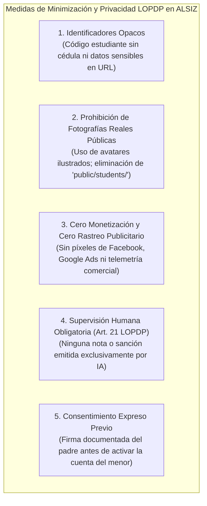

# Matriz de Roles, Permisos y Política de Seguridad LOPDP — ALSIZ

## 1. Marco de Gobernanza de Accesos y Privacidad

La **Plataforma Educativa ALSIZ para Ekballo Church** opera bajo el principio de **Privacidad y Seguridad por Diseño**, dando cumplimiento exhaustivo a la **Ley Orgánica de Protección de Datos Personales de Ecuador (LOPDP)** y garantizando la protección reforzada de los datos de niñas, niños y adolescentes (Art. 22 LOPDP).

---

## 2. Matriz de Control de Acceso Basado en Roles (RBAC)

Se definen 5 roles jerárquicos y segregados en el sistema:
1. **`SUPERADMIN`**: Administrador tecnológico general (gestión de infraestructura, rotación de llaves, políticas globales).
2. **`ADMIN_PASTOR`**: Liderazgo pastoral y directivo de Ekballo Church (gestión de programas, asignación de docentes, supervisión formativa).
3. **`TEACHER_MENTOR`**: Docentes, mentores y facilitadores de aula (calificación de tareas, revisión socrática, soporte pedagógico).
4. **`REPRESENTATIVE`**: Madres, padres o tutores legales (supervisión de sus propios hijos, firma de consentimientos, descarga de bitácoras).
5. **`STUDENT`**: Alumnos de cualquier programa (acceso a clases, laboratorios, quizzes y tutor IA; restringido a sus propios datos).

### 2.1 Matriz de Permisos Detallada

| Operación / Recurso | `STUDENT` | `REPRESENTATIVE` | `TEACHER_MENTOR` | `ADMIN_PASTOR` | `SUPERADMIN` |
| :--- | :---: | :---: | :---: | :---: | :---: |
| **Autenticación (Login / Logout)** | Sí (propio) | Sí (propio) | Sí (propio) | Sí (propio) | Sí (propio) |
| **Ver Perfil Propio** | Sí | Sí | Sí | Sí | Sí |
| **Ver Expediente de Alumnos** | Solo propio | Solo sus hijos vinculados | Alumnos de sus materias | Todos | Todos |
| **Modificar Datos de Alumnos** | Solo lema/tema | Datos no sensibles de sus hijos | No | Sí | Sí |
| **Consultar Clases y Recursos** | Sí (sus materias) | Sí (materias de sus hijos) | Sí (todas) | Sí (todas) | Sí (todas) |
| **Entregar Tareas / Submissions** | Sí (propias) | No | No | No | No |
| **Calificar y Retroalimentar Tareas** | No | No | Sí (sus materias) | Sí | No |
| **Conversar con Tutor IA Socrático** | Sí (con rate-limit) | Sí (modo prueba) | Sí | Sí | Sí |
| **Firmar Consentimiento LOPDP** | No | Sí (exclusivo legal) | No | No | No |
| **Descargar Bitácora Oficial MINEDUC** | No | Sí (de sus hijos) | Sí (de sus alumnos) | Sí | Sí |
| **Exportar Respaldo de Datos (JSON)** | Solo propio | De toda su familia | No | Toda la plataforma | Toda la plataforma |
| **Gestionar Programas y Materias** | No | No | No | Sí | Sí |
| **Gestionar Usuarios y Asignar Roles** | No | No | No | Sí | Sí |
| **Consultar Libro de Auditoría (Audit Log)** | No | No | No | Solo resumen | Sí (completo) |
| **Rotar Claves de APIs de Inteligencia Artificial** | No | No | No | No | Sí (exclusivo) |

---

## 3. Política de Minimización de Datos de Menores (Art. 22 LOPDP)

El Artículo 22 de la LOPDP ecuatoriana cataloga a los datos de niños, niñas y adolescentes como una **categoría especial sujeta a tutela reforzada**. La plataforma ALSIZ aplica las siguientes medidas obligatorias:

1. **Eliminación de Activos Estáticos Públicos**:
   - Se prohíbe alojar fotos de estudiantes o archivos de tareas en la carpeta `public/` del servidor web.
   - Las imágenes y documentos de entrega se almacenan en cubos de almacenamiento privados (S3 / Cloudflare R2), accesibles únicamente mediante **URLs firmadas temporalmente (Presigned URLs con expiración máxima de 15 minutos)** y previa validación del rol del usuario.
2. **Minimización de Datos en Base de Datos**:
   - En la ficha de los estudiantes se recaba exclusivamente: nombre de pila, fecha de nacimiento (para pertinencia pedagógica) e intereses académicos. No se almacenan números de cédula, expedientes médicos ni datos biométricos del menor.
3. **No Discriminación Algorítmica (Art. 21 LOPDP)**:
   - El tutor de Inteligencia Artificial funge exclusivamente como asistente socrático y pre-evaluador formativo orientativo.
   - Toda calificación oficial o reporte legal para el MINEDUC requiere la convalidación humana de un docente o tutor acreditado.

---

## 4. Política de Retención, Ciclo de Vida y Supresión de Datos

| Tipo de Dato | Período de Retención | Base Legal / Justificación | Disposición al Vencimiento |
| :--- | :--- | :--- | :--- |
| **Credenciales y Cuentas de Acceso** | Mientras la cuenta esté activa + 6 meses tras inactividad. | Continuidad de servicio y soporte. | Anonimización irreversible o eliminación total si no hay obligaciones legales. |
| **Expedientes Académicos y Calificaciones** | **5 años** tras la culminación del ciclo lectivo. | Art. 33 Acuerdo MINEDUC-2023-00069-A (respaldo para convalidación distrital). | Archivado frío cifrado; posterior eliminación a solicitud expresa del representante. |
| **Entregas de Tareas y Archivos Multimedia** | **1 año lectivo** posterior al cierre del curso. | Verificación formativa de portafolio y resolución de controversias. | Purgado automático de almacenamiento de objetos previo aviso al padre. |
| **Conversaciones de Chat con el Tutor IA** | **90 días**. | Control de calidad pedagógica y prevención de abusos. | Eliminación automática programada mediante tarea periódica (*cron*). |
| **Eventos de Auditoría (Audit Logs)** | **3 años**. | Trazabilidad de seguridad y defensa legal LOPDP. | Transferencia a almacenamiento inmutable de largo plazo. |

---

## 5. Ciclo de Vida de Sesiones y Almacenamiento de Tokens

1. **Tokens de Acceso (Access Tokens JWT)**:
   - *Algoritmo*: HMAC-SHA256 (`HS256`) o Asimétrico `RS256`.
   - *Tiempo de Vida (TTL)*: **60 minutos**.
   - *Almacenamiento*: **Cookie `HttpOnly`** con flags `Secure=true`, `SameSite=Lax`, `Path=/api`.
   - *Prohibición*: Prohibido almacenar tokens en `localStorage` o `sessionStorage` del navegador para evitar vulnerabilidades de robo de sesión por XSS (Cross-Site Scripting).
2. **Tokens de Renovación (Refresh Tokens)**:
   - *Tiempo de Vida*: **14 días**.
   - *Almacenamiento*: Cookie `HttpOnly` dedicada en ruta `/api/v1/auth/refresh`.
   - *Rotación de Tokens*: En cada renovación, el token anterior queda revocado inmediatamente (*Refresh Token Rotation*).
3. **Protección Táctil por Inactividad en Dispositivos Escolares (iPads)**:
   - Tras **20 minutos de inactividad** en pantallas de estudiantes infantiles, la sesión se bloquea automáticamente exigiendo reingresar el PIN de 4 dígitos.

---

## 6. Registro de Auditoría Inmutable (Audit Trail)

La tabla `audit_events` registra eventos clave con los siguientes estándares:
- **Eventos Auditados Obligatoriamente**:
  - Inicios y cierres de sesión (exitosos y fallidos).
  - Consulta o descarga de expedientes de menores por parte de adultos.
  - Modificación de calificaciones o estados de aprobación.
  - Registro de firma de consentimiento informado LOPDP.
  - Descarga masiva o exportación de datos en JSON.
  - Alertas de contenido inapropiado detectadas en interacciones con agentes IA.
- **Protección de la Privacidad del Auditor**: La dirección IP de origen se almacena únicamente mediante un hash criptográfico salado (`SHA-256(IP + salt)`), permitiendo detectar ataques coordinados sin almacenar la dirección IP cruda del hogar familiar.

