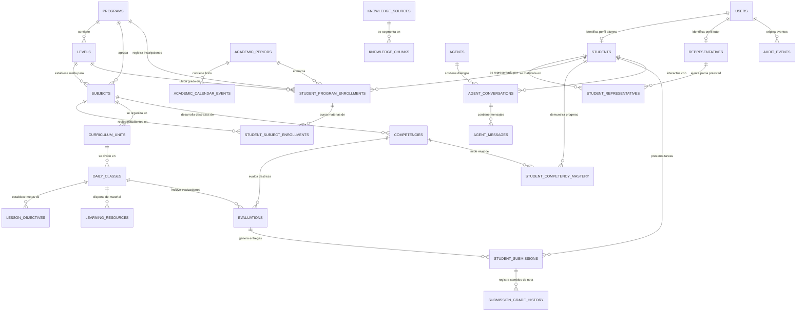

# Modelo de Datos y Diccionario de Entidades — ALSIZ

## 1. Visión y Principios del Modelo de Datos

El modelo de datos de la **Plataforma Educativa ALSIZ para Ekballo Church** ha sido concebido para resolver de manera definitiva las limitaciones del esquema volátil heredado de Wisdom School, bajo cuatro directrices maestras:

1. **Unicidad de Expediente y Matrícula Multi-Programa**: Un estudiante dispone de un único identificador global y expediente académico, pero puede matricularse simultáneamente en múltiples programas (ej. *8.º EGB Superior Homeschool* + *Curso de Discipulado Ekballo* + *Taller de Programación*) sin duplicar su identidad, tutores ni registros personales.
2. **Relaciones Familiares Flexibles y Corresponsabilidad Legal**: Un estudiante puede estar vinculado a uno o varios representantes legales (madre, padre, tutor), y un representante puede gestionar múltiples hijos bajo un único acceso unificado.
3. **Trazabilidad Curricular y Competencial**: Cada actividad y evaluación se vincula a destrezas con criterio de desempeño del MINEDUC o estándares internacionales (MCER / Virginia SOL).
4. **Seguridad y Auditoría Inmutable (LOPDP Art. 21 y 22)**: Todos los eventos de acceso y manipulación de datos de menores quedan registrados en un libro de auditoría de solo anexado (*append-only*).

---

## 2. Diagrama Entidad-Relación (ERD)

---

## 3. Diccionario Detallado de Entidades

### 3.1 Módulo: Identidad, Usuarios y Familia

#### 1. Entidad: `users`
Tabla central de autenticación y credenciales de acceso para todos los roles del sistema.
- **`id`** (`UUID`, PK, Not Null): Identificador único universal del usuario.
- **`email`** (`VARCHAR(255)`, Unique, Nullable): Correo electrónico del usuario (opcional para menores de 14 años; obligatorio para representantes y docentes).
- **`username`** (`VARCHAR(64)`, Unique, Not Null): Nombre de usuario único para acceso sin correo en niños (ej. `gael2026`).
- **`password_hash`** (`VARCHAR(255)`, Not Null): Hash criptográfico seguro (Argon2id o Bcrypt con salt aleatorio).
- **`role`** (`ENUM('STUDENT', 'REPRESENTATIVE', 'TEACHER', 'ADMIN', 'AUDITOR')`, Not Null): Rol principal en el sistema.
- **`status`** (`ENUM('ACTIVE', 'SUSPENDED', 'PENDING_ACTIVATION')`, Not Null, Default: `'ACTIVE'`): Estado operativo.
- **`first_name`** (`VARCHAR(100)`, Not Null): Nombres del usuario.
- **`last_name`** (`VARCHAR(100)`, Not Null): Apellidos del usuario.
- **`avatar_asset_key`** (`VARCHAR(255)`, Nullable): Referencia a avatar ilustrado seguro (sin fotografías reales públicas).
- **`created_at`** (`TIMESTAMP WITH TIME ZONE`, Not Null, Default: `NOW()`): Fecha de registro.
- **`updated_at`** (`TIMESTAMP WITH TIME ZONE`, Not Null, Default: `NOW()`): Última actualización.
- *Índices*: `idx_users_username` (`username`), `idx_users_email` (`email`), `idx_users_role` (`role`).

#### 2. Entidad: `students`
Perfil académico del estudiante. Se relaciona 1:1 con `users`.
- **`id`** (`UUID`, PK, Not Null): Identificador del estudiante (mismo `user_id` o UUID dedicado).
- **`user_id`** (`UUID`, FK -> `users.id`, Unique, Not Null): Vínculo con credenciales.
- **`pin_code_hash`** (`VARCHAR(255)`, Nullable): Hash para inicio de sesión simplificado por PIN táctil en iPads.
- **`birth_date`** (`DATE`, Not Null): Fecha de nacimiento (para cálculo de pertinencia etaria y LOPDP).
- **`student_code`** (`VARCHAR(32)`, Unique, Not Null): Código institucional opaco (ej. `EKB-STU-001`).
- **`motto`** (`VARCHAR(255)`, Nullable): Lema motivacional del estudiante.
- **`color_theme_json`** (`JSONB`, Nullable): Paleta de colores de interfaz personalizada.
- **`created_at`** (`TIMESTAMP WITH TIME ZONE`, Not Null): Fecha de alta.
- *Índices*: `idx_students_user_id` (`user_id`), `idx_students_code` (`student_code`).

#### 3. Entidad: `representatives`
Perfil de los padres de familia, madres o tutores legales responsables de la educación en casa.
- **`id`** (`UUID`, PK, Not Null): Identificador del representante.
- **`user_id`** (`UUID`, FK -> `users.id`, Unique, Not Null): Vínculo de usuario.
- **`identification_type`** (`ENUM('CEDULA', 'PASAPORTE')`, Not Null): Tipo de documento de identidad.
- **`identification_number`** (`VARCHAR(32)`, Not Null): Número de cédula o pasaporte.
- **`phone_number`** (`VARCHAR(32)`, Not Null): Teléfono de contacto de emergencia.
- **`address_text`** (`TEXT`, Nullable): Domicilio de residencia en Ecuador.
- **`consent_lopdp_signed_at`** (`TIMESTAMP WITH TIME ZONE`, Nullable): Fecha y hora del consentimiento informado firmado.
- **`consent_document_hash`** (`VARCHAR(64)`, Nullable): Checksum SHA-256 del documento de consentimiento almacenado.
- *Índices*: `idx_rep_user_id` (`user_id`), `idx_rep_id_num` (`identification_number`).

#### 4. Entidad: `student_representatives`
Tabla asociativa (N:M) que vincula estudiantes con sus representantes legales, permitiendo corresponsabilidad.
- **`student_id`** (`UUID`, FK -> `students.id`, Not Null): Alumno representado.
- **`representative_id`** (`UUID`, FK -> `representatives.id`, Not Null): Padre o tutor legal.
- **`relationship_type`** (`ENUM('FATHER', 'MOTHER', 'LEGAL_GUARDIAN')`, Not Null): Vínculo familiar.
- **`is_primary_contact`** (`BOOLEAN`, Not Null, Default: `TRUE`): Representante legal principal ante el MINEDUC.
- **`created_at`** (`TIMESTAMP WITH TIME ZONE`, Not Null): Fecha de asignación.
- *Restricción PK*: Compuesta `(student_id, representative_id)`.

---

### 3.2 Módulo: Oferta Académica, Currículo y Programas

#### 5. Entidad: `programs`
Definición de las grandes líneas o modalidades formativas que ofrece ALSIZ.
- **`id`** (`UUID`, PK, Not Null): Identificador del programa.
- **`code`** (`VARCHAR(32)`, Unique, Not Null): Código único (ej. `EKB-HOMESCHOOL`, `EKB-DISCIPLESHIP`, `EKB-AP-EXT`).
- **`name`** (`VARCHAR(150)`, Not Null): Nombre público (ej. *"Educación en Casa K-12"*, *"Discipulado Institucional"*).
- **`program_type`** (`ENUM('K12_HOMESCHOOL', 'DISCIPLESHIP', 'CONTINUING_ED', 'SUMMER_CAMP')`, Not Null): Tipología.
- **`description`** (`TEXT`, Nullable): Resumen pedagógico del programa.
- **`is_active`** (`BOOLEAN`, Not Null, Default: `TRUE`): Disponibilidad.
- *Índices*: `idx_programs_code` (`code`).

#### 6. Entidad: `levels`
Subniveles o grados que componen un programa formativo.
- **`id`** (`UUID`, PK, Not Null): Identificador del nivel.
- **`program_id`** (`UUID`, FK -> `programs.id`, Not Null): Programa al que pertenece.
- **`code`** (`VARCHAR(32)`, Not Null): Código del grado (ej. `EGB-ELEM-4`, `EGB-SUP-8`, `DISC-MOD-1`).
- **`name`** (`VARCHAR(100)`, Not Null): Nombre descriptivo (ej. *"4.º Grado EGB Elemental"*, *"8.º Grado EGB Superior"*).
- **`order_index`** (`INT`, Not Null): Secuencia ordinal formativa.
- **`min_recommended_age`** (`INT`, Nullable): Edad mínima sugerida.
- *Índices*: `idx_levels_program_order` (`program_id`, `order_index`).

#### 7. Entidad: `academic_periods`
Definición de ciclos lectivos anuales y periodos escolares oficiales (Régimen Sierra-Amazonía / Costa-Galápagos).
- **`id`** (`VARCHAR(64)`, PK, Not Null): Identificador del periodo (ej. `'period-2026-2027'`).
- **`code`** (`VARCHAR(32)`, Unique, Not Null): Código único del ciclo lectivo (ej. `'2026-2027'`).
- **`name`** (`VARCHAR(150)`, Not Null): Nombre público (ej. *"Año Lectivo Sierra-Amazonía 2026-2027"*).
- **`start_date`** (`DATE`, Not Null): Fecha de inicio del periodo lectivo (ej. `2026-09-01`).
- **`end_date`** (`DATE`, Not Null): Fecha de finalización del periodo lectivo (ej. `2027-06-30`).
- **`is_current`** (`BOOLEAN`, Not Null, Default: `FALSE`): Marca de vigencia activa.
- **`created_at`** (`TIMESTAMP WITH TIME ZONE`, Not Null, Default: `NOW()`): Fecha de registro.
- *Índices*: `idx_periods_code` (`code`), `idx_periods_current` (`is_current`).

#### 8. Entidad: `academic_calendar_events`
Hitos, fechas de inicio de trimestre, vacaciones y fechas límite de actividades académicas.
- **`id`** (`VARCHAR(64)`, PK, Not Null): Identificador del evento o hito.
- **`period_id`** (`VARCHAR(64)`, FK -> `academic_periods.id`, Nullable): Periodo lectivo asociado.
- **`program_id`** (`VARCHAR(64)`, FK -> `programs.id`, Nullable): Programa específico (o null si es transversal).
- **`title`** (`VARCHAR(200)`, Not Null): Nombre del hito o evento en el calendario.
- **`description`** (`TEXT`, Nullable): Detalle pedagógico u operativo del evento.
- **`event_type`** (`ENUM('ACADEMIC_MILESTONE', 'EXAM_PERIOD', 'HOLIDAY', 'SUBMISSION_DEADLINE', 'TRIMESTER_START')`, Not Null): Tipología.
- **`start_date`** (`DATE`, Not Null): Fecha inicial del evento.
- **`end_date`** (`DATE`, Nullable): Fecha de culminación del evento.
- **`created_at`** (`TIMESTAMP WITH TIME ZONE`, Not Null, Default: `NOW()`): Fecha de alta.
- *Índices*: `idx_cal_events_period` (`period_id`), `idx_cal_events_dates` (`start_date`, `end_date`).

#### 9. Entidad: `student_program_enrollments`
**Entidad clave de matriculación**: Resuelve el requisito de no duplicar estudiantes al cursar múltiples programas.
- **`id`** (`UUID`, PK, Not Null): Identificador de la matrícula.
- **`student_id`** (`UUID`, FK -> `students.id`, Not Null): Alumno matriculado.
- **`program_id`** (`UUID`, FK -> `programs.id`, Not Null): Programa cursado.
- **`level_id`** (`UUID`, FK -> `levels.id`, Not Null): Grado o nivel actual.
- **`school_year`** (`VARCHAR(32)`, Not Null): Ciclo lectivo (ej. `'2026-2027'`).
- **`status`** (`ENUM('ACTIVE', 'COMPLETED', 'SUSPENDED', 'WITHDRAWN')`, Not Null, Default: `'ACTIVE'`): Estado académico.
- **`enrolled_at`** (`TIMESTAMP WITH TIME ZONE`, Not Null, Default: `NOW()`): Fecha de registro de matrícula.
- **`completed_at`** (`TIMESTAMP WITH TIME ZONE`, Nullable): Fecha de finalización o promoción.
- *Índices*: `idx_enrollment_student_prog` (`student_id`, `program_id`, `school_year`).

#### 10. Entidad: `student_subject_enrollments`
**Vinculación normalizada estudiante-asignatura**: Registra formalmente qué materias cursa cada alumno por ciclo y docente asignado.
- **`id`** (`VARCHAR(64)`, PK, Not Null): Identificador de asignación.
- **`student_id`** (`VARCHAR(64)`, FK -> `students.id`, Not Null): Alumno matriculado.
- **`subject_id`** (`VARCHAR(64)`, FK -> `subjects.id`, Not Null): Asignatura que cursa.
- **`program_enrollment_id`** (`VARCHAR(64)`, FK -> `student_program_enrollments.id`, Nullable): Matrícula madre del programa.
- **`teacher_id`** (`VARCHAR(64)`, FK -> `users.id`, Nullable): Docente o tutor responsable de la cátedra.
- **`status`** (`ENUM('ENROLLED', 'COMPLETED', 'DROPPED')`, Not Null, Default: `'ENROLLED'`): Estado.
- **`enrolled_at`** (`TIMESTAMP WITH TIME ZONE`, Not Null, Default: `NOW()`): Fecha de inscripción en la materia.
- *Índices*: `idx_sub_enr_student` (`student_id`), `idx_sub_enr_subject` (`subject_id`), `idx_sub_enr_unique` (`student_id`, `subject_id`).

#### 11. Entidad: `subjects`
Asignaturas individuales que componen un nivel o programa.
- **`id`** (`UUID`, PK, Not Null): Identificador de la asignatura.
- **`program_id`** (`UUID`, FK -> `programs.id`, Not Null): Programa de pertenencia.
- **`level_id`** (`UUID`, FK -> `levels.id`, Not Null): Nivel escolar asociado.
- **`code`** (`VARCHAR(32)`, Not Null): Código de materia (ej. `MAT-401`, `LEN-801`, `REL-801`).
- **`name`** (`VARCHAR(150)`, Not Null): Nombre de la materia (ej. *"Matemáticas"*, *"Relación con Dios"*).
- **`category`** (`ENUM('TRONCAL_MINEDUC', 'FORMACION_CRISTIANA', 'COMPLEMENTARIA', 'AMPLIACION_INTERNACIONAL')`, Not Null): Categoría.
- **`weekly_hours`** (`INT`, Not Null, Default: 3): Horas pedagógicas sugeridas por semana.
- **`default_teacher_id`** (`UUID`, FK -> `users.id`, Nullable): Mentor o docente asignado por defecto.
- *Índices*: `idx_subjects_level` (`level_id`), `idx_subjects_code` (`code`).

#### 12. Entidad: `competencies`
Destrezas con criterio de desempeño (MINEDUC) y competencias internacionales que desarrolla cada asignatura.
- **`id`** (`UUID`, PK, Not Null): Identificador de la competencia.
- **`subject_id`** (`UUID`, FK -> `subjects.id`, Not Null): Asignatura vinculada.
- **`official_code`** (`VARCHAR(32)`, Not Null): Código oficial (ej. `M.2.1.26`, `LL.4.3.1`, `EFL.4.2.1`).
- **`title`** (`VARCHAR(255)`, Not Null): Título sintético de la habilidad.
- **`description`** (`TEXT`, Not Null): Descripción formal de la destreza y nivel de logro esperado.
- **`domain_category`** (`ENUM('COMUNICACIONAL', 'MATEMATICA', 'DIGITAL', 'SOCIOEMOCIONAL', 'ESPIRITUAL')`, Not Null): Dominio.
- **`source_standard`** (`VARCHAR(64)`, Not Null): Origen (ej. `'MINEDUC_2023'`, `'VIRGINIA_SOL'`, `'MCER_B1'`).
- *Índices*: `idx_competencies_subject` (`subject_id`), `idx_competencies_code` (`official_code`).

---

### 3.3 Módulo: LMS, Contenido, Evaluación y Seguimiento de Dominio

#### 13. Entidad: `curriculum_units`
Unidades trimestrales de aprendizaje dentro de una asignatura.
- **`id`** (`VARCHAR(64)`, PK, Not Null): Identificador de la unidad.
- **`subject_id`** (`VARCHAR(64)`, FK -> `subjects.id`, Not Null): Asignatura padre.
- **`unit_number`** (`INT`, Not Null): Número de unidad (1, 2 o 3).
- **`trimester_number`** (`INT`, Not Null): Trimestre escolar oficial (1, 2 o 3).
- **`title`** (`VARCHAR(200)`, Not Null): Título pedagógico (ej. *"Trimestre 2: Cinemática y Principios de la Creación"*).
- **`learning_axis`** (`TEXT`, Nullable): Eje temático e integrador de la unidad.
- *Índices*: `idx_units_subject_trimester` (`subject_id`, `trimester_number`).

#### 14. Entidad: `daily_classes`
Clases diarias o lecciones interactivas que estructuran la rutina de estudio socrático.
- **`id`** (`VARCHAR(64)`, PK, Not Null): Identificador de la clase diaria.
- **`unit_id`** (`VARCHAR(64)`, FK -> `curriculum_units.id`, Not Null): Unidad a la que pertenece.
- **`day_number`** (`INT`, Not Null): Número secuencial de lección (1 al 36).
- **`title`** (`VARCHAR(200)`, Not Null): Título de la clase.
- **`socratic_question`** (`TEXT`, Not Null): Pregunta detonante para debate y razonamiento.
- **`dynamic_activity`** (`TEXT`, Not Null): Instrucciones del taller práctico o experimento.
- **`content_markdown`** (`TEXT`, Not Null): Contenido pedagógico explicativo estructurado.
- **`lab_type`** (`VARCHAR(64)`, Nullable): Tipo de simulación (ej. `'scratch'`, `'phet'`, `'bible_study'`).
- *Índices*: `idx_classes_unit_day` (`unit_id`, `day_number`).

#### 15. Entidad: `lesson_objectives`
Objetivos específicos de aprendizaje desglosados para cada lección diaria.
- **`id`** (`VARCHAR(64)`, PK, Not Null): Identificador del objetivo de clase.
- **`daily_class_id`** (`VARCHAR(64)`, FK -> `daily_classes.id`, Not Null): Lección asociada.
- **`competency_id`** (`VARCHAR(64)`, FK -> `competencies.id`, Nullable): Destreza curricular a la que tributa.
- **`objective_text`** (`TEXT`, Not Null): Enunciado claro y medible del objetivo pedagógico.
- **`is_primary`** (`BOOLEAN`, Not Null, Default: `TRUE`): Indica si es el objetivo rector de la sesión.
- *Índices*: `idx_obj_class` (`daily_class_id`), `idx_obj_competency` (`competency_id`).

#### 16. Entidad: `learning_resources`
Materiales pedagógicos de soporte con soporte bilingüe y política de fallback transparente.
- **`id`** (`VARCHAR(64)`, PK, Not Null): Identificador del recurso educativo.
- **`daily_class_id`** (`VARCHAR(64)`, FK -> `daily_classes.id`, Not Null): Lección de pertenencia.
- **`title`** (`VARCHAR(200)`, Not Null): Título del material didáctico.
- **`resource_type`** (`ENUM('VIDEO', 'PDF', 'READING', 'INTERACTIVE_SIM', 'EXTERNAL_URL')`, Not Null): Formato.
- **`url`** (`TEXT`, Not Null): Enlace o URI del recurso.
- **`language`** (`VARCHAR(5)`, Not Null, Default: `'es'`): Código de idioma (`'es'`, `'en'`, etc.).
- **`is_required`** (`BOOLEAN`, Not Null, Default: `TRUE`): Obligatoriedad de revisión.
- *Índices*: `idx_res_class_lang` (`daily_class_id`, `language`).

#### 17. Entidad: `evaluations`
Instrumentos de evaluación formativa vinculados a clases, competencias y rúbricas.
- **`id`** (`VARCHAR(64)`, PK, Not Null): Identificador del instrumento evaluativo.
- **`daily_class_id`** (`VARCHAR(64)`, FK -> `daily_classes.id`, Nullable): Clase asociada.
- **`unit_id`** (`VARCHAR(64)`, FK -> `curriculum_units.id`, Nullable): Unidad asociada.
- **`competency_id`** (`VARCHAR(64)`, FK -> `competencies.id`, Nullable): Destreza oficial evaluada.
- **`title`** (`VARCHAR(200)`, Not Null): Nombre de la tarea, taller o proyecto.
- **`evaluation_type`** (`ENUM('PROJECT_RUBRIC', 'QUIZ_ADAPTIVE', 'SOCRATIC_DIALOGUE', 'PORTFOLIO_EVIDENCE')`, Not Null): Formato.
- **`max_score`** (`NUMERIC(4,2)`, Not Null, Default: `10.00`): Puntuación máxima en escala ecuatoriana.
- **`rubric_definition_json`** (`JSONB`, Nullable): Criterios y descriptores de rúbrica.
- **`rubric_criteria_json`** (`JSONB`, Nullable): Ponderaciones y niveles de logro analíticos.
- **`due_date`** (`DATE`, Nullable): Fecha límite de presentación.
- **`is_mineduc_evidence`** (`BOOLEAN`, Not Null, Default: `FALSE`): Marca de hito para bitácora oficial.
- *Índices*: `idx_eval_class` (`daily_class_id`), `idx_eval_competency` (`competency_id`).

#### 18. Entidad: `student_submissions`
Evidencias, respuestas y entregas de los estudiantes ante actividades formativas.
- **`id`** (`VARCHAR(64)`, PK, Not Null): Identificador de la entrega.
- **`student_id`** (`VARCHAR(64)`, FK -> `students.id`, Not Null): Alumno autor.
- **`evaluation_id`** (`VARCHAR(64)`, FK -> `evaluations.id`, Not Null): Instrumento evaluado.
- **`submission_text`** (`TEXT`, Nullable): Respuesta escrita, código o ensayo presentado.
- **`attachment_asset_key`** (`VARCHAR(255)`, Nullable): Clave de almacenamiento privado de archivos.
- **`status`** (`ENUM('SUBMITTED', 'EVALUATED', 'NEEDS_REVISION')`, Not Null, Default: `'SUBMITTED'`): Estado.
- **`score`** (`NUMERIC(4,2)`, Nullable): Calificación cuantitativa asignada (0.00 a 10.00).
- **`qualitative_feedback`** (`TEXT`, Nullable): Devolución socrática formativa del docente.
- **`evaluated_by_user_id`** (`VARCHAR(64)`, FK -> `users.id`, Nullable): Docente evaluador.
- **`ai_pre_evaluation_json`** (`JSONB`, Nullable): Análisis preliminar de apoyo IA.
- **`evaluated_at`** (`TIMESTAMP WITH TIME ZONE`, Nullable): Fecha de retroalimentación.
- *Índices*: `idx_subm_student_eval` (`student_id`, `evaluation_id`).

#### 19. Entidad: `submission_grade_history`
**Historial inmutable de calificaciones y retroalimentación**: Garantiza la trazabilidad legal de cada cambio de nota.
- **`id`** (`VARCHAR(64)`, PK, Not Null): Identificador del registro histórico.
- **`submission_id`** (`VARCHAR(64)`, FK -> `student_submissions.id`, Not Null): Entrega afectada.
- **`previous_score`** (`NUMERIC(4,2)`, Nullable): Nota antes del cambio.
- **`new_score`** (`NUMERIC(4,2)`, Not Null): Nueva nota registrada.
- **`previous_feedback`** (`TEXT`, Nullable): Retroalimentación anterior.
- **`new_feedback`** (`TEXT`, Nullable): Nueva retroalimentación.
- **`rubric_scores_json`** (`TEXT/JSON`, Nullable): Desglose cuantitativo por criterio de rúbrica.
- **`changed_by_user_id`** (`VARCHAR(64)`, FK -> `users.id`, Not Null): Docente o administrador responsable.
- **`change_reason`** (`TEXT`, Nullable): Justificación pedagógica del reajuste o re-evaluación.
- **`changed_at`** (`TIMESTAMP WITH TIME ZONE`, Not Null, Default: `NOW()`): Marca de tiempo del cambio.
- *Índices*: `idx_sgh_submission` (`submission_id`), `idx_sgh_changed_by` (`changed_by_user_id`).

#### 20. Entidad: `student_competency_mastery`
**Seguimiento competencial riguroso**: Distingue inequívocamente entre *actividad completada* y *dominio demostrado*.
- **`id`** (`VARCHAR(64)`, PK, Not Null): Identificador del registro de dominio.
- **`student_id`** (`VARCHAR(64)`, FK -> `students.id`, Not Null): Alumno evaluado.
- **`competency_id`** (`VARCHAR(64)`, FK -> `competencies.id`, Not Null): Destreza curricular medida.
- **`mastery_level`** (`ENUM('NOT_STARTED', 'IN_PROGRESS', 'COMPLETED_NO_MASTERY', 'DEMONSTRATED_MASTERY')`, Not Null): Nivel de logro.
- **`evidence_count`** (`INT`, Not Null, Default: 0): Número de evidencias/actividades entregadas.
- **`average_score`** (`NUMERIC(4,2)`, Nullable): Promedio aritmético obtenido en las actividades vinculadas.
- **`is_mastered`** (`BOOLEAN`, Not Null, Default: `FALSE`): Indicador booleano estricto (solo `TRUE` si `average_score >= 7.00`).
- **`last_evaluated_at`** (`TIMESTAMP WITH TIME ZONE`, Nullable): Fecha de la última evaluación computable.
- *Índices*: `idx_scm_student` (`student_id`), `idx_scm_competency` (`competency_id`), `idx_scm_unique` (`student_id`, `competency_id`).

---

### 3.4 Módulo: Base de Conocimiento, RAG y Gobernanza Editorial (ETAPA-07)

#### 21. Entidad: `knowledge_sources`
Catálogo editorial de documentos canónicos institucionales y curriculares.
- **`id`** (`TEXT`, PK, Not Null): Identificador único de la fuente (ej. `src-8a4353a1-327`).
- **`code`** (`TEXT`, Unique, Not Null): Código canónico identificador (ej. `EKB-DOC-CLASE-01`, `MINEDUC-FIS-BGU-01`).
- **`title`** (`TEXT`, Not Null): Título oficial del recurso.
- **`description`** (`TEXT`, Nullable): Resumen pedagógico del recurso.
- **`source_type`** (`TEXT`, Not Null, CHECK: `'OFICIAL_MINEDUC'`, `'DOCTRINAL_EKBALLO'`, `'EDITORIAL_EXTERNA'`, `'RECURSO_ABIERTO'`).
- **`format_type`** (`TEXT`, Not Null, CHECK: `'DOCUMENT_MD'`, `'DOCUMENT_TXT'`, `'DOCUMENT_PDF'`, `'DOCUMENT_DOCX'`, `'URL_REFERENCE'`, `'MEDIA_REFERENCE'`).
- **`uri_or_url`** (`TEXT`, Not Null): Localizador canónico o enlace al recurso.
- **`content_text`** (`TEXT`, Nullable): Contenido textual íntegro normalizado para extracción.
- **`checksum_sha256`** (`TEXT`, Not Null): Suma criptográfica SHA-256 para detección y rechazo de duplicados.
- **`subject_id`** (`TEXT`, FK -> `subjects.id`, Nullable): Asignatura curricular vinculada.
- **`level_id`** (`TEXT`, FK -> `levels.id`, Nullable): Grado o nivel formativo aplicable.
- **`competency_id`** (`TEXT`, FK -> `competencies.id`, Nullable): Competencia pedagógica principal.
- **`language`** (`TEXT`, Not Null, Default: `'es'`): Código de idioma (`'es'`, `'en'`, etc.).
- **`target_agent_family`** (`TEXT`, Not Null, Default: `'GENERAL_KNOWLEDGE'`, CHECK: `'SOCRATIC_TUTOR'`, `'ESSAY_EVALUATOR'`, `'LESSON_PLANNER'`, `'GENERAL_KNOWLEDGE'`).
- **`status`** (`TEXT`, Not Null, Default: `'PENDIENTE'`, CHECK: `'PENDIENTE'`, `'EN_REVISION'`, `'APROBADO'`, `'RECHAZADO'`, `'DESACTIVADO'`, `'ERROR'`).
- **`version_number`** (`INTEGER`, Not Null, Default: `1`): Número secuencial de versión.
- **`parent_source_id`** (`TEXT`, FK -> `knowledge_sources.id`, Nullable): Referencia a versión previa.
- **`trust_level`** (`TEXT`, Not Null, Default: `'VERIFICADO_MEDIO'`, CHECK: `'CANONICAL_ALTO'`, `'VERIFICADO_MEDIO'`, `'SUPLEMENTARIO_BAJO'`).
- **`license_type`** (`TEXT`, Not Null, Default: `'USO_EDUCATIVO_AUTORIZADO'`, CHECK: `'CREATIVE_COMMONS'`, `'PROPIETARIO_EKBALLO'`, `'DOMINIO_PUBLICO_MINEDUC'`, `'USO_EDUCATIVO_AUTORIZADO'`).
- **`author_or_publisher`** (`TEXT`, Nullable): Autor o entidad editorial responsable.
- **`incorporation_date`** (`TEXT`, Not Null, Default: `date('now')`): Fecha de alta en el sistema.
- **`verification_date`** (`TEXT`, Nullable): Fecha de aprobación o dictamen editorial.
- **`reviewed_by_user_id`** (`TEXT`, FK -> `users.id`, Nullable): Usuario que aprobó o revisó la fuente.
- **`created_by_user_id`** (`TEXT`, FK -> `users.id`, Nullable): Usuario que subió el recurso.
- **`created_at`** (`TEXT`, Not Null, Default: `datetime('now')`): Marca de tiempo de creación.
- **`updated_at`** (`TEXT`, Not Null, Default: `datetime('now')`): Marca de tiempo de actualización.
- *Índices*: `idx_ks_status` (`status`), `idx_ks_source_type` (`source_type`), `idx_ks_subject` (`subject_id`), `idx_ks_target_agent` (`target_agent_family`), `idx_ks_checksum` (`checksum_sha256`), `idx_ks_parent` (`parent_source_id`).

#### 22. Entidad: `knowledge_chunks`
Segmentos textuales normalizados y citables para inyección contextual en agentes de IA y búsqueda indexada.
- **`id`** (`TEXT`, PK, Not Null): Identificador único del fragmento (ej. `chk-38e4a901`).
- **`source_id`** (`TEXT`, FK -> `knowledge_sources.id` ON DELETE CASCADE, Not Null): Documento fuente.
- **`chunk_index`** (`INTEGER`, Not Null): Posición secuencial ordinal dentro del documento.
- **`citation_tag`** (`TEXT`, Not Null): Etiqueta formal obligatoria para cita (ej. `[EKB-DOC-CLASE-01#C1]`).
- **`section_title`** (`TEXT`, Nullable): Título del encabezado o sección temática.
- **`content_text`** (`TEXT`, Not Null): Contenido textual del bloque (200-500 palabras).
- **`token_count`** (`INTEGER`, Not Null, Default: `0`): Cantidad estimada de tokens.
- **`metadata_json`** (`TEXT`, Nullable): JSON con metadatos contextuales (materia, familia de agente).
- **`embedding_json`** (`TEXT`, Nullable): Vector numérico en JSON para futura similitud densa opcional.
- **`created_at`** (`TEXT`, Not Null, Default: `datetime('now')`): Fecha de segmentación.
- *Índices*: `idx_kc_source` (`source_id`), `idx_kc_citation` (`citation_tag`).
- *Tabla Virtual SQLite FTS5*: `knowledge_chunks_fts` (indexación completa sincronizada por triggers `trg_kc_ai`, `trg_kc_ad`, `trg_kc_au` con algoritmo BM25).

#### 23. Entidad: `knowledge_source_history`
Libro mayor inmutable de auditoría editorial de las fuentes de conocimiento.
- **`id`** (`TEXT`, PK, Not Null): Identificador del registro histórico.
- **`source_id`** (`TEXT`, FK -> `knowledge_sources.id` ON DELETE CASCADE, Not Null): Fuente afectada.
- **`action`** (`TEXT`, Not Null, CHECK: `'CREATED'`, `'APPROVED'`, `'REJECTED'`, `'DEACTIVATED'`, `'VERSIONED'`, `'UPDATED'`): Acción efectuada.
- **`performed_by_user_id`** (`TEXT`, FK -> `users.id`, Not Null): Usuario responsable de la acción.
- **`justification`** (`TEXT`, Not Null): Justificación pedagógica o motivo de la acción.
- **`details_json`** (`TEXT`, Nullable): Metadatos complementarios del cambio en JSON.
- **`performed_at`** (`TEXT`, Not Null, Default: `datetime('now')`): Fecha y hora del registro.
- *Índices*: `idx_ksh_source` (`source_id`), `idx_ksh_user` (`performed_by_user_id`).

#### 24. Entidad: `knowledge_source_conflicts`
Registro y escalamiento de discrepancias doctrinales, contradicciones pedagógicas o de licenciamiento.
- **`id`** (`TEXT`, PK, Not Null): Identificador del conflicto.
- **`source_id_a`** (`TEXT`, FK -> `knowledge_sources.id`, Not Null): Primera fuente en conflicto.
- **`source_id_b`** (`TEXT`, FK -> `knowledge_sources.id`, Not Null): Segunda fuente en conflicto.
- **`conflict_type`** (`TEXT`, Not Null, CHECK: `'DOCTRINAL_DISCREPANCY'`, `'CURRICULAR_MISMATCH'`, `'FACTUAL_CONTRADICTION'`, `'COPYRIGHT_CLAIM'`): Tipo de conflicto.
- **`description`** (`TEXT`, Not Null): Detalle de la discrepancia identificada.
- **`status`** (`TEXT`, Not Null, Default: `'REPORTED'`, CHECK: `'REPORTED'`, `'IN_REVIEW'`, `'RESOLVED'`, `'DISMISSED'`): Estado editorial.
- **`reported_by_user_id`** (`TEXT`, FK -> `users.id`, Not Null): Usuario que reportó la discrepancia.
- **`resolved_by_user_id`** (`TEXT`, FK -> `users.id`, Nullable): Administrador o Coordinador que resolvió el conflicto.
- **`resolution_notes`** (`TEXT`, Nullable): Dictamen formal y notas de resolución pedagógica.
- **`reported_at`** (`TEXT`, Not Null, Default: `datetime('now')`): Fecha de reporte.
- **`resolved_at`** (`TEXT`, Nullable): Fecha del dictamen final.
- *Índices*: `idx_ksc_status` (`status`), `idx_ksc_type` (`conflict_type`).

---

### 3.5 Módulo: Seguridad y Auditoría Inmutable (LOPDP)

#### 24. Entidad: `audit_events`
Libro mayor inmutable (*append-only ledger*) para registro de accesos y cumplimiento legal.
- **`id`** (`UUID`, PK, Not Null): Identificador único del evento.
- **`user_id`** (`UUID`, FK -> `users.id`, Nullable): Usuario que ejecutó la acción (o `NULL` si fue anónimo/fallido).
- **`event_type`** (`ENUM('AUTH_SUCCESS', 'AUTH_FAILURE', 'STUDENT_DATA_VIEW', 'GRADE_MODIFIED', 'CONSENT_GRANTED', 'BACKUP_EXPORTED', 'AI_PROMPT_EXECUTED')`, Not Null): Tipología.
- **`resource_type`** (`VARCHAR(64)`, Not Null): Entidad afectada (ej. `'student_submissions'`, `'users'`).
- **`resource_id`** (`UUID`, Nullable): Identificador del registro consultado o modificado.
- **`ip_hash`** (`VARCHAR(64)`, Not Null): Hash criptográfico unidireccional de la dirección IP de origen (protege privacidad).
- **`user_agent`** (`VARCHAR(255)`, Nullable): Navegador o dispositivo de origen.
- **`details_json`** (`JSONB`, Nullable): Metadatos del evento (sin contener contraseñas ni PII innecesaria).
- **`created_at`** (`TIMESTAMP WITH TIME ZONE`, Not Null, Default: `NOW()`): Marca temporal exacta UTC.
- *Índices*: `idx_audit_user_time` (`user_id`, `created_at`), `idx_audit_type` (`event_type`).

---

### 3.6 Módulo: Profesores IA Especializados y Orquestación Multiagente (Etapa 08)

#### 25. Entidad: `ai_agents`
Catálogo maestro de tutores y agentes virtuales pedagógicos con roles, estilos y fuentes permitidas.
- **`id`** (`TEXT`, PK, Not Null): Identificador del agente (ej. `'agt-socratic-mat-01'`).
- **`code`** (`TEXT`, Unique, Not Null): Código mnemotécnico institucional (ej. `'prof_ciencias_socratico'`, `'mentor_ekballo_doctrinal'`).
- **`name`** (`TEXT`, Not Null): Nombre público del tutor (ej. `'Profesor Kepler - Ciencias y Matemáticas'`).
- **`role_type`** (`TEXT`, Not Null): Tipo funcional (`'TUTOR'`, `'MENTOR'`, `'EVALUATOR'`, `'COORDINATOR'`).
- **`subject_id`** (`TEXT`, FK -> `subjects.id`, Nullable): Asignatura vinculada si es especialista temático.
- **`description`** (`TEXT`, Not Null): Reseña y ámbito pedagógico del tutor.
- **`pedagogical_style`** (`TEXT`, Not Null, Default: `'SOCRATIC'`): Estilo pedagógico (`'SOCRATIC'`, `'DISCIPLESHIP'`, `'ANALYTICAL_RUBRICS'`).
- **`system_prompt`** (`TEXT`, Not Null): Directivas maestras del sistema y salvaguardas éticas inyectadas en tiempo de ejecución.
- **`default_language`** (`TEXT`, Not Null, Default: `'es'`): Idioma principal de interacción (`'es'`, `'en'`).
- **`allowed_source_codes_json`** (`TEXT`, Nullable): Arreglo JSON de códigos de fuentes del Centro de Conocimiento autorizadas para RAG.
- **`version_number`** (`INTEGER`, Not Null, Default: 1): Control de versión de la directiva y configuración del agente.
- **`is_active`** (`INTEGER`, Not Null, Default: 1): Flag booleano de disponibilidad.
- **`created_at`** (`TEXT`, Not Null): Fecha de alta del agente.
- **`updated_at`** (`TEXT`, Not Null): Fecha de última modificación de la directiva.
- *Índices*: `idx_ai_agents_code` (`code`), `idx_ai_agents_active` (`is_active`).

#### 26. Entidad: `ai_conversations`
Hilos de conversación dialógica entre un estudiante y un profesor IA, con aislamiento estricto de privacidad.
- **`id`** (`TEXT`, PK, Not Null): Identificador de la conversación (ej. `'conv-c03b12ef'`).
- **`student_id`** (`TEXT`, FK -> `students.id`, Not Null): Alumno propietario (partición Anti-IDOR).
- **`agent_id`** (`TEXT`, FK -> `ai_agents.id`, Not Null): Profesor IA asignado.
- **`subject_id`** (`TEXT`, FK -> `subjects.id`, Nullable): Materia contextual.
- **`title`** (`TEXT`, Not Null): Título o tema del diálogo socrático.
- **`status`** (`TEXT`, Not Null, Default: `'ACTIVE'`): Estado (`'ACTIVE'`, `'ARCHIVED'`, `'FLAGGED'`).
- **`created_at`** (`TEXT`, Not Null): Fecha de inicio.
- **`updated_at`** (`TEXT`, Not Null): Fecha del último intercambio.
- *Índices*: `idx_ai_conv_student` (`student_id`), `idx_ai_conv_agent` (`agent_id`).

#### 27. Entidad: `ai_messages`
Mensajes individuales intercambiados dentro de una conversación, con citas bibliográficas RAG verificables.
- **`id`** (`TEXT`, PK, Not Null): Identificador único del mensaje.
- **`conversation_id`** (`TEXT`, FK -> `ai_conversations.id`, Not Null): Conversación contenedora.
- **`sender_type`** (`TEXT`, Not Null): Origen (`'STUDENT'`, `'AGENT'`, `'SYSTEM'`).
- **`content`** (`TEXT`, Not Null): Contenido en texto o Markdown.
- **`citation_tags_json`** (`TEXT`, Nullable): Etiquetas de citación RAG identificadas (ej. `'["[MINEDUC-FIS#C1]"]'`).
- **`metadata_json`** (`TEXT`, Nullable): Metadatos del mensaje (tokens, latencia, modelo, etc.).
- **`created_at`** (`TEXT`, Not Null): Marca temporal de creación.
- *Índices*: `idx_ai_msg_conv` (`conversation_id`), `idx_ai_msg_created` (`created_at`).

#### 28. Entidad: `ai_telemetry_logs`
Libro mayor inmutable de métricas operacionales de IA anonimizado sin datos personales de menores (LOPDP).
- **`id`** (`TEXT`, PK, Not Null): Identificador del registro telemétrico.
- **`conversation_id`** (`TEXT`, FK -> `ai_conversations.id`, Nullable): Sesión asociada.
- **`agent_code`** (`TEXT`, Not Null): Código del agente ejecutado.
- **`provider_name`** (`TEXT`, Not Null): Proveedor que procesó la inferencia (`'GOOGLE_GEMINI'`, `'DEEPSEEK_API'`, `'SIMULATED_LOCAL'`).
- **`model_name`** (`TEXT`, Not Null): Modelo específico (ej. `'gemini-3.8-flash'`).
- **`latency_ms`** (`INTEGER`, Not Null): Tiempo de respuesta en milisegundos.
- **`tokens_prompt`** (`INTEGER`, Not Null, Default: 0): Tokens consumidos en entrada.
- **`tokens_completion`** (`INTEGER`, Not Null, Default: 0): Tokens generados en salida.
- **`is_fallback`** (`INTEGER`, Not Null, Default: 0): Flag indicando si provino de conmutación por falla de red/cuota.
- **`safety_flags_json`** (`TEXT`, Nullable): Banderas de salvaguarda (ej. `'["MEDICAL_PSYCHOLOGICAL_REFUSAL_ESCALATED"]'`).
- **`created_at`** (`TEXT`, Not Null): Marca temporal de la llamada.
- *Índices*: `idx_ai_telem_agent` (`agent_code`), `idx_ai_telem_provider` (`provider_name`).

#### 29. Entidad: `ai_generated_materials`
Bandeja de supervisión docente *Human-in-the-Loop* para recursos educativos generados por agentes IA.
- **`id`** (`TEXT`, PK, Not Null): Identificador del recurso generado.
- **`agent_id`** (`TEXT`, FK -> `ai_agents.id`, Not Null): Agente proponente.
- **`subject_id`** (`TEXT`, FK -> `subjects.id`, Nullable): Asignatura destino.
- **`title`** (`TEXT`, Not Null): Título de la guía, reto o actividad.
- **`content_markdown`** (`TEXT`, Not Null): Cuerpo del material en Markdown estructurado.
- **`status`** (`TEXT`, Not Null, Default: `'DRAFT_REVIEW'`): Estado de supervisión (`'DRAFT_REVIEW'`, `'APPROVED_PUBLISHED'`, `'REJECTED'`).
- **`reviewed_by`** (`TEXT`, FK -> `users.id`, Nullable): Docente o administrador que auditó el recurso.
- **`review_notes`** (`TEXT`, Nullable): Observaciones de la auditoría humana.
- **`created_at`** (`TEXT`, Not Null): Fecha de propuesta.
- **`reviewed_at`** (`TEXT`, Nullable): Fecha de aprobación o rechazo.
- *Índices*: `idx_ai_mat_status` (`status`), `idx_ai_mat_subject` (`subject_id`).

---

### 3.7 Módulo: Aula Interactiva e Integración de OpenMAIC en Sandbox (Etapa 09)

#### 30. Entidad: `interactive_pilot_config`
Configuración global del piloto, conmutador de emergencia (Kill-Switch) y parámetros operativos.
- **`key`** (`TEXT`, PK, Not Null): Clave de configuración (ej. `'pilot_enabled'`, `'max_turns_per_session'`, `'session_ttl_minutes'`).
- **`value`** (`TEXT`, Not Null): Valor en texto plano o JSON serializado.
- **`description`** (`TEXT`, Nullable): Descripción pedagógica u operativa del parámetro.
- **`updated_at`** (`TEXT`, Not Null): Fecha de última actualización.

#### 31. Entidad: `interactive_pilot_sessions`
Registro de sesiones efímeras del piloto interactivo completamente aisladas de credenciales y datos reales del estudiante.
- **`id`** (`TEXT`, PK, Not Null): Identificador opaco de la sesión (ej. `'pilot-sess-92a8b1c4'`).
- **`ephemeral_token`** (`TEXT`, Unique, Not Null): Token criptográfico temporal para interacción en sandbox (TTL de 15 minutos).
- **`student_synthetic_alias`** (`TEXT`, Not Null): Alias anónimo asignado al alumno (ej. `'Estudiante Explorador #412'`).
- **`subject_code`** (`TEXT`, Not Null): Asignatura explorada (ej. `'subj-fis-bgu-01'`).
- **`lesson_theme`** (`TEXT`, Not Null): Título de la lección o desafío de física/óptica.
- **`started_at`** (`TEXT`, Not Null): Fecha y hora de inicio UTC.
- **`ended_at`** (`TEXT`, Nullable): Fecha y hora de finalización UTC.
- **`status`** (`TEXT`, Not Null, Default: `'ACTIVE'`): Estado (`'ACTIVE'`, `'COMPLETED'`, `'ABORTED_BY_USER'`, `'TERMINATED_ERROR'`).
- **`created_at`** (`TEXT`, Not Null): Marca temporal de creación.
- *Índices*: `idx_pilot_sess_token` (`ephemeral_token`), `idx_pilot_sess_status` (`status`).

#### 32. Entidad: `interactive_pilot_telemetry`
Telemetría de rendimiento y evaluación del piloto interactivo sin datos personales de menores (LOPDP).
- **`id`** (`TEXT`, PK, Not Null): Identificador del registro telemétrico.
- **`session_id`** (`TEXT`, FK -> `interactive_pilot_sessions.id`, Not Null): Sesión asociada.
- **`turns_count`** (`INTEGER`, Not Null, Default: 0): Cantidad de turnos multiagente ejecutados.
- **`latency_ms`** (`INTEGER`, Not Null): Tiempo de procesamiento y respuesta en milisegundos.
- **`tokens_estimated`** (`INTEGER`, Not Null, Default: 0): Estimación de consumo de tokens.
- **`simulation_interactions`** (`INTEGER`, Not Null, Default: 0): Cantidad de manipulaciones del simulador de física/canvas.
- **`exit_reason`** (`TEXT`, Not Null, Default: `'USER_EXIT'`): Razón de término (`'USER_EXIT'`, `'SESSION_TIMEOUT'`, `'LESSON_COMPLETED'`, `'SYSTEM_KILL_SWITCH'`).
- **`created_at`** (`TEXT`, Not Null): Marca temporal del registro.
- *Índices*: `idx_pilot_telem_sess` (`session_id`).

---

### 3.8 Módulo: Administración Unificada y Parámetros Globales (Etapa 10)

#### 33. Entidad: `institution_settings`
Almacenamiento transaccional de parámetros globales, directivas de funcionamiento institucional y umbrales operativos regulados por rol `ADMIN`.
- **`setting_key`** (`TEXT`, PK, Not Null): Clave identificadora del parámetro (ej. `'institution_name'`, `'current_school_year'`, `'k12_min_annual_hours'`, `'max_ai_turns_default'`, `'pilot_emergency_kill_switch'`).
- **`setting_value`** (`TEXT`, Not Null): Valor serializado del parámetro (texto, numérico o JSON string).
- **`category`** (`TEXT`, Not Null, Default: `'GENERAL'`): Categoría organizativa (`'GENERAL'`, `'ACADEMIC'`, `'AI_LIMITS'`, `'SECURITY'`).
- **`description`** (`TEXT`, Nullable): Explicación funcional o marco normativo asociado al parámetro.
- **`updated_at`** (`TEXT`, Not Null): Marca temporal de última modificación.
- *Índices*: `idx_settings_cat` (`category`).

---

## 4. Reglas de Aislamiento y Políticas de Multi-Tenancy

1. **Aislamiento por Familia (Tenant Familiar)**:
   - Los representantes legales (`REPRESENTATIVE`) únicamente tienen permisos de lectura y firma sobre los estudiantes con los que mantengan un vínculo activo en `student_representatives`.
   - Cualquier consulta `GET /api/students/:id/*` valida a nivel de middleware que `req.user.id` coincida con el alumno o con un representante vinculado formalmente.
2. **Aislamiento de Menores frente a Otros Alumnos**:
   - Un estudiante solo puede acceder a su propio expediente, calificaciones y conversaciones con el tutor IA (`ai_conversations.student_id = req.user.studentId`).
   - Las calificaciones y entregas de tareas están estrictamente restringidas a su propio `student_id`.
3. **Inmutabilidad de la Bitácora de Auditoría y Telemetría**:
   - Las tablas `audit_events`, `ai_telemetry_logs` e `interactive_pilot_telemetry` cuentan con políticas de solo inserción (*append-only*), garantizando la trazabilidad forense sin manipulación posterior.
4. **Aislamiento Criptográfico Anti-PII en Sandboxes Experimentales**:
   - Todo entorno de simulación o integración experimental (e.g. Piloto Interactivo) opera exclusivamente con tokens efímeros y alias sintéticos, sin recibir credenciales, JWTs de sesión principal ni datos personales de menores.

