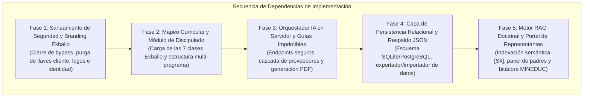

# Plan de Implementación por Dependencias, Migraciones y Pruebas — ALSIZ

## 1. Estrategia de Transición Incremental

Para mitigar riesgos operativos y evitar la temida "re-escritura total (*big bang*)", la transición desde el estado heredado de Wisdom School hacia la arquitectura modular de la **Plataforma Educativa ALSIZ para Ekballo Church** se organiza en **cinco fases técnicas estrictamente secuenciadas**. Cada fase cuenta con prerrequisitos explícitos, criterios de aceptación verificables y un protocolo de reversa (*rollback*) inmediato.

---

## 2. Detalle de Fases de Implementación y Dependencias

---

### Fase 1: Saneamiento de Seguridad y Branding Institucional Ekballo Church (Próxima Etapa 04)
- **Objetivo**: Eliminar las brechas críticas de seguridad heredadas y vestir la plataforma con la identidad institucional de Ekballo Church.
- **Dependencias**: Aprobación de la Etapa 03 (Arquitectura).
- **Tareas Técnicas**:
  1. Corregir la condición de bypass en `src/context/SchoolContext.tsx#L382`, exigiendo contraseña o PIN no vacío.
  2. Purgar referencias a `VITE_GEMINI_API_KEY` en `src/services/aiService.ts`; canalizar todas las peticiones a través de `server.ts`.
  3. Reemplazar los assets gráficos de Wisdom School por el pack oficial de `DOCUMENTOS EKBALLO/EKBALLO_logo_pack/` (logos fondo claro/oscuro, favicon, web manifest y metadata).
  4. Actualizar títulos de pestaña, textos institucionales y paleta de colores en Tailwind CSS.
- **Estrategia de Pruebas**:
  - Prueba de login negativo: intentar entrar con ID sin PIN -> Debe rechazar con error `401`.
  - Prueba de fuga de secretos: `grep -rn "AIza" dist/` tras `npm run build` -> 0 coincidencias.
- **Protocolo de Reversa**: `git checkout etapa-03-arquitectura-y-plan-tecnico`.

---

### Fase 2: Integración Curricular del Discipulado Ekballo y Matrícula Multi-Programa
- **Objetivo**: Incorporar las 7 clases doctrinales fundacionales de Ekballo Church y estructurar la oferta académica sin alterar el microcurrículo existente de 4.º y 8.º EGB.
- **Dependencias**: Fase 1 aprobada y verificada.
- **Tareas Técnicas**:
  1. Extraer el contenido pedagógico de los 7 PDFs de `DOCUMENTOS EKBALLO/` estructurado en 4 fases (Contenido, Lectura, Laboratorio, Actividades).
  2. Crear `src/data/ekballoCurriculumData.ts` con tipado estricto `Subject` y `DailyClass`.
  3. Incorporar la asignatura *Relación con Dios* en los perfiles de los estudiantes en `mockData.ts`.
  4. Habilitar selector de programa académico en la interfaz para alternar entre el currículo escolar y el curso de discipulado.
- **Estrategia de Pruebas**:
  - Verificación de renderizado de las 7 clases con sus textos bíblicos y actividades.
  - Verificación de que las materias de Avril y Gael siguen intactas al 100%.

---

### Fase 3: Orquestador de Inteligencia Artificial en Servidor y Guías Offline
- **Objetivo**: Desplegar el endpoint seguro de chat socrático con cascada de proveedores y la generación de guías imprimibles en PDF para trabajo desconectado.
- **Dependencias**: Fase 2 completada.
- **Tareas Técnicas**:
  1. Implementar `POST /api/v1/agents/chat` en `server.ts` con circuit-breaker (DeepSeek V3 -> Gemini 2.0 Flash -> OpenRouter).
  2. Inyectar prompts socráticos estructurados para cada una de las 7 clases de Ekballo.
  3. Desarrollar el generador de Guías Didácticas Imprimibles (`/api/v1/agents/generate-guide`) con estilos CSS optimizados para impresión en papel bond A4.
- **Estrategia de Pruebas**:
  - Simular caída forzada de DeepSeek (invalidando token temporalmente) -> Debe conmutar a Gemini en menos de 4 segundos sin error para el alumno.
  - Generar guía didáctica en PDF y comprobar maquetación a 3 niveles de preguntas.

---

### Fase 4: Persistencia Relacional y Utilidad de Respaldo / Restauración en JSON
- **Objetivo**: Superar la fragilidad de `localStorage` mediante un esquema de base de datos relacional modular y proveer soberanía de datos a las familias mediante exportación JSON.
- **Dependencias**: Fases 1, 2 y 3 completadas.
- **Tareas Técnicas**:
  1. Configurar Drizzle ORM o Prisma con soporte dual: SQLite local para desarrollo/offline y PostgreSQL para despliegue centralizado.
  2. Implementar los scripts de migración DDL basados en el modelo de datos de la Etapa 03.
  3. Crear el componente `DataBackupModal` en el frontend para exportar todo el progreso a un archivo `.json` firmado y permitir su restauración en cualquier otro dispositivo.
- **Estrategia de Pruebas**:
  - Exportar progreso -> Limpiar caché del navegador (`localStorage.clear()`) -> Importar JSON -> Progreso restaurado al 100%.

---

### Fase 5: Motor RAG Doctrinal Avanzado y Portal de Representantes (MINEDUC)
- **Objetivo**: Desplegar la búsqueda semántica con citas obligatorias `[S#]` sobre todo el corpus de la iglesia y el panel de seguimiento legal para padres.
- **Dependencias**: Fase 4 completada.
- **Tareas Técnicas**:
  1. Ejecutar el pipeline de chunking e incrustación semántica con `text-embedding-004` sobre los textos canónicos de Ekballo.
  2. Configurar la validación regex en el backend para exigir citas `[S1-C#-P#]`.
  3. Diseñar la vista `RepresentativeDashboard`: visualización de horas pedagógicas, porcentaje de logro de competencias y botón para descargar la **Bitácora de Educación en Casa para el MINEDUC**.
- **Estrategia de Pruebas**:
  - Formular pregunta doctrinal fuera de las 7 clases -> El agente debe declinar amablemente citando insuficiencia de fuentes oficiales.
  - Descargar informe PDF de bitácora y verificar cumplimiento de los campos requeridos por el Acuerdo Ministerial 2023-00069-A.

---

## 3. Matriz de Riesgos de Migración y Estrategias de Rollback

| Riesgo Técnico en Migración | Probabilidad | Severidad | Plan de Contingencia / Reversión |
| :--- | :---: | :---: | :--- |
| **Incompatibilidad de esquema al migrar de `localStorage`** | Media | Alta | La utilidad de migración mantiene una copia de respaldo automática en `localStorage.backup_timestamp` antes de escribir en base de datos. |
| **Latencia excesiva en la cascada de proveedores LLM** | Baja | Media | Timeout estricto de 4.0 segundos en el proveedor primario con disyuntor en memoria. |
| **Fallas en entornos serverless (Vercel) por estado en memoria** | Media | Alta | El backend de producción se mantiene desacoplado en contenedor Docker independiente o se utiliza base de datos serverless (Neon / Supabase) con pool de conexiones. |

