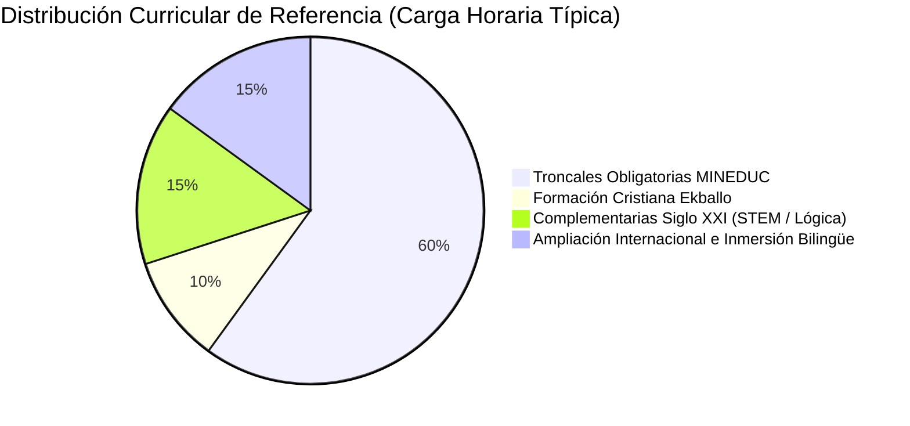

# Catálogo General de Asignaturas por Niveles y Grados — Plataforma Educativa ALSIZ

## 1. Presentación y Arquitectura Curricular
Este catálogo define la estructura académica completa de la **Plataforma Educativa ALSIZ para Ekballo Church**. La oferta educativa equilibra el cumplimiento de las exigencias formativas del Ministerio de Educación de Ecuador (MINEDUC), la cosmovisión bíblica cristiana institucional, el desarrollo del pensamiento científico-computacional y la preparación internacional bilingüe.

---

## 2. Taxonomía de las Cuatro Categorías Curriculares

1. **Troncales Obligatorias Nacionales (MINEDUC Ecuador)**:
   - Responden al Currículo Nacional y al Perfil de Salida del Bachiller Ecuatoriano (Justicia, Innovación y Solidaridad).
   - Aseguran la cobertura de las destrezas con criterio de desempeño requeridas para las evaluaciones de subnivel del Sistema Nacional de Educación (Acuerdo MINEDUC-2023-00069-A / MINEDUC-2025-00024-A).
2. **Formación Cristiana Institucional (Ekballo Church)**:
   - Asignatura eje: *Relación con Dios* (preservada en toda la trayectoria desde EGB Elemental hasta Bachillerato).
   - Estructurada sobre los 7 módulos doctrinales fundacionales de Ekballo Church.
   - Enfoque: diálogo socrático de la fe, cultivo de virtudes, cosmovisión bíblica, discipulado y liderazgo de servicio.
3. **Asignaturas Complementarias del Siglo XXI**:
   - Asignaturas que amplían las competencias para la economía del conocimiento: *Software y Programación*, *Ciencias Políticas y Ciudadanía*, y *Administración y Marketing*.
   - Fomentan el pensamiento algorítmico, la capacidad de debate, la diplomacia y el emprendimiento con impacto social.
4. **Ampliación Internacional y Bilingüismo**:
   - Diseñadas con referencia al Marco Común Europeo de Referencia (MCER / CEFR) y estándares norteamericanos (*Virginia Standards of Learning - SOL*).
   - Proveen inmersión progresiva en inglés académico, literatura en lengua inglesa, argumentación internacional y preparación para cursos avanzados (*Advanced Placement - AP*).

---

## 3. Catálogo por Niveles y Subniveles Educativos

---

### 3.1 Subnivel: Educación General Básica Elemental (2.º, 3.º y 4.º EGB — 6 a 8 años)
*Foco prioritario de implementación: 4.º Año de EGB (Gael — 8 años).*

#### 3.1.1 Troncales Obligatorias MINEDUC
- **`LEN-401` — Lengua y Literatura Elemental**
  - *Carga semanal*: 5 horas pedagógicas.
  - *Enfoque*: Comunicación oral, conciencia fonológica, comprensión lectora activa, narración y producción creativa de cuentos.
  - *Metodología*: *Storytelling*, círculos de lectura compartida, dramatización y creación de libros artesanales.
  - *Evaluación*: Portafolio de cuentos ilustrados, rúbrica de fluidez lectora y bitácora de expresión oral.
- **`MAT-401` — Matemáticas Elemental**
  - *Carga semanal*: 5 horas pedagógicas.
  - *Enfoque*: Sentido numérico, relaciones de orden, suma y resta con reagrupación, multiplicación como adición repetida, geometría bidimensional y tridimensional, unidades de medida.
  - *Metodología*: Método Singapur / Secuencia CPA (Concreto-Pictórico-Abstracto) mediante manipulación de bloques Lego, regletas y aplicaciones visuales. Cero memorización ciega de tablas.
  - *Evaluación*: Demostración manipulativa de problemas, planos espaciales y portafolio de desafíos lógicos.
- **`CNI-401` — Ciencias Naturales Elemental**
  - *Carga semanal*: 4 horas pedagógicas.
  - *Enfoque*: Los seres vivos y su ciclo vital, diversidad vegetal y animal en las cuatro regiones naturales de Ecuador, la materia y sus estados, fuerzas y movimiento, la Tierra en el sistema solar.
  - *Metodología*: Indagación de campo guiada, registro gráfico de observaciones en cuaderno de explorador y experimentos vivenciales seguros.
  - *Evaluación*: Cuaderno de campo, maqueta de bioma y proyectos de germinación controlada.
- **`SOC-401` — Estudios Sociales Elemental**
  - *Carga semanal*: 3 horas pedagógicas.
  - *Enfoque*: Mi entorno familiar, vecindario, cantón y provincia; servicios públicos y servidores de la comunidad; símbolos patrios y diversidad pluricultural del Ecuador.
  - *Metodología*: Cartografía lúdica, construcción de mapas interactivos, entrevistas a servidores comunitarios y juego de roles cívico.
  - *Evaluación*: Maqueta del vecindario, croquis de servicios esenciales y proyecto "La Ciudad Ideal".
- **`ING-401` — Inglés (EFL - English as a Foreign Language)**
  - *Carga semanal*: 4 horas pedagógicas.
  - *Enfoque*: Nivel MCER Pre-A1 / A1.1. Conciencia fonética (*Phonics*), vocabulario del entorno inmediato (familia, juguetes, colores, animales, comida) y comandos de aula.
  - *Metodología*: Total Physical Response (TPR), canciones, juegos fonéticos interactivos y lectura compartida con libros ilustrados (*Picture Books*).
  - *Evaluación*: Rúbrica de discriminación fonética, diálogos guiados en video y flashcards orales.
- **`ART-401` — Educación Cultural y Artística (ECA)**
  - *Carga semanal*: 2 horas pedagógicas.
  - *Enfoque*: Expresión plástica, volumetría 3D, suprareciclaje (*upcycling*), teoría del color aplicada y diseño arquitectónico básico.
  - *Metodología*: *Design Thinking* infantil, arte socrático. Directiva pedagógica: cero plantillas mecánicas para colorear, el error como variación creativa.
  - *Evaluación*: Portafolio de obras tridimensionales, maquetas de materiales reciclados y bitácora visual.
- **`EFI-401` — Educación Física Elemental**
  - *Carga semanal*: 2 horas pedagógicas.
  - *Enfoque*: Desarrollo psicomotor, equilibrio dinámico y estático, coordinación viso-motriz, juegos colectivos tradicionales y salud postural.
  - *Metodología*: Circuitos motrices lúdicos, dinámicas cooperativas sin competencia excluyente y estiramientos conscientes.
  - *Evaluación*: Lista de cotejo de destrezas psicomotrices y registro de hábitos de hidratación y descanso.

#### 3.1.2 Formación Cristiana Institucional
- **`REL-401` — Relación con Dios (Fe, Valores y Carácter)**
  - *Carga semanal*: 2 horas pedagógicas.
  - *Enfoque*: Dios como Creador amoroso y Padre fiel; identidad como hijos de Dios; la vida y enseñanzas de Jesús; virtudes cardinales (bondad, verdad, justicia, amor al prójimo, perdón).
  - *Metodología*: Diálogo socrático sobre historias y parábolas bíblicas, diarios devocionales ilustrados y proyectos familiares de bondad práctica.
  - *Evaluación*: Rúbrica de reflexión ética en discusiones guiadas y bitácora de actos de amor y servicio familiar.

#### 3.1.3 Complementarias del Siglo XXI
- **`SOFT-401` — Software y Programación Elemental**
  - *Carga semanal*: 3 horas pedagógicas.
  - *Enfoque*: Fundamentos del pensamiento computacional, descomposición de problemas, secuencias algorítmicas, bucles y eventos mediante bloques en Scratch / ScratchJr.
  - *Metodología*: Construcción de cuentos interactivos animados y pequeños videojuegos arcade; resolución colaborativa de acertijos lógicos.
  - *Evaluación*: Proyecto interactivo en Scratch con documentación visual de los bloques utilizados.

---

### 3.2 Subnivel: Educación General Básica Media (5.º, 6.º y 7.º EGB — 9 a 11 años)
*Fase de transición y consolidación de la autonomía académica.*

- **Troncales Obligatorias MINEDUC**:
  - `LEN-M01` — Lengua y Literatura Media (Tipologías textuales, estructura del párrafo, inferencias y literatura infantil y juvenil).
  - `MAT-M01` — Matemáticas Media (Fracciones, decimales, porcentajes, áreas y perímetros de polígonos, estadística básica).
  - `CNI-M01` — Ciencias Naturales Media (Sistemas del cuerpo humano, nutrición, fotosíntesis, ecosistemas terrestres y acuáticos del Ecuador, fuentes de energía).
  - `SOC-M01` — Estudios Sociales Media (Época aborigen, conquista e independencia del Ecuador; geografía física y regiones naturales).
  - `ING-M01` — Inglés Media (Nivel MCER A1.2 a A2.1; descripciones de rutinas, redacción de párrafos simples, audición guiada).
  - `ART-M01` — Educación Cultural y Artística Media (Técnicas de grabado, stop-motion básico, patrimonio cultural local).
  - `EFI-M01` — Educación Física Media (Juegos reglados, natación/atletismo básico, condición física y ergonomía).
- **Formación Cristiana Institucional**:
  - `REL-M01` — Relación con Dios (El Gran Relato Bíblico: Creación, Pactos, Reyes y Profetas; la mayordomía ambiental y social).
- **Complementarias Siglo XXI**:
  - `SOFT-M01` — Pensamiento Computacional y Robótica (Variables, operadores lógicos y programación visual aplicada a micro:bit o simuladores).
  - `FIN-M01` — Educación Financiera Temprana (Conceptos de ahorro, presupuesto familiar, valor del trabajo y generosidad).

---

### 3.3 Subnivel: Educación General Básica Superior (8.º, 9.º y 10.º EGB — 12 a 14 años)
*Foco prioritario de implementación: 8.º Año de EGB (Avril — 12 años).*

#### 3.3.1 Troncales Obligatorias MINEDUC
- **`LEN-801` — Lengua y Literatura Superior**
  - *Carga semanal*: 4 horas pedagógicas.
  - *Enfoque*: Ensayo argumentativo, dialéctica, análisis crítico de medios y redes sociales, literatura ecuatoriana e hispanoamericana, normas de citación académica (APA).
  - *Metodología*: Talleres de escritura dialógica, mesas redondas, análisis textual socrático y debates reglados.
  - *Evaluación*: Ensayos académicos de 1.200 a 1.500 palabras, podcast analíticos y rúbricas de debate formal.
- **`MAT-801` — Matemáticas Superior**
  - *Carga semanal*: 5 horas pedagógicas.
  - *Enfoque*: Conjunto de números racionales e irracionales, notación científica, lenguaje algebraico, ecuaciones e inecuaciones de primer grado, funciones lineales, geometría analítica y estadística bivariada.
  - *Metodología*: Modelado matemático de fenómenos reales, desafíos de demostración lógica, uso crítico de GeoGebra y resolución analítica.
  - *Evaluación*: Exámenes de resolución de problemas con sustentación de procedimientos, proyectos de optimización y portafolio de modelado.
- **`CNI-801` — Ciencias Naturales Superior**
  - *Carga semanal*: 4 horas pedagógicas.
  - *Enfoque*: Biología celular y molecular, transporte celular, ácidos nucleicos (ADN/ARN), leyes de la herencia mendeliana, taxonomía y sistemática, impacto humano en los biomas ecuatorianos.
  - *Metodología*: Método científico riguroso, simuladores de laboratorio virtual (PhET, BioDigital), microscopía y diseño de monografías científicas.
  - *Evaluación*: Informes de laboratorio con estructura IMRyD (Introducción, Métodos, Resultados y Discusión), maquetas moleculares y monografías ecológicas.
- **`SOC-801` — Estudios Sociales Superior**
  - *Carga semanal*: 4 horas pedagógicas.
  - *Enfoque*: De los imperios antiguos a la Edad Media, el Renacimiento y la modernidad; historia colonial y republicana del Ecuador; economía mundial y movimientos sociales.
  - *Metodología*: Análisis de fuentes históricas primarias y secundarias, debates historiográficos y construcción de líneas de tiempo comparadas.
  - *Evaluación*: Ensayos de interpretación histórica, mapas conceptuales geográficos y exposiciones magistrales.
- **`ING-801` — Inglés Avanzado (Inmersión Bilingüe)**
  - *Carga semanal*: 5 horas pedagógicas.
  - *Enfoque*: Nivel MCER B1 hacia B1+. Argumentación en lengua inglesa, comprensión de conferencias y textos científicos breves, redacción formal y *Public Speaking*.
  - *Metodología*: *Content and Language Integrated Learning* (CLIL), simulaciones diplomáticas, debates orales y preparación para exámenes estandarizados (Cambridge PET / TOEFL Junior).
  - *Evaluación*: *Position Papers* en inglés, conferencias estilo TED grabadas en video y ensayos de opinión en inglés de 600 palabras.
- **`ART-801` — Educación Cultural y Artística (ECA) Superior**
  - *Carga semanal*: 2 horas pedagógicas.
  - *Enfoque*: Semiótica visual, composición estética avanzada, historia del arte contemporáneo, patrimonio arquitectónico y realización audiovisual independiente.
  - *Metodología*: Talleres de producción multimedia, fotografía conceptual, curaduría digital y crítica de arte.
  - *Evaluación*: Cortometraje conceptual de 2 minutos, portafolio fotográfico narrativo y memoria descriptiva del proyecto artístico.
- **`EFI-801` — Educación Física Superior**
  - *Carga semanal*: 2 horas pedagógicas.
  - *Enfoque*: Acondicionamiento neuromuscular, calistenia, biomecánica del ejercicio, táctica en deportes individuales y colectivos, nutrición y prevención de lesiones.
  - *Metodología*: Planes de entrenamiento individualizados, análisis biomecánico en video y diario de rendimiento corporal.
  - *Evaluación*: Plan personal de actividad física mensual, prueba de resistencia aeróbica adaptada y autoevaluación ergonómica.

#### 3.3.2 Formación Cristiana Institucional
- **`REL-801` — Relación con Dios (Cosmovisión Bíblica y Carácter)**
  - *Carga semanal*: 2 horas pedagógicas.
  - *Enfoque*: La narrativa de la Redención (Creación, Caída, Redención, Consumación); Jesucristo en el contexto cultural; apologética fundamental frente al escepticismo moderno; vocación, dones espirituales y liderazgo siervo.
  - *Metodología*: Seminarios de lectura bíblica inductiva, discusión de dilemas éticos y bioéticos, análisis de cosmovisiones en el cine y la literatura, y proyectos comunitarios de ayuda social.
  - *Evaluación*: Ensayos de análisis de cosmovisión, diseño y ejecución de un plan de voluntariado eclesial/comunitario, y disertación socrática de fe y razón.

#### 3.3.3 Complementarias del Siglo XXI
- **`SOFT-801` — Software y Programación Superior**
  - *Carga semanal*: 3 horas pedagógicas.
  - *Enfoque*: Lógica algorítmica estructurada, tipado, estructuras de control, funciones y programación orientada a objetos básica en Python y JavaScript; arquitectura web y principios éticos de la Inteligencia Artificial.
  - *Metodología*: Programación en parejas (*pair programming*), proyectos prácticos de desarrollo de scripts y aplicaciones de consola, y revisión de código (*code review*).
  - *Evaluación*: Repositorio de código funcional en GitHub con proyectos personales y ensayo sobre ética y sesgos en modelos de IA.
- **`POL-801` — Ciencias Políticas y Ciudadanía**
  - *Carga semanal*: 2 horas pedagógicas.
  - *Enfoque*: Teoría del Estado, regímenes políticos (democracia, autoritarismo), división de poderes, Estado de Derecho, derechos constitucionales universales y geopolítica internacional.
  - *Metodología*: Simulaciones de cuerpos colegiados (Modelo ONU, asamblea legislativa), estudio de casos constitucionales y dilemas de justicia distributiva.
  - *Evaluación*: Participación en debate parlamentario reglado, redacción de proyectos de ordenanza ciudadana y ensayos comparativos de sistemas constitucionales.
- **`ADM-801` — Administración y Marketing (Emprendimiento)**
  - *Carga semanal*: 2 horas pedagógicas.
  - *Enfoque*: Principios de economía, análisis de necesidades de mercado, diseño de propuestas de valor, *Business Model Canvas*, presupuestos y estados financieros básicos, y mercadeo digital ético.
  - *Metodología*: Metodología *Lean Startup* adaptada a secundaria, desarrollo de un prototipo de producto o servicio con impacto social y elaboración de presentaciones de negocio (*pitch*).
  - *Evaluación*: Modelo Canvas completo, hoja de cálculo con estructura de costos y punto de equilibrio, y presentación ante panel de evaluadores.

---

### 3.4 Nivel: Bachillerato General Unificado (BGU — 1.º, 2.º y 3.º BGU — 15 a 17 años)
*Proyección curricular institucional para culminación de estudios y titulación.*

- **Troncales Obligatorias MINEDUC**:
  - `MAT-BGU` — Matemática Superior (Cálculo diferencial, trigonometría, matrices y vectores).
  - `LEN-BGU` — Lengua y Literatura (Retórica, semiótica, canon literario universal y tesis de grado).
  - `FIS-BGU` — Física (Mecánica clásica, termodinámica, electromagnetismo y ondas).
  - `QUI-BGU` — Química (Química inorgánica y orgánica, estequiometría y laboratorio químico).
  - `BIO-BGU` — Biología (Genética molecular, biotecnología, evolución y bioética).
  - `HIS-BGU` — Historia (Procesos históricos contemporáneos, guerras mundiales y Guerra Fría).
  - `FIL-BGU` — Filosofía (Lógica formal, epistemología, metafísica y corrientes filosóficas).
  - `EDU-BGU` — Educación para la Ciudadanía (Derechos humanos, republicanismo y constitución).
  - `EMP-BGU` — Emprendimiento y Gestión (Planes de negocio, contabilidad de costos y tributación SRI).
  - `ART-BGU` — Educación Cultural y Artística BGU.
  - `EFI-BGU` — Educación Física BGU.
  - `ING-BGU` — Inglés BGU (Nivel MCER B2; preparación IELTS/TOEFL y textos académicos).
- **Formación Cristiana Institucional**:
  - `REL-BGU` — Teología Cristiana, Ética y Liderazgo Global (Cosmovisión integral, bioética cristiana, teología del trabajo y preparación universitaria con convicción bíblica).
- **Ampliación Internacional (Opcional Avanzado / Alianza)**:
  - Cursos de colocación avanzada (*Advanced Placement - AP*): AP Calculus AB, AP Computer Science A, AP English Literature, AP Psychology.

---

## 4. Matriz Síntesis de Carga Horaria Comparada

| Subnivel Educativo | Grado Representativo | Troncales MINEDUC | Formación Cristiana | Complementarias STEM/Cívica | Total Horas Semanales |
| :--- | :---: | :---: | :---: | :---: | :---: |
| **EGB Elemental** | 4.º EGB (Gael) | 25 h | 2 h | 3 h (Software) | **30 h** |
| **EGB Media** | 6.º EGB | 26 h | 2 h | 4 h (Software + Finanzas) | **32 h** |
| **EGB Superior** | 8.º EGB (Avril) | 26 h | 2 h | 7 h (Software + Políticas + Admin) | **35 h** |
| **Bachillerato (BGU)**| 1.º a 3.º BGU | 30 h | 2 h | 3-5 h (AP Electives) | **35-37 h** |

---

## 5. Garantía de Cumplimiento Normativo y Flexibilidad

1. **Régimen Trimestral Oficial**: El calendario académico se organiza en 3 trimestres de aproximadamente 12 a 14 semanas cada uno, completando los 200 días laborables que exige la legislación educativa ecuatoriana.
2. **Homologabilidad y Transferibilidad**: El diseño de las materias troncales garantiza que ante una eventual reincorporación del estudiante al sistema fiscal, particular presencial o ante las evaluaciones oficiales de subnivel del MINEDUC, el estudiante domine el 100% de las destrezas con criterio de desempeño de su grado.
3. **Resguardo de Autonomía Pedagógica**: Las asignaturas complementarias y de formación cristiana fortalecen el perfil integral del estudiante sin colisionar con la malla básica obligatoria.

