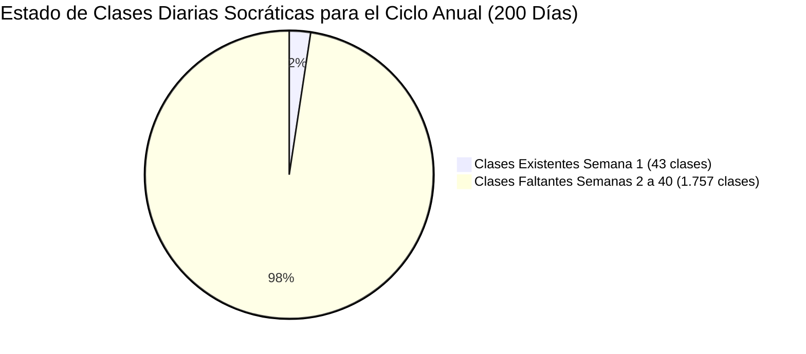
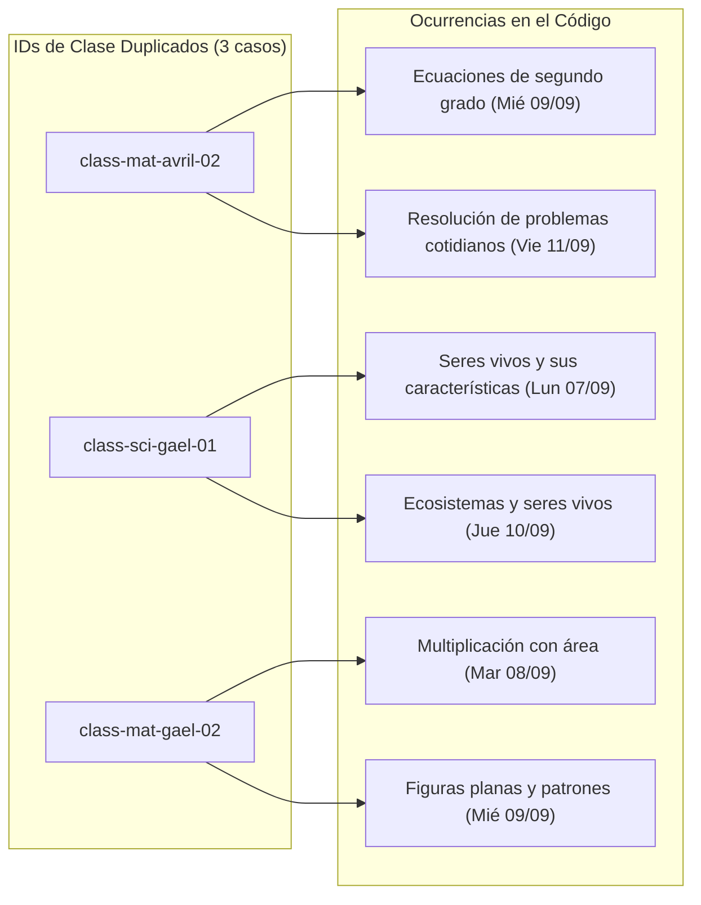
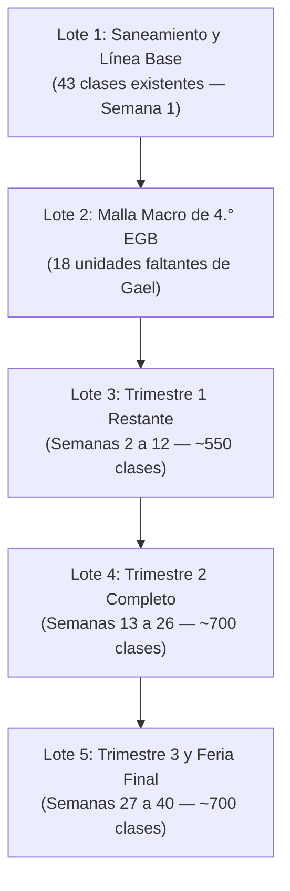

# Matriz de Estado de Completitud Curricular y Calendario Anual (2026 - 2027)
## Plataforma Educativa ALSIZ — Ekballo Church
### Auditoría Técnica y Pedagógica Exhaustiva Previa a la Generación Masiva de Contenido

- **Fecha de Auditoría**: 17 de Octubre de 2026
- **Ámbito**: Gael (4.º Grado EGB Elemental) y Avril (8.º Grado EGB Superior)
- **Marco Normativo**: Ministerio de Educación de Ecuador (LOEI, Acuerdos MINEDUC-2023-00069-A / MINEDUC-2025-00024-A), Virginia Standards of Learning (SOL / EE. UU.), Marco Común Europeo de Referencia (MCER) y los 7 Módulos Doctrinales de Ekballo Church.
- **Archivo de Datos de Seguimiento**: [`docs/curriculum/matriz_seguimiento_curriculo_2026_2027.csv`](file:///c:/Users/Alsiz/Documents/plataforma%20educativa%20ALSIZ/docs/curriculum/matriz_seguimiento_curriculo_2026_2027.csv) (553 registros catalogados).
- **Validador Automatizado**: [`scripts/test-curriculum-completeness.ts`](file:///c:/Users/Alsiz/Documents/plataforma%20educativa%20ALSIZ/scripts/test-curriculum-completeness.ts)

---

## 1. Resumen Ejecutivo y Dictamen de la Auditoría

> [!IMPORTANT]
> **Dictamen Técnico-Académico: BLOQUEO PREVENTIVO DE GENERACIÓN MASIVA**  
> Se declara formalmente que **NO se debe proceder a la generación automatizada masiva de cientos de lecciones** hasta que se subsanen las inconsistencias estructurales detectadas en la línea base:
> 1. **Colisiones de Claves Primarias**: 3 clases diarias y 6 recursos didácticos comparten identificadores duplicados.
> 2. **Desbalance Macrocurricular en 4.° EGB**: Gael cuenta únicamente con 1 unidad por asignatura (9 unidades en total); **faltan 18 unidades macrocurriculares** para completar los tres trimestres.
> 3. **Brecha de Cobertura Temporal**: El acervo actual contiene únicamente **43 clases diarias socráticas completas** correspondientes a la **Semana 1** (del 07 al 11 de septiembre de 2026), frente a las **1.800 a 2.000 sesiones anuales requeridas** para cumplir los 200 días laborables.
> 4. **Recursos No Validados**: 43 guías didácticas apuntan a un dominio extinto (`wisdom-school.edu`), 35 enlaces temáticos apuntan a `wisdomschool.ec`, 25 recursos audiovisuales corresponden a un video placeholder simulado (Rickroll `dQw4w9WgXcQ`), y 9 enlaces son anclajes vacíos (`#`).
> 5. **Ausencia de Mapeo Formal de Destrezas MINEDUC**: El 100% de los ítems de microcurrículo carece de la codificación alfanumérica explícita de Destrezas con Criterio de Desempeño (DCD) en su esquema de datos.



---

## 2. Taxonomía y Separación Rigurosa de Asignaturas

Para evitar confusiones regulatorias y asegurar que las familias y el Ministerio de Educación identifiquen nítidamente la naturaleza de cada asignatura, se establece la siguiente clasificación sin sustituciones indebidas:

### 2.1 Categoría 1: Troncales Obligatorias Nacionales (MINEDUC Ecuador)
Cumplen obligatoriamente con el Currículo Nacional ecuatoriano y preparan al estudiante para las evaluaciones de subnivel (4.° EGB Elemental para Gael y 10.° EGB Superior para Avril):

| Subnivel / Grado | Código | Asignatura Oficial | Carga Horaria MINEDUC Sugerida | Horas/Sesiones Semanales en Horario ALSIZ | Enfoque Pedagógico |
| :--- | :---: | :--- | :---: | :---: | :--- |
| **4.º EGB Elemental (Gael)** | `LEN-401` | Lengua y Literatura | 5 h | 5 sesiones (225 min) | Comunicación oral, conciencia fonológica, lectoescritura, cuentos tradicionales. |
| | `MAT-401` | Matemáticas | 5 h | 5 sesiones (225 min) | Sentido numérico, adición/sustracción con reagrupación, multiplicación visual (CPA Singapur). |
| | `CNI-401` | Ciencias Naturales | 4 h | 4 sesiones (180 min) | Seres vivos, ciclo vital, ecosistemas de las 4 regiones del Ecuador, observación de campo. |
| | `SOC-401` | Estudios Sociales | 3 h | 3 sesiones (135 min) | Mi cantón, mi provincia, geografía local, servicios públicos, símbolos patrios. |
| | `ING-401` | Inglés (EFL) | 4 h | 3 sesiones (120 min) | Nivel Pre-A1 a A1.1 MCER. Phonics, canciones, vocabulario cotidiano, Total Physical Response. |
| | `ART-401` | Educación Cultural y Artística (ECA) | 2 h | 1 sesión (30 min) | Expresión plástica, upcycling, modelado 3D, arte socrático. Cero plantillas mecánicas. |
| | `EFI-401` | Educación Física | 2 h | 1 sesión (30 min) | Psicomotricidad, equilibrio, coordinación viso-motriz, juegos motores tradicionales. |
| **8.º EGB Superior (Avril)** | `LEN-801` | Lengua y Literatura | 4 h | 4 sesiones (180 min) | Ensayo argumentativo, debate reglado, análisis crítico de medios, literatura ecuatoriana. |
| | `MAT-801` | Matemáticas | 5 h | 4 sesiones (180 min) | Números enteros y racionales ($\mathbb{Z}, \mathbb{Q}$), lenguaje algebraico, ecuaciones, GeoGebra. |
| | `CNI-801` | Ciencias Naturales | 4 h | 3 sesiones (135 min) | Biología celular y molecular, biomoléculas, ADN/ARN, laboratorios virtuales PhET. |
| | `SOC-801` | Estudios Sociales | 4 h | 2 sesiones (90 min) | De las civilizaciones antiguas a la colonia en América y la Real Audiencia de Quito. |
| | `ING-801` | Inglés (B1 MCER) | 5 h | 3 sesiones (120 min) | Comprensión oral y escrita, redacción formal, oratoria y simulación diplomática (Model UN). |
| | `ART-801` | Educación Cultural y Artística (ECA) | 2 h | 1 sesión (30 min) | Semiótica visual, composición estética, fotografía, historia del arte contemporáneo. |
| | `EFI-801` | Educación Física | 2 h | 1 sesión (30 min) | Calistenia, acondicionamiento neuromuscular, salud postural, biomecánica básica. |

> [!WARNING]
> **Regla de No Sustitución**:
> Las asignaturas de formación cristiana o complementarias del siglo XXI **jamás** se computarán como sustitutos de las materias troncales obligatorias. Ante una evaluación ministerial o solicitud de convalidación distrital, el expediente debe reflejar las 7 áreas troncales de manera autónoma.

### 2.2 Categoría 2: Formación Cristiana Institucional (Ekballo Church)
Asignatura confesional propia, impartida al amparo de la libertad de enseñanza (Art. 29 de la Constitución) y la autonomía eclesiástica (Ley de Cultos):
- **`REL-401` — Relación con Dios (Gael — 4.° EGB)**: 1 sesión semanal (30 min). Enfoque: Semillitas de fe, Dios como Padre Creador amoroso, valores éticos (verdad, justicia, empatía, perdón) y mayordomía de la Creación.
- **`REL-801` — Relación con Dios (Avril — 8.° EGB)**: 1 sesión semanal (30 min). Enfoque: Los 7 módulos doctrinales fundacionales de Ekballo Church (Historia y Visión, Salvación, Carácter, Guerra Espiritual, Oración, Mayordomía y Liderazgo de Servicio), cosmovisión bíblica y apologética juvenil.

### 2.3 Categoría 3: Asignaturas Complementarias del Siglo XXI
Asignaturas formativas no tradicionales que potencian las competencias del perfil de salida en tecnología, civismo y negocios:
- **`SOFT-401` — Software y Programación (Gael)**: 2 sesiones semanales (90 min). Pensamiento computacional, algoritmos visuales, Scratch y robótica con bloques.
- **`SOFT-801` — Software y Programación (Avril)**: 2 sesiones semanales (90 min). Lógica algorítmica estructurada, tipado, fundamentos de Python/JavaScript y ética de la Inteligencia Artificial.
- **`POL-801` — Ciencias Políticas y Ciudadanía (Avril)**: 2 sesiones semanales (90 min). Teoría del Estado, democracia, división de poderes, Estado de Derecho, derechos humanos y simulación parlamentaria.
- **`ADM-801` — Administración y Marketing (Avril)**: 2 sesiones semanales (75 min). Emprendimiento con propósito, Lean Startup, Business Model Canvas, presupuestos y mercadeo digital ético.

---

## 3. Calendario Anual, Carga Horaria y Régimen Operativo

### 3.1 Estructura Temporal del Año Lectivo 2026 - 2027

| Periodo Escolar | Fecha de Inicio | Fecha de Finalización | Semanas Calendario | Días Laborables Estimados | Hito de Evaluación |
| :--- | :--- | :--- | :---: | :---: | :--- |
| **1.º Trimestre** | Lunes 07/09/2026 | Martes 24/11/2026 | 12 semanas | ~58 días | Proyecto Interdisciplinario 1 (25-27 Nov 2026) |
| **2.º Trimestre** | Jueves 26/11/2026 | Lunes 08/03/2027 | 14 semanas | ~68 días | Proyecto Interdisciplinario 2 (09-11 Mar 2027) |
| **3.º Trimestre** | Miércoles 10/03/2027| Miércoles 09/06/2027 | 14 semanas | ~74 días | Proyecto Interdisciplinario 3 y Feria Final (10-15 Jun 2027) |
| **Total Ciclo Regular**| **07/09/2026** | **09/06/2027** | **40 semanas** | **200 días laborables** | **3 Valoraciones Formativas Trimestrales** |
| *Periodo Supletorios*| 28/06/2027 | 02/07/2027 | 1 semana | N/A | Exámenes de recuperación (si aplica) |

### 3.2 Análisis de Carga Horaria: Horario Semanal vs. Exigencia Formal MINEDUC

El horario escolar validado en la plataforma (`src/data/mockData.ts`) establece **25 bloques o sesiones pedagógicas semanales** por estudiante:

```
Horario Diario:
08:00 - 08:45 (45 min) — Sesión 1
08:45 - 09:30 (45 min) — Sesión 2
09:30 - 10:00 (30 min) — RECREO
10:00 - 10:45 (45 min) — Sesión 3
10:45 - 11:30 (45 min) — Sesión 4
11:30 - 12:00 (30 min) — Sesión 5
Total diario: 3.5 horas reloj (210 minutos)
Total semanal: 25 sesiones
```

#### Requisito de Calendario y Autorización para el Asesor Normativo:
1. **Bajo el Régimen de Educación en Casa (Homeschooling — Acuerdo MINEDUC-2023-00069-A)**:
   - La familia ejerce la tutela educativa directa (Art. 31). La distribución de 25 sesiones semanales de ritmo socrático adaptativo es **plenamente válida y recomendable**, ya que no existe obligación de replicar la rigidez horaria del aula presencial. La acreditación se obtiene en las evaluaciones oficiales de subnivel.
2. **Si se pretende operar como Educación Formal Escolarizada (Plantel Educativo con Código AMIE)**:
   - El Ministerio de Educación exige un mínimo de **30 horas pedagógicas semanales para EGB Elemental** y **35 horas pedagógicas semanales para EGB Superior** (de 40 a 45 minutos cada una). El horario actual de 25 sesiones dejaría un déficit normativo de 5 a 10 periodos semanales que el asesor normativo debe advertir antes de tramitar permisos de institución escolarizada regular.

---

## 4. Auditoría Técnica de Anomalías y Clasificación de Recursos

### 4.1 Colisiones de Identificadores (Claves Primarias Duplicadas)

Se detectaron **3 colisiones de ID de clases diarias** en el repositorio legado, que a su vez causaron la duplicación de **6 recursos didácticos**:



**Acción de Saneamiento Obligatoria**:
- Renombrar las segundas instancias con sufijo inequívoco (`class-mat-avril-02-dup2` $\to$ `class-mat-avril-03`, `class-sci-gael-01-dup2` $\to$ `class-sci-gael-03`, `class-mat-gael-02-dup2` $\to$ `class-mat-gael-04`), actualizando sus recursos en cascada.

### 4.2 Inventario y Clasificación Exhaustiva de Recursos Didácticos

De acuerdo con la directiva del proyecto, ningún recurso no validado se mostrará al estudiante como recomendación final. La auditoría sobre los **86 recursos de clases diarias** y **492 recursos de microcurrículo** arroja la siguiente clasificación:

| Decisión Oficial | Cantidad en Clases Diarias | Cantidad en Microcurrículo | Criterio de Clasificación y Protocolo Técnico |
| :---: | :---: | :---: | :--- |
| **`CONSERVAR`** | **18** | **56** | Recursos interactivos oficiales de alta calidad pedagógica y licencia abierta o institucional: **PhET Colorado** (CC-BY), **GeoGebra**, **Scratch MIT** y **Google QuickDraw**. Permanecen activos. |
| **`REEMPLAZAR`** | **25** | **0** | Enlaces audiovisuales que contienen el video placeholder Rickroll (`https://www.youtube.com/watch?v=dQw4w9WgXcQ` / `embed/dQw4w9WgXcQ`). **Deben ser sustituidos urgentemente** por videos curriculares de Khan Academy en Español, Eduteca o MINEDUC. |
| **`REGENERAR`** | **43** | **35** | Materiales tipo PDF o enlaces interactivos que apuntan a dominios extintos o legados (`wisdom-school.edu` en las 43 guías PDF y `wisdomschool.ec` en 35 recursos de microcurrículo). **Deben ser re-alojados o generados internamente** en el Centro de Conocimiento ALSIZ (`/api/v1/academic/classes/:id/guide.pdf`). |
| **`RETIRAR`** | **0** | **9** | Enlaces rotos, anclajes vacíos (`url: '#'`) o URLs huérfanas sin destino verificable. Deben ser retirados de la vista del alumno hasta contar con un enlace operativo. |
| **`REVISIÓN HUMANA`** | **0** | **392** | Recursos externos provenientes de terceros (TED-Ed, British Council, Kiddle, sitios web gubernamentales y culturales). Requieren validación docente periódica de disponibilidad y adecuación de edad antes de publicarse como definitivos. |
| **Total** | **86** | **492** | **578 recursos catalogados en total** |

---

## 5. Contraste Normativo: MINEDUC vs. Referencias Internacionales (Alliance K12)

### 5.1 Marco Oficial MINEDUC (Ecuador)
- **Marco Jurídico**: LOEI Art. 10, 12, 50; Acuerdo MINEDUC-2023-00069-A; Acuerdo MINEDUC-2025-00024-A.
- **Perfil de Salida**: Tres valores rectores del Perfil del Bachiller Ecuatoriano: **Justicia**, **Innovación** y **Solidaridad**.
- **Destrezas con Criterio de Desempeño (DCD)**: Codificadas por subnivel:
  - Elemental (4.° EGB): Prefijo `.2` (ej. `LL.2.1.1`, `M.2.1.1`, `CN.2.1.1`, `CS.2.1.1`).
  - Superior (8.° EGB): Prefijo `.4` (ej. `LL.4.1.1`, `M.4.1.1`, `CN.4.1.1`, `CS.4.1.1`).
- **Evaluaciones Obligatorias de Subnivel**: Acreditadas ante distritos educativos del MINEDUC para certificar la finalización de la Básica Elemental (4.° grado) y Básica Superior (10.° grado).

### 5.2 Referencias Curriculares de Alliance K12 y Virginia SOL
- **Hallazgo Crítico sobre Alliance K12 (AAI)**:
  - La inspección técnica del dominio oficial `https://alliance.k12.ec/` constató que Alliance Academy International es un **colegio bilingüe presencial privado de élite** ($1,053/mes) y **no ofrece un programa sombrilla virtual público para educación en casa**.
  - No obstante, su estructura pedagógica basada en los **Virginia Standards of Learning (SOL)** y cursos **Advanced Placement (AP)** sirve como excelente **marco de referencia de rigor académico internacional**.
- **Regla de Armonización Pedagógica**:
  1. En **Ciencias Sociales e Historia**: El currículo ecuatoriano es **100% mandatorio y no sustituible**. Los estándares de Virginia (Jamestown, guerra civil estadounidense) no aplican a la realidad cívica ecuatoriana.
  2. En **Ciencias Naturales**: La metodología indagatoria (NGSS) se aplica sobre la **megadiversidad biogeográfica del Ecuador** (Galápagos, Chocó andino, Amazonía).
  3. En **Matemáticas e Inglés**: Se integran los métodos internacionales (Singapur CPA, Virginia Pre-Algebra, MCER B1) para superar los estándares mínimos de MINEDUC sin contravenir la norma.

---

## 6. Plan de Producción de Contenido en Lotes

Para pasar de las 43 clases iniciales a la malla anual completa de forma gobernable, modular y con control de calidad, la producción se estructura en **5 Lotes Estratégicos**:



### 6.1 Detalle de Lotes y Volumen de Contenido

| Lote | Alcance y Contenido | Clases Diarias Proyectadas | Recursos a Curar | Criterios de Calidad Pre-Ejecución (DoD) |
| :---: | :--- | :---: | :---: | :--- |
| **Lote 1** | **Saneamiento de Línea Base**:<br/>- Desambiguar 3 IDs duplicados.<br/>- Reemplazar 25 videos Rickroll.<br/>- Re-alojar 43 guías PDF Wisdom School.<br/>- Asignar formalmente códigos DCD a las 43 clases. | 43 clases<br/>(23 Avril, 20 Gael) | 86 recursos | Cero IDs duplicados en prueba automatizada; 100% URLs accesibles y con HTTPS; guía PDF disponible localmente. |
| **Lote 2** | **Arquitectura Macro de 4.° EGB**:<br/>- Diseñar 18 unidades faltantes de Gael (Trimestres 1, 2 y 3).<br/>- Establecer hilos conductores interdisciplinarios. | 18 unidades macro | 36 recursos de anclaje | 100% de asignaturas con 3 unidades anuales; códigos DCD asignados por unidad; rúbrica de proyecto interdisciplinario definida. |
| **Lote 3** | **Trimestre 1 Restante (Semanas 2 a 12)**:<br/>- 11 semanas lectivas.<br/>- 25 sesiones/semana por estudiante. | ~550 clases<br/>(~275 Gael, ~275 Avril) | ~1.100 recursos | Cada clase contiene: pregunta socrática, 2 recursos validados, 3 actividades y rúbrica formativa. Aprobación docente obligatoria. |
| **Lote 4** | **Trimestre 2 Completo (Semanas 13 a 26)**:<br/>- 14 semanas lectivas (incluye receso invernal).<br/>- Profundización conceptual. | ~700 clases<br/>(~350 Gael, ~350 Avril) | ~1.400 recursos | Integración de simuladores STEM; balance lingüístico dual en inglés; alineación con proyecto integrador T2. |
| **Lote 5** | **Trimestre 3 y Cierre (Semanas 27 a 40)**:<br/>- 14 semanas lectivas.<br/>- Proyectos finales, portafolio y feria. | ~700 clases<br/>(~350 Gael, ~350 Avril) | ~1.400 recursos | Síntesis socrática de salida; preparación para evaluaciones de subnivel MINEDUC; portafolio digital consolidado. |

### 6.2 Criterios Verificables de Calidad por Clase (Definition of Done)
Ninguna clase generada se incorporará al repositorio de producción si no supera la siguiente lista de verificación:
1. **Código Oficial DCD / Estándar**: Vinculación explícita a la destreza MINEDUC o módulo doctrinal de Ekballo Church.
2. **Pedagogía Socrática Activa**: Introducción motivadora, lectura formativa ($\le$ 150 palabras en Elemental, $\le$ 300 palabras en Superior) y pregunta socrática central con 2 repreguntas.
3. **Curaduría de Recursos**: Mínimo 2 recursos didácticos activos (1 interactivo/audiovisual y 1 guía PDF descargable interna). Cero enlaces rotos, cero placeholders.
4. **Actividades Formativas**: Mínimo 2 a 3 actividades con criterios observables de evaluación cualitativa.
5. **Aprobación Docente Humana**: Conforme al Art. 21 de la LOPDP, toda lección generada por IA debe ser revisada y avalada por el tutor humano responsable antes de su despliegue al alumno.

---

## 7. Automatización de Pruebas y Validación Continua

Para garantizar que esta matriz sea un mecanismo de control vivo y reproducible, se implementó el validador automatizado:
- **Script**: `scripts/test-curriculum-completeness.ts`
- **Comando de Ejecución**: `npx tsx scripts/test-curriculum-completeness.ts`
- **Condición de Salida**: La prueba verifica las 5 dimensiones clave (cobertura, unicidad, fechas, recursos y competencias) y **falla de manera estricta** mientras existan sesiones incompletas o recursos no validados, protegiendo al sistema de despliegues prematuros.
