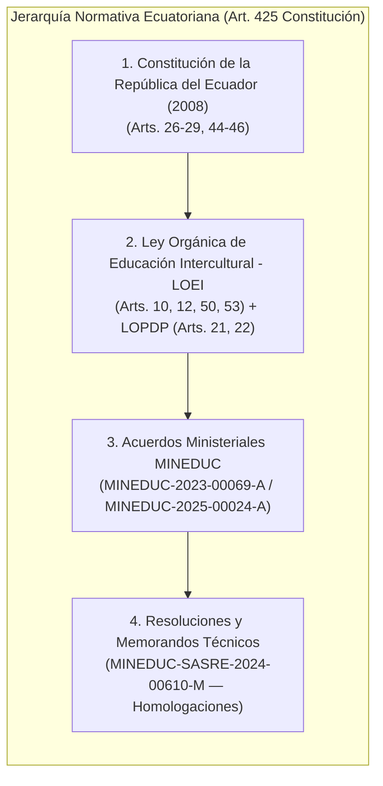
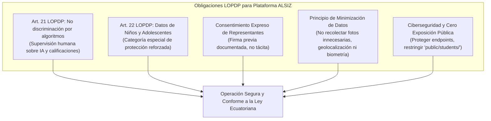

# Informe Técnico-Jurídico de Viabilidad Educativa y Regulatoria en el Ecuador — Plataforma ALSIZ para Ekballo Church

## 1. Identificación y Alcance del Dictamen
- **Institución Promotora**: Ekballo Church.
- **Objeto del Dictamen**: Determinar las condiciones jurídicas, regulatorias, de protección de datos y viabilidad operativa aplicables a la **Plataforma Educativa ALSIZ** en la República del Ecuador.
- **Marco Temporal y Territorial**: Ecuador, legislación vigente consolidada al año lectivo 2026-2027.
- **Naturaleza del Documento**: Análisis técnico-jurídico institucional preliminar de ingeniería y gobernanza.

> [!CAUTION]
> **Aviso Deontológico de No Asesoría Legal Vinculante**:
> Este documento constituye un análisis de ingeniería de requerimientos, viabilidad regulatoria y cumplimiento normativo. No sustituye el patrocinio legal formal, dictamen notarial ni la consulta vinculante ante la Dirección Jurídica del Ministerio de Educación de Ecuador o la Autoridad de Protección de Datos Personales. Los puntos críticos identificados deben ser ratificados por un profesional del derecho debidamente colegiado en el Ecuador antes del inicio formal de operaciones comerciales.

---

## 2. Marco Normativo Ecuatoriano Vigente

### 2.1 Constitución de la República del Ecuador (2008)
- **Artículos 26 y 27**: La educación es un derecho humano fundamental, deber ineludible e inexcusable del Estado, de interés público, garantía de la igualdad e inclusión social.
- **Artículo 29**: Garantiza la **libertad de enseñanza** y el **derecho de las madres, padres y representantes legales a escoger para sus hijas e hijos una educación acorde con sus principios, creencias y opciones pedagógicas**. Este es el anclaje constitucional supremo para la educación en casa (*homeschooling*) y las opciones pedagógicas diferenciadas.
- **Artículos 44, 45 y 46**: Consagran el **Principio del Interés Superior del Niño**, ordenando que los derechos de niñas, niños y adolescentes prevalecerán sobre los de los demás y recibirán protección prioritaria frente a cualquier vulnerabilidad o vulneración de su intimidad.

---

### 2.2 Ley Orgánica de Educación Intercultural (LOEI) y su Reglamento General
- **Artículo 10 y 12**: Derechos y obligaciones de estudiantes y representantes legales. Los padres son los primeros responsables de la educación y cuidado de sus hijos.
- **Artículo 50 (Servicios Educativos Complementarios y Educación No Formal)**: Reconoce expresamente que las personas naturales o jurídicas pueden prestar servicios complementarios de apoyo escolar, tutoría pedagógica, capacitación y formación no formal, los cuales no requieren resolución de creación de plantel educativo siempre que no otorguen títulos de bachiller directos.
- **Artículo 53 (Tipos de Instituciones Educativas)**: Define las instituciones fiscales, fiscomisionales, municipales y particulares. Para constituir una institución educativa formal particular se requiere: resolución distrital, plan de infraestructura, Proyecto Educativo Institucional (PEI), Código AMIE y planta docente titulada sujeta al escalafón.

---

### 2.3 Acuerdo Ministerial Nro. MINEDUC-MINEDUC-2023-00069-A y Reformas Subsecuentes (MINEDUC-2025-00024-A)
Expedido el 30 de octubre de 2023 (Registro Oficial No. 447, 29 de noviembre de 2023), este cuerpo normativo transformó el régimen de educación en casa en Ecuador:

1. **Definición de Educación en Casa (Art. 31)**:
   - Se tipifica como una opción de **educación no formal a distancia, flexible**, cuyo desarrollo pedagógico, formativo y operativo recae **exclusivamente en la madre, padre o representante legal**.
   - **Prohibición Expresa a Colegios Particulares**: Se prohíbe categóricamente que instituciones educativas particulares ofrezcan educación en casa como una modalidad formal regular ordinaria, o que cobren matrículas y pensiones como si el menor asistiera a clases formales bajo su sostenimiento institucional sin autorización expresa de modalidad virtual nacional.
2. **Acreditación Oficial de Conocimientos ante el Estado Ecuatoriano (Arts. 33 al 37)**:
   - Dado que el estudiante en casa no está matriculado en un plantel escolarizado regular, sus estudios no dependen del pase de año emitido por una escuela privada local.
   - El Estado ecuatoriano acredita la educación en casa mediante **cuatro evaluaciones de subnivel** aplicadas por el Ministerio de Educación en distritos educativos autorizados:
     - 1.ª Evaluación: Al término del Subnivel Elemental (4.º grado de EGB — caso Gael).
     - 2.ª Evaluación: Al término del Subnivel Media (7.º grado de EGB).
     - 3.ª Evaluación: Al término del Subnivel Superior (10.º grado de EGB — meta para Avril).
     - 4.ª Evaluación: Evaluación de titulación de Bachillerato (3.º BGU).
3. **Servicios Complementarios de Apoyo Pedagógico (Art. 32)**:
   - Las familias educadoras en casa tienen pleno derecho de contratar **servicios de tutoría, acompañamiento pedagógico, plataformas digitales y talleres familiares** con entidades privadas o confesionales para enriquecer el proceso formativo de sus hijos.
4. **Evolución Normativa 2024-2025 (Acuerdo MINEDUC-2025-00024-A)**:
   - El Ministerio de Educación reguló con mayor detalle las modalidades semipresencial y a distancia virtual asistida, manteniendo inalterado el principio de que los centros o plataformas de apoyo no formal no pueden publicitarse ni operar como escuelas formales emisoras de títulos ecuatorianos sin personería específica.

---

### 2.4 Homologación Internacional de Títulos y Estudios (Memorando MINEDUC-SASRE-2024-00610-M)
Para aquellas familias que optan por inscribir a sus hijos en **escuelas sombrilla (*umbrella schools*)** con sede en los Estados Unidos (acreditadas por organismos como Cognia, Middle States Association o Western Association of Schools and Colleges):
- El Ministerio de Educación del Ecuador, a través de la Subsecretaría de Apoyo, Seguimiento y Regulación de la Educación (SASRE), tramita anualmente miles de solicitudes de homologación de estudios y convalidación de títulos de bachiller obtenidos en el exterior.
- **Requisitos Jurídicos Obligatorios**:
  1. Certificados de calificaciones (*transcripts*) y diploma emitidos por la institución educativa acreditada en el país de origen.
  2. **Apostilla de La Haya** (Convenio de 5 de octubre de 1961) en los documentos originales expedida por la autoridad estatal competente en EE. UU. (ej. Secretaría de Estado del estado emisor).
  3. Traducción oficial al español con reconocimiento de firma si el documento consta únicamente en idioma extranjero.
  4. Ingreso del trámite en la plataforma oficial del MINEDUC para emisión de la Resolución Distrital de Homologación con validez plena en Ecuador para ingreso universitario.

---

### 2.5 Ley Orgánica de Protección de Datos Personales (LOPDP Ecuador — Registro Oficial 459, 2021)
El despliegue de una plataforma educativa informática que procesa datos de niños, niñas y adolescentes impone obligaciones de cumplimiento estricto:

1. **Artículo 21 (Derecho a no ser objeto de decisiones individuales basadas exclusivamente en valoraciones automatizadas)**:
   - Los módulos de Inteligencia Artificial de la plataforma ALSIZ (asistente de estudio, tutor virtual, evaluación de ensayos) **no pueden tomar decisiones disciplinarias o de reprobación escolar de forma autónoma**.
   - Toda calificación final o informe oficial debe contar con la revisión y validación socrática de un tutor o representante humano.
2. **Artículo 22 (Tratamiento de datos personales de niñas, niños y adolescentes)**:
   - Los datos de menores son **categoría especial protegida**.
   - Solo se pueden recolectar y tratar con el **consentimiento expreso, libre, previo y específico de los padres o representantes legales**.
   - Queda terminantemente prohibida la comercialización, monetización, cesión a redes publicitarias o creación de perfiles comerciales con datos de menores.
   - **Mandato Inmediato de Seguridad en ALSIZ**: Se debe corregir el almacenamiento de fotos personales y expedientes en rutas públicas no autenticadas (como se identificó en la auditoría de `public/students/` y `server.ts:97`), trasladándolos a almacenamiento privado cifrado con control de sesión.

---

## 3. Delimitación Rigurosa de las Cinco Figuras Jurídico-Operativas

Para evitar contingencias de clausura, sanciones administrativas o publicidad engañosa sancionada por la Ley Orgánica de Defensa del Consumidor, Ekballo Church debe delimitar nítidamente su modelo de operación:

| Figura Jurídica | ¿Otorga Título Formal Directo? | Marco Legal Aplicable | Requisitos Distritales MINEDUC | Viabilidad para Ekballo Church |
| :--- | :---: | :--- | :--- | :--- |
| **A. Plataforma de Apoyo Educativo (Software LMS / SaaS)** | **NO** | Código de Comercio, Ley de Comercio Electrónico y LOPDP. | Ninguno. Es un servicio puramente tecnológico y didáctico digital. | **Alta e Inmediata**. Modelo base actual del repositorio. |
| **B. Servicio Complementario No Formal de Tutoría** | **NO** | Art. 50 LOEI y Art. 32 Acuerdo 2023-00069-A. | Registro de personería jurídica como centro de capacitación o personería eclesiástica. No requiere Código AMIE. | **Alta y Recomendada**. Permite acompañar a familias educadoras en casa con soporte pedagógico. |
| **C. Cursos No Formales y Formación Ministerial Eclesial** | **NO** | Ley de Cultos, personería jurídica eclesiástica de Ekballo Church. | Ninguno ante MINEDUC. Autonomía eclesial para discipulado y educación religiosa. | **Alta**. Cobertura ideal para las 7 clases de discipulado de Ekballo Church. |
| **D. Alianza B2B2C con Instituciones Autorizadas (Nacional / EE. UU.)** | **SÍ (a través del aliado)** | Convenio interinstitucional privado y Memorando SASRE-2024-00610-M (homologación). | El aliado debe poseer Código AMIE vigente (Ecuador) o acreditación regional formal (Cognia, EE. UU.). | **Media-Alta a Mediano Plazo**. Modelo sombrilla similar a Skholé o West River Academy. |
| **E. Institución Educativa Formal Particular** | **SÍ (directo)** | Capítulo I Acuerdo 2023-00069-A, Acuerdo 2025-00013-A, LOEI Art. 53. | Plan de Infraestructura física, PEI aprobado, planta docente con escalafón LOEI, Código AMIE propio. | **Desaconsejada en Fase Inicial**. Costos fijos exorbitantes y alta rigidez burocrática. |

---

## 4. Contraste Crítico con el Documento de Investigación Institucional

Revisión técnica de las afirmaciones contenidas en `DOCUMENTOS EKBALLO/Investigación Educativa para Ekballo Church.docx`:

### 4.1 Afirmaciones Plenamente Vigentes y Corroboradas
- **Descarte de la Institución Formal Particular Inicial**: El documento acierta plenamente al recomendar no fundar un colegio particular tradicional en la primera fase, debido a las barreras burocráticas y financieras de la LOEI ecuatoriana.
- **Adopción del Servicio Complementario (Art. 32 Acuerdo 2023-00069-A)**: La figura de centro de tutoría y acompañamiento pedagógico es jurídicamente viable y se encuentra plenamente amparada por la normativa ecuatoriana.
- **Ruta de Homologación de Bachillerato en el Exterior**: Se confirma la plena vigencia del Memorando MINEDUC-SASRE-2024-00610-M para la convalidación de diplomas de *High School* apostillados de EE. UU.
- **Exigencia de Consentimiento LOPDP**: Se valida la necesidad legal de formalizar contratos y consentimientos firmados con padres de familia antes del ingreso a la plataforma.

### 4.2 Afirmaciones que Requieren Corrección o Precisión Técnica
- **Dinamismo Regulatorio del Acuerdo 2023-00069-A**: El documento trata el acuerdo ministerial de 2023 como un marco legal estático definitivo. Debe precisarse que en junio de 2025 se expidió el Acuerdo Ministerial MINEDUC-MINEDUC-2025-00024-A (gestión ministra Alegría Crespo), el cual actualizó lineamientos para modalidades a distancia y virtuales. La plataforma debe monitorear periódicamente las resoluciones de la SASRE.
- **Naturaleza Operativa de Alliance Academy International (AAI)**: El documento de mercado cita a Alliance K12 como un referente inspirador. Sin embargo, la auditoría técnica de `https://alliance.k12.ec/` demostró que AAI es un **colegio presencial privado de alta pensión ($1,053/mes) sin modalidad de educación en casa virtual pública**. No debe presentarse a las familias como un modelo de bajo costo ni suponerse una alianza sombrilla sin antes haber mantenido reuniones directas de exploración con sus directivos.
- **Claridad sobre la Emisión de Diplomas**: La plataforma **jamás** debe prometer "graduación oficial directa con ALSIZ". Debe redactarse en los términos de servicio que la acreditación formal la otorga el Estado ecuatoriano (vía exámenes de subnivel del MINEDUC) o la escuela sombrilla estadounidense legalmente acreditada con la que los padres contraten el paquete sombrilla.

### 4.3 Afirmaciones No Corroboradas Empíricamente
- **Cifras de Mercado Estimadas (6.000 familias evangélicas)**: El documento de mercado formula estimaciones basadas en extrapolaciones de porcentajes de población evangélica sobre matrícula particular. No existe un censo oficial del MINEDUC de familias homeschoolers cristianas en Ecuador. Estas cifras deben tratarse como hipótesis de trabajo y no como certezas de captación comercial.
- **Disposición de Pago Validada**: No se cuenta aún con encuestas directas firmadas por miembros de la congregación de Ekballo Church que certifiquen su capacidad de pago de aranceles de $60 a $120 mensuales. Debe realizarse un sondeo interno real antes de comprometer inversiones operativas.

---

## 5. Asuntos Críticos que Requieren Asesoría Jurídica Profesional

Para salvaguardar la responsabilidad fiduciaria, legal y pastoral de Ekballo Church, se recomienda formalmente someter a revisión de un abogado especialista en Ecuador los siguientes temas:

1. **Revisión del Estatuto Eclesiástico / Objeto Social**: Confirmar que los estatutos de personería jurídica de la iglesia o corporación religiosa titular contemplan expresamente la prestación de *servicios complementarios de capacitación, formación integral y soporte tecnológico educativo no formal*.
2. **Redacción de Términos, Condiciones y Política de Privacidad LOPDP**: Redactar los contratos de prestación de servicios educativos complementarios y el formulario de consentimiento expreso para el tratamiento de datos de menores de edad según la LOPDP ecuatoriana.
3. **Estructura Contractual para Alianzas Sombrilla**: Diseñar el convenio marco interinstitucional en caso de suscribir alianzas con colegios virtuales autorizados en Ecuador o en los Estados Unidos (homologación SASRE).
4. **Protección de Marca y Propiedad Intelectual**: Registrar formalmente la marca **ALSIZ** y el logotipo institucional de Ekballo Church ante el Servicio Nacional de Derechos Intelectuales (SENADI) en las clases pertinentes (servicios educativos y software).

