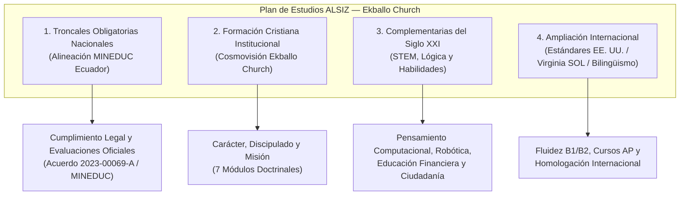
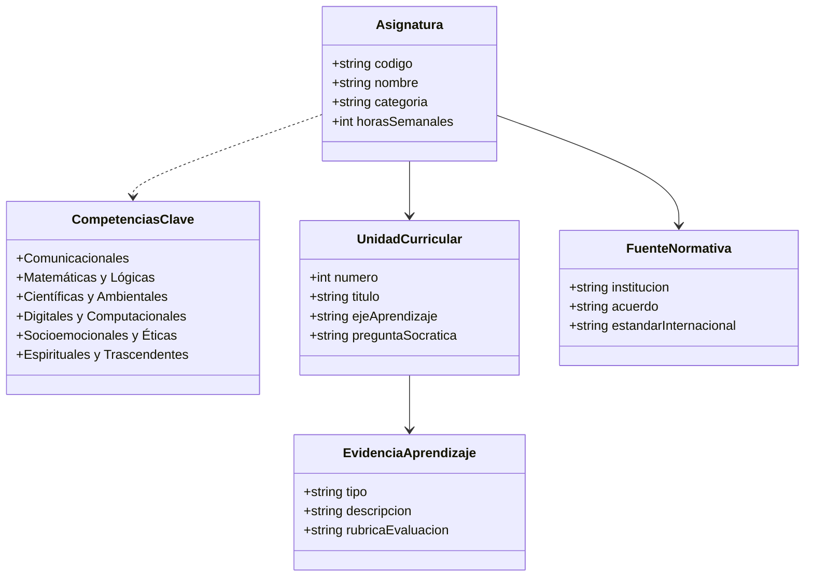
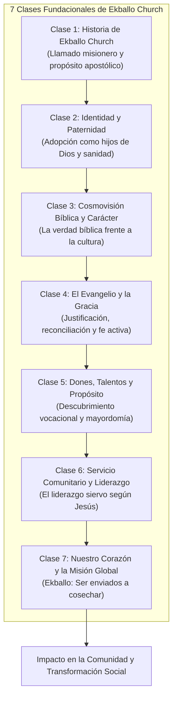

# Mapa Curricular Preliminar — Plataforma Educativa ALSIZ para Ekballo Church

## 1. Identificación y Propósito del Documento
- **Institución**: Ekballo Church / Plataforma Educativa ALSIZ.
- **Nivel del Documento**: Marco Curricular de Referencia Institucional (Macro y Mesocurrículo).
- **Año Lectivo Base**: 2026 - 2027.
- **Enfoque Pedagógico**: Educación integral, socrática, basada en indagación, aprendizaje basado en proyectos interdisciplinarios (ABP) y fundamentada en la cosmovisión bíblica cristiana.
- **Audiencia Objetivo de Referencia**:
  - Nivel Elemental: 4.º Año de Educación General Básica (EGB Elemental) — Caso de estudio: Gael (8 años).
  - Nivel Superior: 8.º Año de Educación General Básica (EGB Superior) — Caso de estudio: Avril (12 años).
  - Proyección de Progresión: Subniveles Media (5.º a 7.º EGB) y Bachillerato General Unificado (1.º a 3.º BGU).

---

## 2. Marco Filosófico y Modelo Pedagógico

### 2.1 Principios Rectores
1. **Cosmovisión Bíblica Cristiana**: Todo conocimiento procede de Dios; la verdad es unitaria y el aprendizaje persigue la maduración del carácter, la mayordomía de la creación y el servicio redentor a la comunidad (Colosenses 1:16-17; Proverbios 1:7).
2. **Método Socrático e Indagación Activa**: En lugar de la memorización pasiva y la repetición de respuestas prescritas, los docentes y mentores plantean preguntas profundas, dilemas morales y desafíos de investigación que guían al estudiante a descubrir la estructura lógica de los conceptos.
3. **Aprendizaje Basado en Proyectos (ABP) Interdisciplinarios**: Los contenidos de distintas disciplinas (ciencias, matemáticas, literatura, arte y fe) convergen en proyectos reales trimestrales con entregables concretos (maquetas, prototipos web, ensayos, simulaciones internacionales).
4. **Enfoque Concreto-Pictórico-Abstracto (CPA / Método Singapur)**: Especialmente para el área de matemáticas en niveles elementales, avanzando desde la manipulación física y el modelado visual hacia la notación simbólica y el álgebra.
5. **Bilingüismo Equilibrado y Comunicativo**: Inmersión progresiva en idioma inglés articulada con el Marco Común Europeo de Referencia (MCER / CEFR) y adaptada etariamente, asegurando el dominio del español académico y la fluidez funcional en inglés.
6. **Cero Memorización Repetitiva y Cero Plantillas**: En educación artística (ECA), proyectos científicos y literatura, se prohíbe el uso de plantillas mecánicas que sofocan la creatividad; el error se asume como una variable de aprendizaje y perfeccionamiento.

---

## 3. Estructura y Organización del Plan de Estudios

El plan de estudios de la Plataforma Educativa ALSIZ organiza las asignaturas en cuatro categorías complementarias:

### 3.1 Categorías Curriculares
1. **Asignaturas Troncales Obligatorias (MINEDUC Ecuador)**: Garantizan la cobertura de las destrezas con criterios de desempeño del Currículo Nacional ecuatoriano exigidas para las evaluaciones oficiales de subnivel.
2. **Formación Cristiana Institucional (Ekballo Church)**: Materia troncal transversal "Relación con Dios", articulada en 7 módulos doctrinales fundamentados en las Sagradas Escrituras y los materiales de discipulado de la iglesia.
3. **Asignaturas Complementarias del Siglo XXI**: Materias que desarrollan pensamiento computacional, programación con bloques y texto, resolución de problemas algorítmicos, educación financiera y ciencias políticas introductorias.
4. **Ampliación Internacional y Bilingüismo**: Asignaturas de inmersión en inglés alineadas al MCER y estándares norteamericanos (Virginia Standards of Learning - SOL), preparando al estudiante para certificaciones de competencia lingüística y cursos avanzados (AP).

---

## 4. Catálogo y Malla Curricular por Niveles y Grados

### 4.1 Subnivel EGB Elemental: 4.º Grado (Gael — 8 años)
- **Régimen Horario Semanal**: 30 horas pedagógicas (períodos de 45 minutos y talleres prácticos).
- **Modelo de Evaluación**: Cualitativa, basada en portafolio de evidencias, rúbricas de desempeño y proyectos trimestrales.

| Código | Asignatura | Categoría | Carga Semanal | Enfoque Pedagógico y Metodología | Docente / Perfil Mentor |
| :--- | :--- | :--- | :---: | :--- | :--- |
| `LEN-401` | **Lengua y Literatura** | Troncal MINEDUC | 5 horas | Lectura comprensiva, narración de historias (*storytelling*), expresión oral y creación de cuentos infantiles. | Especialista en lectoescritura infantil y literatura. |
| `MAT-401` | **Matemáticas** | Troncal MINEDUC | 5 horas | Método CPA (Singapur), manipulación de bloques Lego, geometría espacial 3D y multiplicación intuitiva. | Educador especialista en didáctica matemática lúdica. |
| `CNI-401` | **Ciencias Naturales** | Troncal MINEDUC | 4 horas | Indagación activa, expediciones al entorno, estudio de ecosistemas vivos, botánica y método científico elemental. | Científico/biólogo con enfoque en divulgación infantil. |
| `SOC-401` | **Estudios Sociales** | Troncal MINEDUC | 3 horas | Geografía local y nacional, cartografía interactiva, convivencia comunitaria y servicios públicos. | Docente de ciencias sociales con uso de mapas dinámicos. |
| `ING-401` | **Inglés (EFL)** | Troncal / Internacional | 4 horas | Inmersión lúdica basada en fonética sintética (*Phonics*), canciones, juegos de rol y nivel MCER Pre-A1/A1.1. | Especialista bilingüe en enseñanza de inglés temprano. |
| `ART-401` | **Educación Cultural y Artística (ECA)** | Troncal MINEDUC | 2 horas | Suprareciclaje (*upcycling*), teoría del color, modelado 3D, cero plantillas y *Design Thinking*. | Tallerista de artes plásticas con enfoque en creatividad libre. |
| `EFI-401` | **Educación Física** | Troncal MINEDUC | 2 horas | Psicomotricidad, coordinación gruesa y fina, salud postural y circuitos lúdicos. | Entrenador infantil de desarrollo psicomotor y salud física. |
| `SOFT-401` | **Software y Programación** | Complementaria | 3 horas | Pensamiento computacional, algoritmos con bloques lógicos en Scratch y diseño de historias interactivas. | Ingeniero/mentor en robótica y programación visual. |
| `REL-401` | **Relación con Dios (Fe y Valores)** | Formación Cristiana | 2 horas | Diálogo socrático sobre virtudes bíblicas, amor a Dios, bondad, obediencia, empatía y mayordomía de la creación. | Pastor/educador cristiano con pedagogía de historias bíblicas. |

---

### 4.2 Subnivel EGB Superior: 8.º Grado (Avril — 12 años)
- **Régimen Horario Semanal**: 35 horas pedagógicas.
- **Modelo de Evaluación**: Cuantitativa y formativa (escala 1 a 10; aprobación 7.00/10), complementada con rúbricas analíticas de proyectos interdisciplinarios y sustentación oral.

| Código | Asignatura | Categoría | Carga Semanal | Enfoque Pedagógico y Metodología | Docente / Perfil Mentor |
| :--- | :--- | :--- | :---: | :--- | :--- |
| `LEN-801` | **Lengua y Literatura** | Troncal MINEDUC | 4 horas | Lectura analítica, pensamiento crítico, redacción de ensayos argumentativos y literatura ecuatoriana e hispanoamericana. | Magíster en Literatura con enfoque en dialéctica y ensayo. |
| `MAT-801` | **Matemáticas** | Troncal MINEDUC | 5 horas | Álgebra inicial, modelado de problemas cotidianos, funciones lineales, geometría analítica y estadística descriptiva. | Especialista en matemáticas aplicadas y resolución socrática. |
| `CNI-801` | **Ciencias Naturales** | Troncal MINEDUC | 4 horas | Biología celular, biomoléculas, genética elemental, ciclos biogeoquímicos y ecología de Galápagos y Ecuador. | Doctor/Magíster en Biología con enfoque experimental. |
| `SOC-801` | **Estudios Sociales** | Troncal MINEDUC | 4 horas | Historia del Ecuador y América Latina, civilizaciones antiguas, geopolítica y organización democrática. | Historiador e investigador social con pedagogía dialógica. |
| `ING-801` | **Inglés Avanzado** | Troncal / Internacional | 5 horas | Inmersión lingüística en nivel B1 (MCER), debate oral, redacción formal, *Position Papers* y preparación TOEFL Junior. | Docente de habla inglesa nativa o acreditado B2/C1. |
| `ART-801` | **Educación Cultural y Artística (ECA)** | Troncal MINEDUC | 2 horas | Semiótica visual, composición estética, patrimonio cultural ecuatoriano y producción audiovisual independiente. | Licenciado en Artes Visuales y Realización Digital. |
| `EFI-801` | **Educación Física** | Troncal MINEDUC | 2 horas | Acondicionamiento físico, hábitos de vida saludable, biomecánica postural y deportes individuales. | Especialista en kinesiología deportiva y bienestar físico. |
| `SOFT-801` | **Software y Programación** | Complementaria | 3 horas | Algoritmia estructurada, fundamentos de JavaScript/Python, arquitectura de computadores y ética de la inteligencia artificial. | Ingeniero de Software con experiencia en sistemas y pedagogía. |
| `POL-801` | **Ciencias Políticas y Ciudadanía** | Complementaria | 2 horas | Sistemas de gobierno, estado de derecho, derechos humanos universales, diplomacia y modelos de debate tipo ONU. | Especialista en Ciencias Políticas y Relaciones Internacionales. |
| `ADM-801` | **Administración y Marketing** | Complementaria | 2 horas | Formulación de proyectos con impacto social, modelo Canvas, finanzas personales, presupuestos y ética empresarial. | Máster en Administración de Empresas / Emprendimiento social. |
| `REL-801` | **Relación con Dios (Cosmovisión)** | Formación Cristiana | 2 horas | Cosmovisión bíblica aplicada a la cultura contemporánea, apologética básica, liderazgo de servicio y carácter cristiano. | Teólogo pastoral con experiencia en mentoría juvenil. |

---

## 5. Matriz Curricular Preliminar Integrada

La siguiente matriz establece la trazabilidad completa entre subnivel, grado, área, competencias clave, objetivos de aprendizaje, unidades temáticas, evidencias evaluables y fuentes normativas de referencia:

### 5.1 Matriz Detallada — 4.º Año EGB (Gael)

| Asignatura y Código | Competencias Clave | Objetivos de Aprendizaje | Unidades Temáticas Trimestrales | Evidencias Evaluables | Fuentes de Referencia |
| :--- | :--- | :--- | :--- | :--- | :--- |
| **Lengua y Literatura** (`LEN-401`) | Comunicacional (lectoescritura fluida, comprensión oral y escrita). | O.LL.2.5: Leer de manera autónoma textos literarios y no literarios; expresar ideas con claridad respetando normas ortográficas. | **U1**: El Poder de las Palabras y los Cuentos. **U2**: Exploradores de la Realidad y Noticias. **U3**: El Gran Libro de Nuestras Aventuras. | - Cuento infantil ilustrado con portada y estructura narrativa. - Bitácora de lectura con grabaciones de voz. - Exposición oral de 3 minutos. | Currículo Nacional MINEDUC (LL EGB Elem.); Destrezas `LL.2.3.1`, `LL.2.4.1`. |
| **Matemáticas** (`MAT-401`) | Matemática y Lógica (resolución de problemas numéricos y espaciales). | O.M.2.1: Explicar y construir patrones de figuras y números; operar con multiplicaciones como adiciones repetidas y calcular áreas. | **U1**: El Misterio de los Números y la Multiplicación. **U2**: Geometría en Nuestra Casa y Ciudad. **U3**: Medición y Estadística del Crecimiento. | - Representación física con bloques (CPA). - Plano a escala de su habitación. - Gráficas de barras con datos recolectados. | Currículo Nacional MINEDUC (`M.2.1.26`, `M.2.2.8`); Singapur Math Grade 3/4. |
| **Ciencias Naturales** (`CNI-401`) | Científica y Ambiental (curiosidad investigativa y cuidado de la creación). | O.CN.2.1: Explorar y comprender el ciclo de vida de los seres vivos, hábitats del Ecuador y estados de la materia. | **U1**: El Reino de la Vida (Plantas y Animales). **U2**: Fuerzas, Movimiento y Ecosistemas. **U3**: Cuidado del Planeta y Recursos Naturales. | - Cuaderno de campo con fotos y muestras orgánicas. - Experimento de germinación y registro de variables. - Maqueta de ecosistema ecuatoriano. | Currículo Nacional MINEDUC (`CN.2.1.1`, `CN.2.4.2`); Next Generation Science Standards (NGSS Elementary). |
| **Estudios Sociales** (`SOC-401`) | Socioemocional y Cívica (identidad local, historia y convivencia pacífica). | O.CS.2.4: Reconocer la importancia de la organización comunitaria, los servicios públicos y la diversidad geográfica del país. | **U1**: Mi Familia y Mi Vecindario. **U2**: Pueblos, Ciudades y Rutas del Ecuador. **U3**: Ciudadanos Responsables y Servidores. | - Mapa ilustrado del barrio y croquis con coordenadas lúdicas. - Entrevista a un servidor público comunitario. - Proyecto "La Ciudad Ideal". | Currículo Nacional MINEDUC (`CS.2.1.6`, `CS.2.2.5`). |
| **Inglés** (`ING-401`) | Comunicacional bilingüe (Pre-A1/A1.1 MCER). | O.EFL.2.1: Identificar vocabulario cotidiano, seguir instrucciones básicas en el aula e interactuar en diálogos cortos guiados. | **U1**: All About Me, Family and Friends. **U2**: My House, Animals and Nature. **U3**: Fun and Games (Actions and Feelings). | - Diálogos cortos grabados en audio/video. - Flashcards ilustradas de vocabulario fonético. - Mini-presentación oral: "This is my pet/toy". | MINEDUC EFL Curriculum; MCER Pre-A1/A1; Cambridge Young Learners (Starters). |
| **Educación Cultural y Artística** (`ART-401`) | Creativa, Estética y Motriz. | O.ECA.2.1: Expresar ideas, emociones e inquietudes mediante la manipulación de diferentes materiales plásticos y visuales. | **U1**: La Paleta de la Naturaleza (Biomímesis). **U2**: Arquitectura de la Utopía (Maqueta 3D). **U3**: El Arte en Movimiento (Cuerpo y Cinética). | - Portafolio artístico con obras en técnica mixta. - Maqueta tridimensional con material suprareciclado. - Escultura móvil. | Currículo Nacional MINEDUC (`ECA.2.1.1`, `ECA.2.2.4`); Tate Kids Art Education. |
| **Educación Física** (`EFI-401`) | Motriz y de Salud (esquema corporal y hábitos saludables). | O.EF.2.2: Participar en juegos cooperativos y tradicionales, regulando el esfuerzo motor y reconociendo posturas adecuadas. | **U1**: Coordinación Motriz y Equilibrio. **U2**: Juegos Tradicionales y Cooperación. **U3**: Ritmo Corporal y Hábitos de Salud. | - Circuito motriz completado con registro de tiempos. - Registro semanal de actividad física y descanso. - Coreografía de coordinación rítmica. | Currículo Nacional MINEDUC (`EF.2.1.1`, `EF.2.5.2`). |
| **Software y Programación** (`SOFT-401`) | Digital y Algorítmica (pensamiento computacional). | O.COMP.4.1: Comprender nociones básicas de algoritmo, bucles y condiciones mediante bloques visuales de Scratch. | **U1**: ¿Cómo Piensan las Máquinas? (Algoritmos). **U2**: Creando Historias Animadas en Scratch. **U3**: Mini-Videojuegos y Creatividad Digital. | - Proyecto Scratch: Cuento interactivo animado. - Mini-juego con puntaje y detección de colisión. - Diagrama de flujo dibujado a mano de una rutina. | CSTA K-12 Computer Science Standards (Level 1B: Grades 3-5). |
| **Relación con Dios** (`REL-401`) | Espiritual, Ética y Trascendente (cosmovisión cristiana). | O.RD.4.1: Reconocer el amor paternal de Dios, la identidad como creación especial y practicar el amor al prójimo en la vida diaria. | **U1**: Dios, Creador y Padre Amoroso. **U2**: Las Historias de Jesús y la Bondad. **U3**: Mis Talentos para Servir a los Demás. | - Diario devocional con reflexiones y dibujos. - Acción solidaria concreta documentada en familia. - Memorización reflexiva de pasajes clave. | Módulos Institucionales de Discipleship Ekballo Church (Clases 1 a 4). |

---

### 5.2 Matriz Detallada — 8.º Año EGB (Avril)

| Asignatura y Código | Competencias Clave | Objetivos de Aprendizaje | Unidades Temáticas Trimestrales | Evidencias Evaluables | Fuentes de Referencia |
| :--- | :--- | :--- | :--- | :--- | :--- |
| **Lengua y Literatura** (`LEN-801`) | Comunicacional compleja (análisis crítico, argumentación y retórica). | O.LL.4.3: Analizar textos de divulgación y literatura hispanoamericana; redactar ensayos académicos rigurosos con citas y normas bibliográficas. | **U1**: El Poder del Ensayo Argumentativo. **U2**: Literatura Latinoamericana y Memoria. **U3**: Periodismo de Investigación y Retórica. | - Ensayo argumentativo de 1.200 palabras con fuentes contrastadas. - Podcast analítico sobre una novela clásica. - Debate formal en aula sobre un dilema ético contemporáneo. | Currículo Nacional MINEDUC (`LL.4.3.1`, `LL.4.4.1`); Common Core ELA Grade 8. |
| **Matemáticas** (`MAT-801`) | Matemática y Lógica (abstracción algebraica y modelado). | O.M.4.2: Aplicar números enteros, racionales e irracionales; resolver sistemas de ecuaciones lineales y funciones en situaciones reales. | **U1**: De la Aritmética al Álgebra (Enteros y Racionales). **U2**: Ecuaciones y Funciones Lineales. **U3**: Geometría Euclidiana y Probabilidad. | - Portafolio de problemas modelados con lenguaje algebraico. - Proyecto financiero: proyección de un presupuesto real. - Examen de razonamiento lógico sin calculadora. | Currículo Nacional MINEDUC (`M.4.1.14`, `M.4.2.5`); Virginia SOL Mathematics Grade 8. |
| **Ciencias Naturales** (`CNI-801`) | Científica y Experimental (biología celular y ecología). | O.CN.4.2: Explicar la teoría celular, los niveles de organización biológica, la fotosíntesis y el impacto del cambio climático en los biomas. | **U1**: La Célula: Fábrica Molecular de la Vida. **U2**: Genética, Herencia y Reproducción. **U3**: Ecosistemas, Cambio Climático y Galápagos. | - Informe de laboratorio con microscopio virtual/casero. - Modelo tridimensional de la molécula de ADN y organelos. - Monografía sobre la conservación de la biodiversidad en Ecuador. | Currículo Nacional MINEDUC (`CN.4.1.3`, `CN.4.4.8`); NGSS Middle School Life Science. |
| **Estudios Sociales** (`SOC-801`) | Social, Histórica y Geopolítica. | O.CS.4.1: Analizar los grandes procesos históricos mundiales y la formación del Estado ecuatoriano, desarrollando una conciencia crítica de la ciudadanía. | **U1**: Orígenes de las Civilizaciones y Mundo Antiguo. **U2**: La Conquista, Época Colonial y Mestizaje. **U3**: La República del Ecuador en el Siglo XXI. | - Línea de tiempo interactiva comparada. - Análisis documental de fuentes primarias coloniales. - Ensayo histórico sobre la identidad pluricultural del Ecuador. | Currículo Nacional MINEDUC (`CS.4.1.1`, `CS.4.2.14`). |
| **Inglés Avanzado** (`ING-801`) | Bilingüe avanzada (B1 hacia B1+ MCER). | O.EFL.4.2: Comprender puntos principales de textos orales y escritos en lenguaje estándar; producir textos claros y coherentes en debates y composiciones. | **U1**: Global Challenges and Social Media. **U2**: Science, Technology and the Future. **U3**: World Literature and Public Speaking. | - *Position Paper* oficial en inglés (formato Modelo ONU). - Discurso grabado (*TED-style talk*) de 4 minutos sin notas. - Reseña crítica de un ensayo en inglés. | MINEDUC EFL Curriculum; MCER B1; Cambridge Preliminary (PET) / Virginia SOL English 8. |
| **Educación Cultural y Artística** (`ART-801`) | Creativa y Semiótica. | O.ECA.4.3: Desarrollar proyectos de creación artística visual y audiovisual, investigando el patrimonio artístico nacional e internacional. | **U1**: Semiótica y Fotografía Narrativa. **U2**: Instalaciones Artísticas y Patrimonio. **U3**: Cortometraje y Narrativa Digital. | - Portafolio fotográfico con memoria explicativa conceptual. - Producción de un cortometraje de 2 minutos sobre un tema social. - Bitácora de curaduría de arte contemporáneo. | Currículo Nacional MINEDUC (`ECA.4.1.3`, `ECA.4.3.1`). |
| **Educación Física** (`EFI-801`) | Salud Integral y Biomecánica. | O.EF.4.1: Mejorar la condición física mediante planes de entrenamiento personalizados, valorando el ejercicio como factor de salud mental y física. | **U1**: Biomecánica del Movimiento y Calistenia. **U2**: Deportes Individuales y Tácticas Colectivas. **U3**: Plan Personal de Acondicionamiento Físico. | - Plan de entrenamiento semanal ejecutado y documentado. - Videoanálisis de técnicas de postura y respiración. - Diario de hábitos nutricionales y recuperación física. | Currículo Nacional MINEDUC (`EF.4.1.2`, `EF.4.6.1`). |
| **Software y Programación** (`SOFT-801`) | Algorítmica y Arquitectura Tecnológica. | O.COMP.8.1: Diseñar programas utilizando estructuras de control condicionales, ciclos y funciones en JavaScript/Python; comprender la ética digital. | **U1**: Algoritmos, Lógica y Diagramación. **U2**: Programación Estructurada (Python/JS). **U3**: Redes, Ciberseguridad y Ética de la IA. | - Repositorio de código con programas interactivos funcionales. - Proyecto: Calculadora o aplicación de gestión de notas. - Ensayo crítico sobre la privacidad de datos y sesgos en IA. | CSTA K-12 Computer Science Standards (Level 2: Grades 6-8). |
| **Ciencias Políticas** (`POL-801`) | Cívica, Jurídica y Diplomacia. | O.CP.8.1: Comprender los conceptos de soberanía, división de poderes, constitución y resolución pacífica de conflictos internacionales. | **U1**: Fundamentos del Estado y Sistemas de Gobierno. **U2**: La Constitución y Derechos Fundamentales. **U3**: Geopolítica Global y Modelos de Naciones Unidas. | - Simulación parlamentaria o de cumbre diplomática. - Análisis comparativo de dos constituciones políticas. - Proyecto de propuesta de ley comunitaria. | Center for Civic Education (We the People Standards); Currículo Complementario ALSIZ. |
| **Administración y Marketing** (`ADM-801`) | Emprendimiento y Gestión Financiera. | O.ADM.8.1: Formular un plan de negocio ético con propósito social, aplicando conceptos de costos, punto de equilibrio y propuesta de valor. | **U1**: La Mente Emprendedora y Propósito Social. **U2**: El Modelo de Negocio Canvas y Finanzas. **U3**: Marketing Digital Ético y Lanzamiento. | - Lienzo de Modelo de Negocio (*Business Model Canvas*). - Hoja de cálculo de presupuesto, costos y punto de equilibrio. - *Pitch deck* de 5 diapositivas presentado ante un panel. | Junior Achievement Economics / Mineduc Emprendimiento y Gestión (Nivel introductorio). |
| **Relación con Dios** (`REL-801`) | Cosmovisión, Teología y Liderazgo Siervo. | O.RD.8.1: Articular una cosmovisión bíblica consistente frente a las corrientes filosóficas actuales; ejercer liderazgo ético de servicio. | **U1**: La Gran Historia: Creación, Caída, Redención y Restauración. **U2**: Jesús en la Cultura: Apologética y Gracia. **U3**: Vocación, Liderazgo Siervo y la Gran Comisión. | - Monografía reflexiva: "¿Cómo responde el Evangelio a la crisis contemporánea?". - Proyecto de servicio comunitario planificado y ejecutado. - Exposición sobre el corazón misionero de la iglesia. | Módulos Institucionales de Discipleship Ekballo Church (Clases 1 a 7 completas). |

---

## 6. Integración del Currículo Institucional de Discipulado (Ekballo Church)

La materia **Relación con Dios** (`REL-401` y `REL-801`) no es una clase dominical convencional ni catecismo memorístico, sino un espacio académico y espiritual donde se estudia la Biblia desde el método inductivo y dialógico, incorporando la herencia teológica e histórica de Ekballo Church.

### 6.1 Secuenciación Adaptada por Edades
- **En 4.º EGB (Gael — 8 años)**:
  - Foco en la **Paternidad Amorosa de Dios** y la **Historia de Jesús**.
  - Metodología socrática centrada en parábolas y dilemas morales cotidianos (ej. perdonar, decir la verdad, compartir con el necesitado).
  - Evidencias: Diario de gratitud, dibujos de historias bíblicas, proyecto de bondad familiar.
- **En 8.º EGB (Avril — 12 años)**:
  - Foco en la **Cosmovisión Bíblica**, la **Defensa de la Fe (Apologética Básica)** y el **Liderazgo Siervo**.
  - Estudio de la cosmovisión cristiana frente al nihilismo, relativismo y materialismo contemporáneos.
  - Evidencias: Ensayos reflexivos, formulación de proyectos de voluntariado y mayordomía ambiental y social.

---

## 7. Sistema de Evaluación Formativa y Rúbricas de Desempeño

Siguiendo el mandato de la LOEI ecuatoriana y las mejores prácticas pedagógicas internacionales:

### 7.1 Principios del Modelo Evaluativo
1. **Sin Exámenes Memorísticos Trimestrales**: La retención estéril de fórmulas o fechas para una prueba escrita queda sustituida por la aplicación práctica de conocimientos.
2. **Evaluación Formativa Continua (70% del período)**:
   - Registro de observación docente en diálogos socráticos.
   - Entregas iterativas con retroalimentación cualitativa inmediata.
   - Autoevaluación y coevaluación fundamentada en criterios claros.
3. **Proyectos Interdisciplinarios Integradores (30% del período)**:
   - Al finalizar cada uno de los 3 trimestres, los estudiantes desarrollan un proyecto que combina al menos 3 materias.
   - Evaluación mediante rúbricas analíticas estandarizadas en 4 niveles de logro:
     - *Nivel 4 (Dominio Excelente / A)*: Supera las expectativas, demuestra pensamiento crítico y creatividad original.
     - *Nivel 3 (Logro Aceptable / B)*: Cumple con todos los estándares y criterios requeridos con rigor técnico.
     - *Nivel 2 (En Proceso / C)*: Evidencia comprensión parcial; requiere refuerzo asistido para consolidar la destreza.
     - *Nivel 1 (Inicial / D)*: Dificultad sustancial que activa un plan de acompañamiento tutorial intensivo.

---

## 8. Verificación de Fuentes y Trazabilidad Curricular

1. **Ministerio de Educación del Ecuador (MINEDUC)**:
   - *Currículo Nacional de Educación General Básica y Bachillerato* (Acuerdo Ministerial 2016-00020-A y actualizaciones 2021-00067-A y 2023-00008-A).
   - *Currículo Priorizado con énfasis en Competencias Comunicacionales, Matemáticas, Digitales y Socioemocionales*.
   - *Lineamientos Pedagógicos para Modalidades Semipresencial y a Distancia*.
2. **Estándares Internacionales**:
   - *Virginia Standards of Learning (SOL)* — Virginia Department of Education (VDOE, EE. UU.).
   - *Common Core State Standards for English Language Arts & Mathematics* (EE. UU.).
   - *Next Generation Science Standards (NGSS)* (EE. UU.).
   - *CSTA K-12 Computer Science Standards* — Computer Science Teachers Association.
3. **Marco de Lenguas**:
   - *Marco Común Europeo de Referencia para las Lenguas (MCER / CEFR)* — Consejo de Europa.
   - *Cambridge English Qualifications Scale*.
4. **Documentos Institucionales**:
   - *Plataforma Educativa ALSIZ — Microcurriculums existentes en `src/data/`*.
   - *DOCUMENTOS EKBALLO/ — Clases 1 a 7 de Discipulado*.
   - *DOCUMENTOS EKBALLO/Investigación Educativa para Ekballo Church.docx*.

