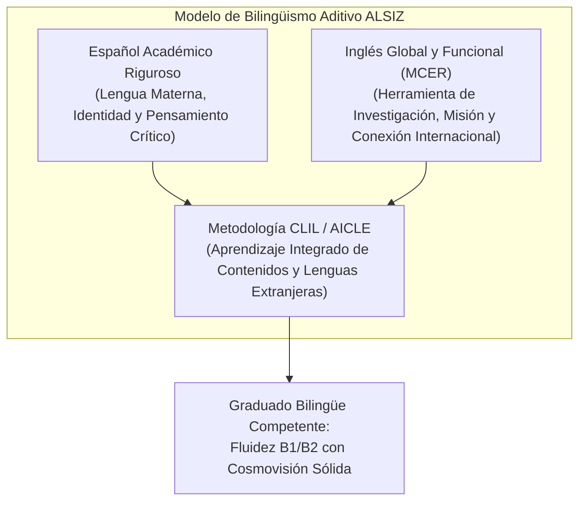
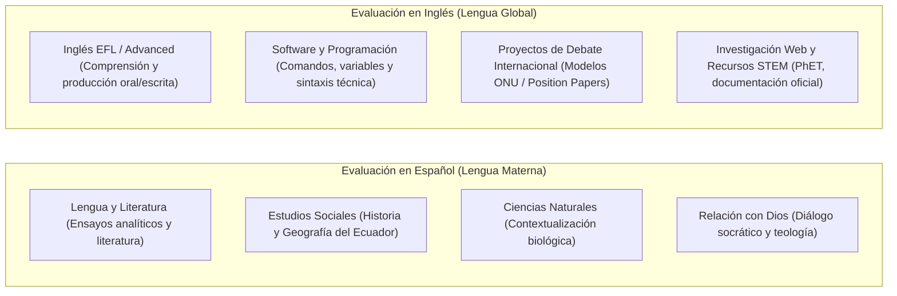

# Marco de Bilingüismo por Etapas y Criterios de Evaluación en Dos Idiomas — ALSIZ

## 1. Fundamentos del Bilingüismo Aditivo en ALSIZ

El modelo de bilingüismo de la **Plataforma Educativa ALSIZ para Ekballo Church** adopta el principio de **bilingüismo aditivo y comunicativo**. Esto significa que la adquisición progresiva y profunda de la lengua inglesa enriquece el capital cognitivo, cultural y ministerial del estudiante, sin debilitar ni desplazar el dominio riguroso del idioma español como lengua materna y de pensamiento reflexivo.

### 1.1 Principios Psicopedagógicos por Edad
1. **Prioridad Fonológica Temprana sobre Gramática Abstracta (6-8 años)**: En EGB Elemental (Gael), el aprendizaje del inglés ocurre mediante discriminación auditiva, ritmo, canciones y fonética sintética lúdica (*Phonics*). Se evita la memorización de reglas gramaticales complejas que interfieren con la consolidación de la lectoescritura en español.
2. **Transición a la Lectura Comprensiva y Expresión Guiada (9-11 años)**: En EGB Media, el estudiante desarrolla la capacidad de leer historias ilustradas, redactar oraciones compuestas y describir situaciones cotidianas.
3. **Uso Instrumental y Académico del Idioma (12-14 años)**: En EGB Superior (Avril), el inglés se convierte en un medio para investigar ciencia, participar en debates internacionales (Modelo ONU) y redactar documentos formales (*Position Papers*).
4. **Pensamiento Crítico y Certificación Global (15-17 años)**: En Bachillerato, se busca consolidar el nivel B2, permitiendo la lectura de textos universitarios y la preparación para pruebas estandarizadas (TOEFL / IELTS).

---

## 2. Mapa de Progresión Lingüística por Etapas Etarias (MCER / CEFR)

| Etapa Escolar | Rango de Edad | Caso de Estudio | Nivel MCER Objetivo | Estándar Cambridge de Referencia | Descripción de Competencia Esperada |
| :--- | :---: | :---: | :---: | :---: | :--- |
| **Etapa 1: EGB Elemental** (2.º a 4.º EGB) | 6 a 8 años | **Gael** (4.º EGB — 8 años) | **Pre-A1 a A1.1** | *Pre A1 Starters (YLE)* | Comprende instrucciones orales muy sencillas; saluda y se presenta; nombra objetos de su entorno (familia, animales, juguetes, colores); asocia sonidos fonéticos básicos con letras. |
| **Etapa 2: EGB Media** (5.º a 7.º EGB) | 9 a 11 años | Transición | **A1.2 a A2.1** | *A1 Movers / A2 Flyers* | Entiende frases y expresiones cotidianas de uso frecuente (rutinas, compras, gustos); interactúa en diálogos sencillos y redacta descripciones breves sobre su vida y familia. |
| **Etapa 3: EGB Superior** (8.º a 10.º EGB) | 12 a 14 años | **Avril** (8.º EGB — 12 años) | **A2.2 a B1.1** (Meta de salida: **B1**) | *A2 Key (KET) a B1 Preliminary (PET)* | Comprende los puntos principales de discursos y textos en lengua estándar; se desenvuelve en viajes; redacta textos coherentes sobre temas de interés; formula opiniones y argumentos en debates moderados. |
| **Etapa 4: Bachillerato** (1.º a 3.º BGU) | 15 a 17 años | Culminación | **B1.2 a B2** | *B2 First (FCE) / TOEFL Junior / IELTS 5.5-6.5* | Comprende ideas complejas de textos técnicos y abstractos; conversa con fluidez y espontaneidad con hablantes nativos; redacta ensayos académicos estructurados y defiende puntos de vista con matices. |

---

## 3. Plan de Asignaturas y Actividades Evaluables en Dos Idiomas

---

### 3.1 Actividades y Evidencias Evaluables — 4.º Año EGB (Gael — 8 años)

#### A. Evidencias en Español
1. **Cuento Interactivo Ilustrado (Lengua y Literatura)**: Creación de un relato infantil de 3 páginas con personajes, conflicto y resolución moral; evaluación de caligrafía, ortografía básica y coherencia narrativa.
2. **Maqueta de la Ciudad Ideal (Estudios Sociales / Arte ECA)**: Presentación oral en español describiendo los servicios comunitarios esenciales (hospitales, escuelas, parques) y su función cívica.
3. **Cuaderno de Explorador de la Naturaleza (Ciencias Naturales)**: Registro ilustrado de experimentos de germinación y clasificación de animales vertebrados e invertebrados de Ecuador.

#### B. Evidencias en Inglés
1. **Interactive Picture Dictionary / Flashcards Audio**: Grabación de audio de 10 palabras con fonemas en inglés de animales y partes de la casa, demostrando pronunciación de *Phonics* (sonidos cortos y largos).
2. **Video de Presentación Guiada "All About Me"**: Video de 90 segundos donde el niño dice en inglés: nombre, edad, comida favorita, mascota y un talento personal usando frases modelo (*"My name is... I am 8 years old... I like..."*).
3. **Simón Dice en Inglés (Total Physical Response - TPR)**: Prueba de comprensión auditiva interactiva donde el estudiante responde físicamente a 8 comandos de acción verbal en inglés (*"Stand up, point to the window, touch your elbow, jump three times"*).

---

### 3.2 Actividades y Evidencias Evaluables — 8.º Año EGB (Avril — 12 años)

#### A. Evidencias en Español
1. **Ensayo Crítico Argumentativo (Lengua y Literatura)**: Ensayo académico formal de 1.200 palabras sobre un dilema ético contemporáneo (ej. *"Impacto del uso de redes sociales en la autoestima de los adolescentes"*), con tesis explícita, contraargumentos y citas en formato APA.
2. **Investigación Histórica Documental (Estudios Sociales)**: Monografía analítica comparando el sistema de encomiendas de la Real Audiencia de Quito con los derechos constitucionales contemporáneos en Ecuador.
3. **Informe Científico de Laboratorio (Ciencias Naturales)**: Estructura IMRyD con introducción teórica celular, procedimiento con microscopio virtual y conclusiones basadas en datos empíricos.

#### B. Evidencias en Inglés
1. **Official Position Paper (Simulación Modelo ONU — Trimestre 2)**: Documento oficial de 2 páginas redactado completamente en inglés representando a una delegación asignada sobre el tema *"Access to Clean Water and Sanitation in Developing Countries"*, con estructura formal: *General Overview, Country Policy, Proposed Solutions*.
2. **TED-Style Presentation (Oral Fluency & Public Speaking)**: Exposición oral en inglés de 3 a 4 minutos grabada en video sin lectura de guion, apoyada en diapositivas visuales, evaluando modulación vocal, vocabulario formal y capacidad de convicción.
3. **Reading Comprehension & Critical Analysis**: Evaluación de comprensión de un artículo de divulgación científica en inglés (nivel B1 Lexile 800-950L) mediante preguntas de inferencia, vocabulario en contexto y síntesis de ideas principales.
4. **Code Documentation in English (Software y Programación)**: Nombres de variables, funciones y comentarios en inglés dentro de los proyectos desarrollados en Python y JavaScript (*"def calculate_balance(income, expenses): # returns net profit"*).

---

## 4. Rúbricas Analíticas de Evaluación Bilingüe

### 4.1 Rúbrica de Producción Oral en Inglés (Speaking — Subnivel Superior / Avril — B1)

| Criterio | Nivel 4: Excelente (9.00 - 10.00) | Nivel 3: Satisfactorio (7.00 - 8.99) | Nivel 2: En Proceso (5.00 - 6.99) | Nivel 1: Inicial (< 5.00) |
| :--- | :--- | :--- | :--- | :--- |
| **Fluidez y Espontaneidad** | Habla con naturalidad y ritmo continuo. Las pausas son breves y dedicadas a planificar ideas, no palabras. | Mantiene el flujo de la conversación con pausas ocasionales para buscar vocabulario. | Presenta frecuentes vacilaciones y pausas prolongadas que dificultan el seguimiento de las ideas. | Discurso fragmentado; requiere asistencia constante del interlocutor para articular frases. |
| **Riqueza y Precisión de Vocabulario** | Utiliza un amplio repertorio léxico adecuado al nivel B1, incluyendo sinónimos, expresiones idiomáticas y conectores lógicos (*however, therefore, whereas*). | Emplea vocabulario suficiente para expresar sus ideas con claridad; utiliza conectores básicos (*and, but, because, so*). | Vocabulario limitado y repetitivo; incurre frecuentemente en palabras en español (*code-switching*) para suplir lagunas léxicas. | Léxico insuficiente para sostener una conversación elemental sobre el tema asignado. |
| **Pronunciación y Entonación** | Pronunciación clara y comprensible; entonación y acentuación correctas que facilitan la comprensión del oyente. | Pronunciación comprensible; algunos errores de fonemas en palabras complejas que no impiden el mensaje general. | Errores recurrentes de pronunciación que obligan al oyente a pedir repetición con frecuencia. | Pronunciación ininteligible que bloquea la comunicación en la mayoría de los enunciados. |
| **Corrección Gramatical** | Domina tiempos verbales del pasado, presente y futuro; formula oraciones compuestas con pocos errores de concordancia. | Utiliza estructuras gramaticales de nivel intermedio; los errores no distorsionan el significado general del enunciado. | Comete errores gramaticales básicos constantes en tiempos simples y estructuras sujeto-verbo. | Control gramatical muy deficiente, limitándose a palabras sueltas sin estructura sintáctica. |

---

### 4.2 Rúbrica de Producción Escrita en Inglés (Writing — Subnivel Superior / Avril — B1)

| Criterio | Nivel 4: Excelente (9.00 - 10.00) | Nivel 3: Satisfactorio (7.00 - 8.99) | Nivel 2: En Proceso (5.00 - 6.99) | Nivel 1: Inicial (< 5.00) |
| :--- | :--- | :--- | :--- | :--- |
| **Estructura y Coherencia del Texto** | Párrafos claramente organizados con oración temática, oraciones de apoyo y conclusión lógica. Uso fluido de transiciones. | Texto organizado en párrafos con progresión lógica comprensible y conectores adecuados. | Párrafos desordenados o texto en bloque único; ideas dispersas con transiciones abruptas. | Desorganización estructural severa; las ideas no guardan relación lógica entre sí. |
| **Cumplimiento del Propósito y Tono** | Cumple cabalmente con las pautas del género (*Position Paper* / Ensayo); registro formal adecuado y convincente. | Cumple con el propósito comunicativo; tono generalmente apropiado con pequeños deslices informales. | Cumple parcialmente con la tarea asignada; registro inconsistente entre formal e informal. | No cumple con el formato solicitado; tono inapropiado para un documento académico. |
| **Mecánica y Ortografía** | Puntuación rigurosa, mayúsculas correctas y ortografía exacta en la inmensa mayoría de palabras complejas. | Puntuación y ortografía adecuadas; errores menores en palabras de ortografía irregular que no impiden la lectura. | Múltiples errores ortográficos y fallas de puntuación que ralentizan la comprensión del lector. | Errores mecánicos y ortográficos generalizados que vuelven el texto incomprensible. |

---

## 5. Prevención de Desequilibrios Cognitivos y Sobrecarga Lingüística

1. **Monitoreo Permanente de la Lengua Materna (L1)**: El desarrollo del bilingüismo en ALSIZ jamás se realizará a expensas de la competencia escrita en español. Si un estudiante muestra dificultades de ortografía, sintaxis o comprensión lectora en español, se priorizará el refuerzo en L1 antes de exigir mayor carga en L2.
2. **Uso Estratégico del Español en Materias de Alta Carga Cívica o Espiritual**: Las materias que tocan las convicciones profundas del ser, la teología bíblica (*Relación con Dios*) y la identidad histórica nacional (*Estudios Sociales*) se imparten primariamente en español, garantizando que el discernimiento ético y espiritual se consolide en la lengua del corazón del estudiante.
3. **Inmersión Gradual y Libre de Estrés**: El inglés debe asociarse con exploración, investigación científica, juego intelectual y comunicación internacional, eliminando el estrés punitivo de las pruebas memorísticas.

