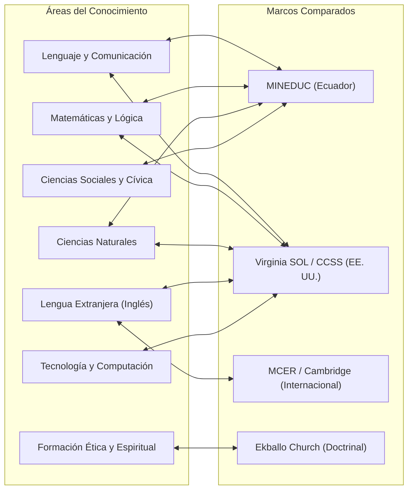
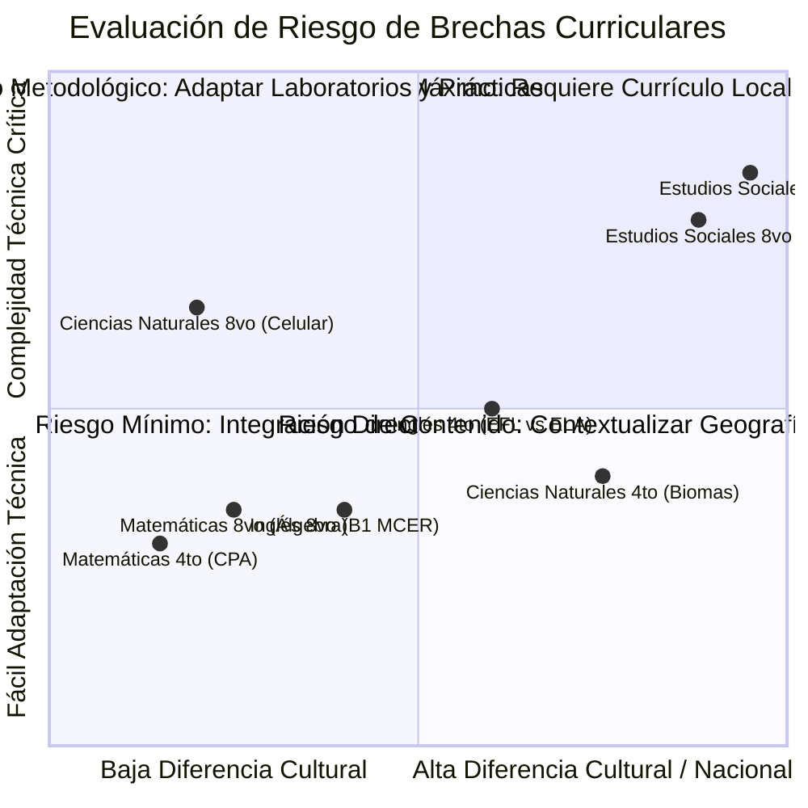

# Matriz de Correspondencia Curricular y Análisis de Brechas — ALSIZ

## 1. Marco Teórico y Criterios de Selección

Para fundamentar la propuesta académica de la **Plataforma Educativa ALSIZ para Ekballo Church**, se han seleccionado tres marcos pedagógicos de referencia contrastados rigurosamente con el estándar oficial de Ecuador:

1. **Marco Nacional Ecuatoriano (MINEDUC)**:
   - *Fundamento*: Currículo Nacional de Educación General Básica y Bachillerato con énfasis en Competencias Comunicacionales, Matemáticas, Digitales y Socioemocionales.
   - *Propósito*: Garantizar el cumplimiento legal y la acreditación oficial de estudios en Ecuador (Acuerdo MINEDUC-2023-00069-A / MINEDUC-2025-00024-A).
2. **Estándares del Estado de Virginia (Virginia Standards of Learning - SOL, EE. UU.)**:
   - *Fundamento*: Marco curricular estadounidense utilizado por instituciones binacionales de referencia en Ecuador (como Alliance Academy International).
   - *Propósito*: Estructurar la secuenciación de destrezas para la ampliación internacional, pensamiento analítico y eventual homologación en EE. UU. (diploma de *High School*).
3. **Next Generation Science Standards (NGSS) y Common Core State Standards (CCSS, EE. UU.)**:
   - *Fundamento*: Enfoque científico de indagación en tres dimensiones (prácticas científicas, conceptos transversales e ideas disciplinares) y rigor en artes del lenguaje y matemáticas.
4. **Marco Común Europeo de Referencia para las Lenguas (MCER / CEFR)**:
   - *Fundamento*: Escala internacional estándar para la medición de la competencia en lenguas extranjeras (niveles Pre-A1 a C2).

> [!WARNING]
> **Principio de No Equivalencia Nominal Arbitraria**:
> No se debe declarar equivalencia automática entre asignaturas únicamente porque compartan títulos similares (por ejemplo, *Social Studies* en EE. UU. no equivale a *Estudios Sociales* en Ecuador; *Language Arts* nativo no equivale a *Inglés EFL* como lengua extranjera). La homologación requiere un análisis sustantivo de contenidos, destrezas y contexto sociocultural.

---

## 2. Matriz de Correspondencia por Áreas del Conocimiento

---

### 2.1 Área: Lenguaje y Comunicación

| Nivel / Grado | Marco MINEDUC (Ecuador) | Marco Virginia SOL / CCSS (EE. UU.) | Análisis de Correspondencia | Brechas Identificadas | Estrategia de Solución ALSIZ |
| :--- | :--- | :--- | :--- | :--- | :--- |
| **4.º EGB** (Gael — 8 años) | **Lengua y Literatura**: Comunicación oral, narración de cuentos, conciencia ortográfica, lectura comprensiva literal e inferencial. | **English Reading 4 / Writing 4**: Decodificación fonética avanzada, análisis de personajes, causa-efecto, escritura de textos narrativos breves. | **Alta en competencias comunicativas estructurales** (estructura narrativa, comprensión lectora, producción de párrafos coherentes). | **Brecha idiomática y de canon**: El marco de Virginia opera en inglés nativo con literatura anglosajona. El MINEDUC exige literatura tradicional infantil ecuatoriana y mitos locales. | Se mantiene **Lengua y Literatura** en español como lengua materna con autores hispanohablantes y leyendas ecuatorianas, incorporando las estrategias de análisis de causa-efecto de Virginia SOL. |
| **8.º EGB** (Avril — 12 años) | **Lengua y Literatura**: El ensayo argumentativo, textos de divulgación científica, literatura hispanoamericana, normas de citación. | **English 8 (Reading/Writing/Research)**: Argumentación persuasiva, evaluación de fuentes primarias/secundarias, sesgos informativos, retórica. | **Muy alta en habilidades lógicas y argumentativas**. Ambos marcos priorizan la estructura de tesis, premisas, contraargumentos y citas. | **Brecha de tipología de textos**: Virginia SOL profundiza más tempranamente en oratoria formal y retórica clásica; MINEDUC enfatiza la historia de la escritura y variedades lingüísticas del Ecuador. | Se integran talleres de retórica y debate socrático con el estudio riguroso del ensayo formal y las variedades lingüísticas del castellano ecuatoriano. |

---

### 2.2 Área: Matemáticas y Razonamiento Lógico

| Nivel / Grado | Marco MINEDUC (Ecuador) | Marco Virginia SOL (EE. UU.) | Análisis de Correspondencia | Brechas Identificadas | Estrategia de Solución ALSIZ |
| :--- | :--- | :--- | :--- | :--- | :--- |
| **4.º EGB** (Gael — 8 años) | **Matemática**: Números hasta el 9.999, multiplicación y división como operaciones aritméticas, noción de perímetro y área en cuadrículas. | **Mathematics 4**: Operaciones multilínea, fracciones como partes de un todo, números decimales hasta décimas, geometría de ángulos y cuadriláteros. | **Media-Alta**. Coincidencia en la aritmética básica y nociones espaciales. | **Brecha de secuenciación en fracciones y decimales**: Virginia SOL introduce fracciones y decimales con mayor intensidad en 4.º grado que el currículo ecuatoriano estándar. | Se adopta el **Método Singapur (CPA)** con manipulación concreta para introducir fracciones y decimales sin sobrecarga cognitiva memorística. |
| **8.º EGB** (Avril — 12 años) | **Matemática**: Conjuntos numéricos ($\mathbb{Z}, \mathbb{Q}$), polinomios básicos, ecuaciones de primer grado, congruencia de triángulos y estadística descriptiva. | **Mathematics 8 / Algebra I**: Álgebra temprana (*Pre-Algebra / Algebra I*), funciones lineales $y = mx + b$, sistemas de ecuaciones $2\times 2$, teorema de Pitágoras. | **Alta en objetivos algebraicos**. Ambos marcos buscan la transición de la aritmética al pensamiento algebraico formal. | **Brecha de abstracción en funciones**: El marco de EE. UU. formaliza antes la notación de funciones y la pendiente de una recta; MINEDUC se concentra más en operaciones con polinomios. | Se armonizan ambos programas: se cubren los polinomios y factorización de MINEDUC junto con la representación gráfica de funciones en GeoGebra inspirada en Virginia SOL. |

---

### 2.3 Área: Ciencias Naturales y Experimentales

| Nivel / Grado | Marco MINEDUC (Ecuador) | Marco NGSS / Virginia SOL (EE. UU.) | Análisis de Correspondencia | Brechas Identificadas | Estrategia de Solución ALSIZ |
| :--- | :--- | :--- | :--- | :--- | :--- |
| **4.º EGB** (Gael — 8 años) | **Ciencias Naturales**: Ciclos de vida, clasificación de animales vertebrados/invertebrados, flora y fauna de las regiones de Ecuador, recursos naturales. | **Science 4 (Earth, Life, Physical)**: Ecosistemas e interdependencia, flujo de energía, fósiles y cambios en la Tierra a lo largo del tiempo, circuitos eléctricos. | **Media**. Coincidencia en los principios de ecología y vida animal/vegetal. | **Brecha biogeográfica crítica**: El currículo de EE. UU. se basa en ecosistemas templados y estaciones climáticas de Norteamérica. El MINEDUC exige el estudio de la megadiversidad ecuatoriana (Costa, Sierra, Amazonía y Galápagos). | **No sustituible**: Las Ciencias Naturales en ALSIZ se contextualizan en la biogeografía del Ecuador (Galápagos, páramos andinos, selva amazónica), utilizando la metodología indagatoria de NGSS. |
| **8.º EGB** (Avril — 12 años) | **Ciencias Naturales**: Teoría celular, microscopía, biomoléculas orgánicas (glúcidos, lípidos, proteínas, ácidos nucleicos), ciclos del carbono y nitrógeno. | **Life Science (Middle School)**: Estructura celular, respiración celular y fotosíntesis, genética mendeliana y mutaciones, ecología de poblaciones. | **Muy alta**. La biología celular y molecular es universal a nivel global. | **Brecha metodológica de laboratorio**: NGSS exige prácticas de laboratorio por diseño ingenieril; en modalidad a distancia/homeschool se dificulta el laboratorio húmedo tradicional. | Se implementan simuladores interactivos PhET (University of Colorado), BioDigital Human y experimentos caseros seguros de extracción de ADN vegetal. |

---

### 2.4 Área: Ciencias Sociales, Historia y Cívica

| Nivel / Grado | Marco MINEDUC (Ecuador) | Marco Virginia SOL (EE. UU.) | Análisis de Correspondencia | Brechas Identificadas | Estrategia de Solución ALSIZ |
| :--- | :--- | :--- | :--- | :--- | :--- |
| **4.º EGB** (Gael — 8 años) | **Estudios Sociales**: Mi cantón, mi provincia, patrimonio cultural ecuatoriano, mapas del Ecuador, servidores públicos y autoridades locales. | **Virginia Studies (Grade 4)**: Historia del asentamiento de Jamestown, colonización británica de Virginia, guerra civil estadounidense y geografía local de Virginia. | **Incompatible / Cero correspondencia sustantiva**. Los contenidos históricos y geográficos son totalmente nacionales y locales. | **Brecha estructural insalvable**: Adoptar el currículo de Virginia en sociales dejaría al estudiante ignorante de la historia y geografía de su país y reprobaría las evaluaciones oficiales de MINEDUC. | **Solución determinante**: Estudios Sociales se dicta al 100% bajo el Currículo Nacional ecuatoriano. Las habilidades cartográficas y de pensamiento espacial de Virginia se aplican a los mapas de Ecuador. |
| **8.º EGB** (Avril — 12 años) | **Estudios Sociales**: De los orígenes de la humanidad a las culturas precolombinas, la conquista española, la Real Audiencia de Quito y la época colonial. | **World History & Geography to 1500**: Civilizaciones fluviales antiguas (Mesopotamia, Egipto, Indo), Grecia, Roma, el Islam y la Europa medieval. | **Media-Alta en historia universal; Discrepante en historia nacional**. Coinciden en el estudio de las civilizaciones antiguas universales. | **Brecha de historia regional**: Virginia SOL apenas menciona los imperios andinos precolombinos (Incas, Cañaris, Caranquis) y la historia específica de la Audiencia de Quito. | Se adopta una estructura dual: historia universal analítica complementada rigurosamente con los módulos de historia aborigen y colonial del Ecuador requeridos por MINEDUC. |

---

### 2.5 Área: Lengua Extranjera (Inglés) y Bilingüismo

| Nivel / Grado | Marco MINEDUC (Ecuador) | Marco MCER / Cambridge | Marco Virginia SOL (EE. UU.) | Análisis de Correspondencia y Brechas | Solución ALSIZ |
| :--- | :--- | :--- | :--- | :--- | :--- |
| **4.º EGB** (Gael — 8 años) | Nivel oficial exigido: **Pre-A1**. Vocabulario básico y órdenes sencillas en inglés. | Nivel objetivo: **Pre-A1 a A1.1** (*Cambridge Starters*). Fonética, canciones y diálogos breves. | *Grade 4 ELA*: Diseñado para hablantes nativos con redacción de ensayos extensos. | **Brecha de sobrecarga**: Tratar de aplicar el estándar de inglés nativo de Virginia a un niño hispanohablante de 8 años genera frustración lingüística y frena la adquisición de la lectoescritura en español. | Se adopta el estándar **MCER A1.1** con fonética sintética lúdica (*Phonics*), cuentos interactivos y comunicación oral cotidiana. |
| **8.º EGB** (Avril — 12 años) | Nivel oficial mínimo MINEDUC: **A2.1 / A2.2**. Comprensión lectora básica. | Nivel objetivo ALSIZ: **B1 hacia B1+** (*Cambridge Preliminary - PET*). Debate, ensayos breves y fluidez oral. | *Grade 8 ELA*: Análisis de textos literarios complejos y retórica nativa. | **Oportunidad de aceleración**: El estándar mínimo de MINEDUC (A2) es insuficiente para el perfil internacional de Avril. El estándar nativo puro es excesivo en terminología arcaica. | Se aplica el nivel **B1 del MCER**, articulado con redacción de documentos diplomáticos (*Position Papers* para modelos ONU) y debates en inglés. |

---

## 3. Matriz Sintética de Brechas y Riesgos Pedagógicos

### 3.1 Resumen de Brechas y Decisiones Obligatorias
1. **Estudios Sociales no puede tercerizarse a currículos extranjeros**: El intento de homologar materias sociales con programas de EE. UU. (ej. Abeka, BJU Press o Virginia SOL) vulnera los requerimientos de la LOEI y priva al estudiante de su identidad ciudadana e histórica ecuatoriana.
2. **Las Ciencias Naturales exigen contextualización biogeográfica**: Si bien la física y la biología celular son universales, el estudio de biomas, ecosistemas y recursos naturales debe centrarse en Ecuador y la reserva marina de Galápagos.
3. **El bilingüismo debe guiarse por el MCER y no por el currículo de inglés nativo**: Medir a un estudiante hispanohablante contra los exámenes de literatura nativa de EE. UU. sin haber consolidado los niveles A1, A2 y B1 genera desfases pedagógicos.
4. **Armonización matemática exitosa**: Las matemáticas de Singapur y el álgebra de Virginia SOL enriquecen notablemente las exigencias de MINEDUC, superando el promedio nacional sin entrar en conflicto con la normativa.

