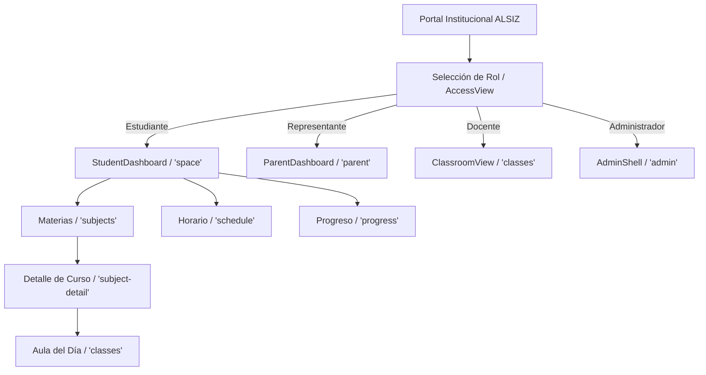

# Sistema de Diseño ALSIZ — Identidad y Frontend
**Ekballo Church • Plataforma Educativa ALSIZ**
*Versión:* 1.0 (Etapa 04) • *Fecha:* Octubre 2026

---

## 1. Fundamentos e Identidad de Marca

El sistema de diseño de la **Plataforma Educativa ALSIZ para Ekballo Church** combina la sobriedad, elegancia y autoridad ministerial de Ekballo Church con un entorno pedagógico lúdico, socrático y adaptativo para niños y jóvenes (Homeschooling K-12).

### 1.1 Activos Oficiales Verificados
- **Logotipo Principal**: `public/ekballo-logo.svg` (vectorizado oficial) con palabra "EKBALLO", subtítulo "CHURCH" y barras de balance ministerial.
- **Monograma Institucional**: Letra capital **"E"** estilizada con gradiente dorado institucional (`#F59E0B` a `#E59000`), utilizada en avatares, favicon y componentes compactos.
- **Favicons y PWA**: `favicon.ico`, `favicon.svg`, `apple-touch-icon.png`, `site.webmanifest`.
- **Tema del Navegador**: `#0A0D11`.

---

## 2. Tokens de Color

### 2.1 Paleta Institucional Ekballo
| Nombre | Valor HEX | Uso Principal |
| :--- | :--- | :--- |
| **Dark Background** | `#0A0D11` | Fondo principal de la aplicación (`min-h-dvh flex flex-col bg-[#0A0D11]`) |
| **Dark Surface** | `#121820` | Superficie de paneles, tarjetas principales y modales |
| **Surface Raised** | `#18202A` | Contenedores elevados y tarjetas hover |
| **Border Dark** | `#283545` | Bordes sutiles de separación estructural |
| **Silver Identity** | `#BCBEBE` | Texto secundario y subtítulo "CHURCH" |
| **Silver Light** | `#ECEFF1` | Texto principal de lectura y contrastes |
| **Gold Ekballo** | `#E59000` | Acento principal, botones primarios y marcas de honor |
| **Gold Hover / Bright**| `#F59E0B` | Estados interactivos hover y foco |

### 2.2 Semántica de Estados Educativos
| Estado | Texto | Fondo Transparente | Borde | Sólido |
| :--- | :--- | :--- | :--- | :--- |
| **Éxito (Logrado)** | `#34D399` | `rgba(16, 185, 129, 0.12)` | `rgba(16, 185, 129, 0.35)` | `#10B981` |
| **Advertencia (Revisión)** | `#FBBF24` | `rgba(245, 158, 11, 0.12)` | `rgba(245, 158, 11, 0.35)` | `#F59E0B` |
| **Error (Desafío)** | `#FB7185` | `rgba(244, 63, 94, 0.12)` | `rgba(244, 63, 94, 0.35)` | `#F43F5E` |
| **Informativo (Guía)** | `#60A5FA` | `rgba(59, 130, 246, 0.12)` | `rgba(59, 130, 246, 0.35)` | `#3B82F6` |
| **Desarrollo Controlado** | `#A78BFA` | `rgba(139, 92, 246, 0.15)` | `rgba(139, 92, 246, 0.40)` | `#8B5CF6` |

### 2.3 Micro-Mundos Temáticos por Estudiante
- **🐶 Mundo Snoopy (Avril / Karen)**: Acentos cálidos en ámbar (`#F59E0B`), metodología de libreta viva y narrativa Charlotte Mason.
- **🍄 Mundo Mario (Gael / Mauricio)**: Acentos lúdicos en carmesí (`#EF4444` / `#DC2626`), misiones por bloques y monedas de recompensa formativa.
- **✨ Discipulado Ekballo**: Dorado (`#E59000`), azul bíblico (`#4F46E5`) y devocionales diarios.

---

## 3. Tipografía y Jerarquía

- **Títulos y Encabezados (`font-heading`)**: `'Outfit'`, `'Plus Jakarta Sans'`, sans-serif. Kerning condensado `-0.04em`, pesos 700 y 800.
- **Cuerpo y Lectura (`font-sans`)**: `'Plus Jakarta Sans'`, sans-serif. Alta legibilidad para lectura prolongada de guías diarias.
- **Códigos, Tiempos y Telemetría (`font-mono`)**: `'Fira Code'`, monospace. Para horarios, códigos curriculares (`EGB-SUP-08`), marcas de auditoría y bytes.

---

## 4. Radios, Elevación y Espaciado

- **Radios de Borde**:
  - `rounded-xl` (12px): Botones, inputs, badges.
  - `rounded-2xl` (16px): Tarjetas secundarias, bloques de microcurrículo.
  - `rounded-3xl` (24px): Banners principales, contenedores modales.
  - `rounded-full` (9999px): Chips de estado, píldoras y avatares.
- **Elevación / Sombras**:
  - Sombra sutil: `shadow-md shadow-black/30`
  - Sombra de tarjeta: `shadow-xl shadow-black/50`
  - Resplandor Dorado: `shadow-lg shadow-amber-950/40`

---

## 5. Arquitectura de Navegación por Roles

La navegación se adapta al perfil y necesidades del actor educativo:

1. **Estudiante (`student`)**:
   - `space`: Mi Espacio de Estudio (widgets, devocional, selector de día escolar, clases programadas).
   - `subjects`: Malla anual de materias con indicadores de avance.
   - `subject-detail`: Detalle de asignatura, profesor tutor, sílabo, unidades curriculares.
   - `classes`: Aula interactiva con Masterclass, Laboratorio PhET, Taller y Evidencias.
   - `schedule`: Horario semanal estructurado.
   - `progress`: Dominio competencial y portafolio de tareas.
2. **Representante (`representative`)**:
   - `parent`: Bitácora ministerial de homeschooling, registro acumulado de horas (meta 800h / 200 días), seguimiento MINEDUC, consentimientos LOPDP y acompañamiento pastoral.
3. **Docente / Tutor Socrático (`teacher`)**:
   - `classes`: Supervisión de dinámicas socráticas, personalización de guías y retroalimentación de cuadernos.
4. **Administrador (`admin`)**:
   - `admin`: Gestión de programas (EGB Elemental, Superior, Discipulado), nómina de alumnos, telemetría `/api/v1/health` y pista inmutable de auditoría LOPDP.

---

## 6. Manejo de Estados y Componentes de Retroalimentación

Implementados en `src/components/common/StateFeedback.tsx`:
1. **LoadingState**: Spinner animado con resplandor dorado y etiqueta `aria-live="polite"`.
2. **EmptyState**: Ilustración de bandeja vacía con texto de apoyo y botón de recuperación.
3. **ErrorState**: Alerta cromática en tonos rosa/rojo oscuro con diagnóstico comprensible y reintento.
4. **AccessDeniedState**: Escudo de protección por rol y botón de retorno al inicio.
5. **SuccessState**: Confirmación visual verde esmeralda con hito alcanzado.
6. **DevelopmentBadge**: Píldora visible ("Datos de desarrollo • Etapa 04") para asegurar que ningún contenido simulado se presente como producción final.

---

## 7. Directriz Anti-Botones Inertes ("No Dead Buttons")

Implementado mediante `FeatureNoticeModal.tsx`:
- Todo botón cuya funcionalidad dependa de etapas posteriores (Etapa 05: Base de Datos, Etapa 06: RAG, Etapa 07: Evaluación oficial) despliega una ventana modal explicativa.
- La ventana indica claramente:
  - Nombre exacto de la función.
  - Etapa planificada según la hoja de ruta.
  - Descripción pedagógica y técnica de lo que hará.
  - Sugerencia de exploración inmediata en la etapa actual.
- Cero botones silenciosos o sin retroalimentación en toda la plataforma.

---

## 8. Verificación de Accesibilidad y Responsividad

- **Contraste**: Fondos oscuros `#0A0D11` con texto blanco `#FFFFFF` y plata `#ECEFF1` cumplen con ratio WCAG 2.1 AA (> 7:1 en títulos, > 4.5:1 en cuerpo).
- **Teclado**: Modales cierran con tecla `Escape`, tabulación accesible y focos visuales activos (`ring-2 ring-amber-400`).
- **Responsive**:
  - Móvil (`<640px`): `MobileBottomNav` ergonómico, diseño apilado y táctil de una columna.
  - Tableta / iPad (`768px - 1024px`): Soporte de gestos táctiles, layout en dos columnas y chat de tutor debajo de la lección para evitar compresión horizontal.
  - Escritorio (`>1024px`): `Sidebar` persistente de 64/72 cols, vista panorámica de 3 columnas en dashboard y tablas completas en admin shell.

