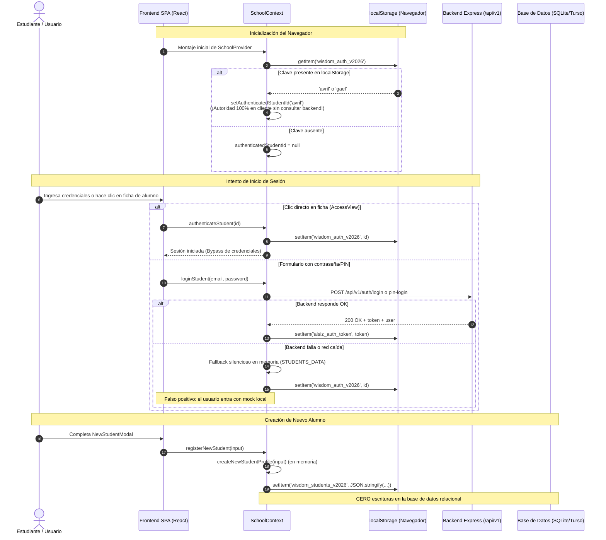

# Plan de Ejecución — Etapa 03: Conectar Interfaz, Autenticación y Creación de Cuentas en Base de Datos

**Plataforma Educativa ALSIZ — Ekballo Church**  
**Fecha:** 17 de Octubre de 2026  
**Rama de Trabajo:** `continuacion-produccion-etapa-03`  
**Commit Inicial:** `1a7964c` (`HEAD` sincronizado con `origin/main`)  
**Estado:** `PLANIFICACIÓN TÉCNICA Y DISEÑO DE ARQUITECTURA`

---

## 1. Diagnóstico del Flujo Actual Heredado y Dependencias de `SchoolContext`

### 1.1 Diagrama del Flujo Actual (Heredado / Inseguro)



### 1.2 Componentes que Dependen de `SchoolContext`

Se realizó el rastreo integral en el código fuente confirmando **27 componentes y hooks** que consumen directamente `useSchool()` o `useTeacherContext()`:

| Componente / Hook | Ruta del Archivo | Responsabilidad / Consumo de Contexto |
| :--- | :--- | :--- |
| `App.tsx` | `src/App.tsx` | Enrutamiento SPA, guardias de ruta, modales globales de auth y demo. |
| `Navbar.tsx` | `src/components/layout/Navbar.tsx` | Identidad activa, avatar, rol actual, disparador de logout y selector de vistas. |
| `Sidebar.tsx` | `src/components/layout/Sidebar.tsx` | Menú lateral contextual por rol (`student`, `representative`, `teacher`, `admin`). |
| `MobileBottomNav.tsx` | `src/components/layout/MobileBottomNav.tsx` | Navegación inferior táctil para dispositivos móviles. |
| `PageHeader.tsx` | `src/components/layout/PageHeader.tsx` | Saludo institucional, nombre del alumno activo y fecha del calendario. |
| `AccessView.tsx` | `src/components/auth/AccessView.tsx` | Portal unificado de selección de perfil y roles. |
| `StudentLoginModal.tsx` | `src/components/auth/StudentLoginModal.tsx` | Modal de inicio de sesión con correo, PIN o Google. |
| `AccountSettingsModal.tsx`| `src/components/auth/AccountSettingsModal.tsx` | Ajustes de cuenta, cambio de contraseña y PIN. |
| `LandingView.tsx` | `src/components/landing/LandingView.tsx` | Pantalla de bienvenida pública, fichas de acceso y botón Google. |
| `NewStudentModal.tsx` | `src/components/landing/NewStudentModal.tsx` | Formulario de registro de nuevo alumno. |
| `StudentDashboard.tsx` | `src/components/dashboard/StudentDashboard.tsx`| Panel del estudiante, materias inscritas, accesos directos de clase. |
| `DevocionalCard.tsx` | `src/components/dashboard/DevocionalCard.tsx` | Devocional diario adaptado al estudiante y día lectivo. |
| `SubjectsView.tsx` | `src/components/subjects/SubjectsView.tsx` | Malla curricular de asignaturas y cálculo de avance. |
| `CourseDetailView.tsx` | `src/components/subjects/CourseDetailView.tsx`| Detalle de unidades y microlecciones de una materia. |
| `DailyClassView.tsx` | `src/components/classes/DailyClassView.tsx` | Clase socrática del día, actividades interactivas y marcado de completitud. |
| `ClassTeacherChat.tsx` | `src/components/classes/ClassTeacherChat.tsx`| Chat contextual del profesor IA con la guía diaria. |
| `AITeacherDrawer.tsx` | `src/components/teacher/AITeacherDrawer.tsx` | Cajón global del tutor virtual socrático. |
| `ProgressView.tsx` | `src/components/progress/ProgressView.tsx` | Gráficos de avance competencial, horas lectivas y entregas. |
| `ScheduleView.tsx` | `src/components/schedule/ScheduleView.tsx` | Horario escolar semanal dinámico. |
| `ParentDashboard.tsx` | `src/components/parent/ParentDashboard.tsx` | Bitácora ministerial de homeschooling y supervisión de hijos. |
| `AdminShell.tsx` | `src/components/admin/AdminShell.tsx` | Consola administrativa unificada, usuarios, auditoría y telemetría. |
| `StudentAvatar.tsx` | `src/components/common/StudentAvatar.tsx` | Renderizado de foto o avatar generado con fallback. |
| `StudentPhotoModal.tsx` | `src/components/common/StudentPhotoModal.tsx`| Carga y guardado de foto del estudiante en servidor. |
| `SaveStatusIndicator.tsx`| `src/components/common/SaveStatusIndicator.tsx`| Indicador visual de estado de sincronización y guardado. |
| `DemoLockModal.tsx` | `src/components/demo/DemoLockModal.tsx` | Candado que restringe avance en perfiles de prueba. |
| `useHardwareBackButton.ts`| `src/hooks/useHardwareBackButton.ts` | Gestión de botón físico atrás en Android/tabletas. |
| `useSwipeBack.ts` | `src/hooks/useSwipeBack.ts` | Navegación por gestos táctiles en iPad/iOS. |

---

## 2. Diagrama del Flujo Objetivo (Autoridad Backend + Base de Datos Real)

```mermaid
sequenceDiagram
    autonumber
    actor Usuario as Estudiante / Representante / Admin
    participant React as Frontend SPA (React)
    participant ApiClient as apiClient (Centralizado)
    participant Ctx as SchoolContext
    participant Backend as Backend Express (/api/v1)
    participant DB as Base de Datos (SQLite/Turso)

    Note over React,DB: Inicialización Autorizada por el Backend
    React->>Ctx: Montaje de SchoolProvider (isSessionLoading = true)
    Ctx->>ApiClient: authApi.getMe() (credentials: 'include')
    ApiClient->>Backend: GET /api/v1/auth/me (Cookie HttpOnly alsiz_session)
    alt Sesión Válida en Base de Datos
        Backend->>DB: SELECT s.*, u.* FROM sessions s JOIN users u ...
        DB-->>Backend: Sesión activa y datos del usuario
        Backend-->>ApiClient: 200 OK { user: AuthUser }
        ApiClient-->>Ctx: User verificado
        Ctx->>Ctx: setAuthenticatedUser(user)<br/>setCurrentRole(user.role)
    else Sesión Expirada o Ausente
        Backend-->>ApiClient: 401 Unauthorized
        ApiClient-->>Ctx: No autenticado
        Ctx->>Ctx: setAuthenticatedUser(null)<br/>(Cero credenciales en localStorage)
    end
    Ctx-->>React: isSessionLoading = false

    Note over Usuario,DB: Login Seguro (Contraseña o PIN)
    Usuario->>React: Ingresa credenciales (email + pass o studentCode + pin)
    React->>Ctx: loginStudent(identifier, passOrPin)
    Ctx->>ApiClient: authApi.login() / authApi.pinLogin()
    ApiClient->>Backend: POST /api/v1/auth/login [credentials: include]
    Backend->>DB: Verifica scrypt hash + estado 'ACTIVE'
    alt Credenciales Válidas
        Backend->>DB: INSERT INTO sessions ...
        Backend->>DB: INSERT INTO audit_events (AUTH_SUCCESS)
        Backend-->>ApiClient: 200 OK + Set-Cookie: alsiz_session (HttpOnly; SameSite=Lax)
        ApiClient-->>Ctx: AuthUser
        Ctx->>Ctx: Actualiza estado global con datos de la BD
        Ctx-->>React: Redirección al espacio del rol correspondiente
    else Fallo de Credenciales / Inactiva / Error Red
        Backend-->>ApiClient: 401 / 403 con código de error Zod estructurado
        ApiClient-->>Ctx: ApiError tipado
        Ctx-->>React: Mensaje honesto (NO hay fallback a datos locales)
    end

    Note over Usuario,DB: Creación Administrativa de Cuentas
    Usuario->>React: Admin / Representante completa matrícula en BD
    React->>ApiClient: adminApi.createStudent(payload)
    ApiClient->>Backend: POST /api/v1/admin/students
    Backend->>DB: INSERT INTO users, students, student_representatives, enrollments
    Backend->>DB: INSERT INTO audit_events (STUDENT_ACCOUNT_CREATED)
    Backend-->>ApiClient: 201 Created + Credenciales Temporales de Entrega Privada
    ApiClient-->>React: Estudiante guardado en base de datos real
```

---

## 3. Estrategia de Implementación por Requisitos (1 al 10)

1. **Reemplazo de la Autoridad en Cliente:**
   - Eliminar `wisdom_auth_v2026` como factor de decisión de autenticación.
   - Usar `isSessionLoading` mientras `/api/v1/auth/me` responde.
   - Si `/api/v1/auth/me` responde 401, el usuario es un visitante no autenticado.

2. **Cliente API Centralizado y Tipado (`src/services/apiClient.ts`):**
   - Tipado riguroso con `ApiResponse<T>` y clase `ApiError`.
   - Soporte a `credentials: 'include'` en todas las peticiones para transportar la cookie segura `alsiz_session`.
   - Manejo seguro de respuestas HTML no deseadas (evitando excepciones en `res.json()`).
   - Mapeo de errores semánticos: `AUTH_INVALID_CREDENTIALS`, `AUTH_ACCOUNT_INACTIVE`, `FORBIDDEN_STUDENT_ACCESS`, `NETWORK_OFFLINE`, `SESSION_EXPIRED`.

3. **Contrato de Sesión HttpOnly:**
   - La cookie `alsiz_session` es la única portadora de la sesión.
   - Eliminar almacenamiento del token reutilizable en `localStorage` (`TOKEN_KEY`).
   - Implementar endpoints de cambio de contraseña (`/api/v1/auth/change-password`) y confirmación de reset.

4. **Sustitución del Auto-Registro Público por Creación Formal en BD:**
   - Crear endpoint en backend: `POST /api/v1/admin/students` (para Coordinación/Admin) y `POST /api/v1/representatives/students` (para Representante acreditado).
   - Escritura atómica en `users`, `students`, `student_representatives`, `student_program_enrollments` y `student_subject_enrollments`.
   - Modificar la UI para que la creación de cuentas solo ocurra dentro del flujo administrativo o del portal del representante verificado con consentimiento LOPDP.

5. **Funciones Administrativas con Mínimo Privilegio y Auditoría:**
   - Creación, activación, suspensión (`PATCH /api/v1/admin/users/:userId/status`) y reseteo seguro de credenciales (`POST /api/v1/admin/users/:userId/reset-credentials`).
   - Generación de contraseñas y PIN criptográficamente aleatorios; almacenamiento únicamente con hash `scrypt`.
   - Registro estricto en `audit_events` garantizando que contraseñas y PIN en texto plano NUNCA se escriban en logs.

6. **Separación de Sesión de Aplicación y Datos de Presentación:**
   - `localStorage` se limita a preferencias no sensibles (tema UI visual, día seleccionado en el calendario) y caché transitoria no crítica.
   - Expedientes, identidades, notas, asignaturas y entregas se cargan y persisten exclusivamente en la base de datos vía API.

7. **Revisión de Google Sign-In:**
   - Crear endpoint `POST /api/v1/auth/google` en el servidor con validación de ID Token mediante Google tokeninfo API.
   - Si no está configurado `VITE_GOOGLE_CLIENT_ID` o no hay credenciales, deshabilitar limpiamente el botón informando al usuario, sin permitir accesos ficticios.

8. **Verificación de Aislamiento Anti-IDOR / Anti-BOLA:**
   - Pruebas automatizadas de aislamiento entre las familias sintéticas 1 y 2 (`stu-01` / `rep-01` vs `stu-02` / `rep-02`).
   - Confirmación de rechazos 403 y registro en `audit_events`.

9. **Mensajes de Pantalla Honestos y Específicos:**
   - En `StudentLoginModal.tsx` y `AccessView.tsx`: feedback diferenciado para error de credenciales, cuenta suspendida, falla de red / API no disponible y sesión expirada. Cero fallbacks silenciosos.

10. **Pruebas de Integración End-to-End:**
    - Script `scripts/test-etapa-03.ts` que valida el ciclo completo: creación administrativa sintética -> login -> recarga simulada por `/me` -> prueba Anti-IDOR -> suspensión -> revocación.

---

## 4. Matriz de Aceptación Preliminar

| Requisito | Criterio de Verificación | Método |
| :--- | :--- | :--- |
| **R1: Autoridad Backend** | Sin cookie válida en `/me`, el estado en React es no autenticado aunque `localStorage` contenga IDs. | Prueba automatizada + inspección |
| **R2: Cliente API Tipado** | Maneja respuestas no-JSON, errores 401/403/503 y expone tipos TypeScript limpios. | `tsc --noEmit` + Suite de pruebas |
| **R3: Sesión HttpOnly** | No se guarda `alsiz_auth_token` en `localStorage`; la sesión sobrevive a recarga vía cookie. | Test E2E + Navegador |
| **R4: Creación de Alumnos en BD** | Registrar un alumno inserta registros coherentes en las 5 tablas relacionales correspondientes. | Test de integración DB |
| **R5: Gestión y Auditoría** | Suspensión de cuenta invalida sesión de inmediato; reseteo genera hash y audita sin secretos en log. | Test de auditoría |
| **R6: Separación de Almacenes** | Cuentas, notas y progreso no se consideran válidos desde `localStorage`. | Revisión de código |
| **R7: Google Sign-In Seguro** | Se valida en servidor o se desactiva elegantemente sin bypass. | Test de validación |
| **R8: Aislamiento Familiar** | Acceso cruzado entre estudiantes sintéticos 1 y 2 es bloqueado con 403 y auditado. | Test Anti-IDOR |
| **R9: Feedback Honesto** | La UI diferencia claramente error de credenciales, desconexión y suspensión. | Inspección de componentes |
| **R10: Verificación E2E** | Alumno sintético creado por API inicia sesión, recarga con éxito y es suspendido. | `npm run test:etapa03` |

