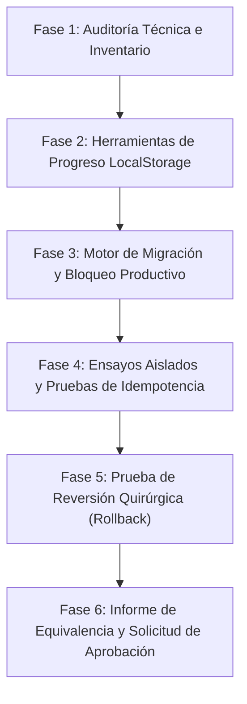

# Plan de Trabajo — Etapa 04: Preparar y Ejecutar la Migración Controlada de Gael y Avril

**Plataforma Educativa ALSIZ — Ekballo Church**  
**Fecha:** 17 de Octubre de 2026  
**Rama de Trabajo:** `continuacion-produccion-etapa-04`  
**Commit Inicial:** `85b7af7`  
**Repositorio:** `https://github.com/rpmministry/plataforma-educativa-alsiz`  
**Estado:** `PLANIFICADO Y EN EJECUCIÓN CONTROLADA`

---

## 1. Contexto y Objetivos

### 1.1 Objetivo General
Trasladar los perfiles académicos de **Gael** (4.º Grado EGB Elemental) y **Avril** (8.º Grado EGB Superior), sus asignaturas, unidades curriculares, clases socráticas, objetivos pedagógicos, recursos didácticos y calendarios desde las fuentes de datos del proyecto hacia la base de datos relacional normalizada de la Plataforma Educativa ALSIZ, sin pérdida de contenido, preservando la integridad referencial y cumpliendo con la Ley Orgánica de Protección de Datos Personales (LOPDP).

### 1.2 Premisa de Seguridad Crítica
La Etapa 11 histórica fue un ensayo conceptual, no una migración productiva. Se auditarán `scripts/migrate-students.ts` y `server/migration/legacyMigrationEngine.ts`. Bajo ninguna circunstancia se retirará el bloqueo productivo sin implementar un control de aprobación de múltiples factores (token criptográfico, respaldo validado con checksum, confirmación de base de datos destino y commit de código). **Ninguna migración sobre la base de producción se ejecutará sin aprobación humana explícita.**

---

## 2. Inventario y Fuente Autoritativa por Entidad

| Entidad | Fuente Origen en Repositorio | Destino en Base de Datos | Carácter de Fuente | Estrategia de Migración |
| :--- | :--- | :--- | :--- | :--- |
| **Programas y Niveles** | `mockData.ts`, `avrilCurriculumDataPart*.ts`, `gaelCurriculumDataPart*.ts` | `programs`, `levels` | Autoritativa (Git) | Idempotente (`prog-homeschool`, `lvl-elem-4`, `lvl-sup-8`). |
| **Periodos Académicos** | `mockData.ts` (Plan Lectivo 2026-2027) | `academic_periods` | Autoritativa (Git) | Inserción de 3 trimestres oficiales con fechas exactas. |
| **Estudiantes** | `mockData.ts` (`STUDENTS_DATA`: Avril y Gael) | `users`, `students` | Autoritativa (Git) | IDs estables (`usr-real-avril`, `stu-real-avril`, `usr-real-gael`, `stu-real-gael`). Códigos únicos (`ALSIZ-8VO-AVR`, `ALSIZ-4TO-GAE`). |
| **Representante Legal** | `contactInfo.ts` (Mauricio Andrade Luna) | `users`, `representatives`, `student_representatives` | Autoritativa (Git) | Creación con `role='REPRESENTATIVE'`. Vínculo paterno con custodia compartida/primaria. Campos ausentes marcados como `PENDIENTE_VERIFICACION`. |
| **Credenciales Iniciales** | Generación Criptográfica Servidor | `users.password_hash`, `students.pin_code_hash` | Procedimiento Seguro | **PROHIBIDO** importar contraseñas locales planas (`avril`, `gael`). Derivación segura mediante `scrypt` con sal criptográfica y flag de reseteo inicial. |
| **Asignaturas (20)** | `mockData.ts` (`RAW_AVRIL_SUBJECTS`, `RAW_GAEL_SUBJECTS`) | `subjects`, `student_subject_enrollments` | Autoritativa (Git) | 11 materias EGB Superior + 9 materias EGB Elemental. 100% matriculadas para cada estudiante. |
| **Unidades Curriculares (42)**| `avrilCurriculumDataPart1-4.ts`, `gaelCurriculumDataPart1-4.ts` | `curriculum_units` | Autoritativa (Git) | 33 unidades EGB Superior + 9 unidades EGB Elemental. |
| **Clases Socráticas (43)** | `dailyClassesAvril.ts` (23) y `dailyClassesGael.ts` (20) | `daily_classes` | Autoritativa (Git) | Desambiguación de colisiones legadas (`-dup2`). Vinculación a unidades correspondientes. |
| **Objetivos de Lección** | `dailyClasses*.ts` (`objective`) | `lesson_objectives` | Autoritativa (Git) | 43 objetivos socráticos mapeados a lección y unidad. |
| **Recursos Didácticos (86)**| `dailyClasses*.ts` (`resources`) | `learning_resources` | Autoritativa (Git) | Auditoría y categorización (`PHET_SIMULATION`, `INTERACTIVE_LAB`, `PDF`, `VIDEO`, `LINK`). Detección de enlaces rotos o simulados. |
| **Evaluaciones Formativas (129)**| `dailyClasses*.ts` (`activities`) | `evaluations` | Autoritativa (Git) | Mapeo a tipos oficiales: `PROJECT_RUBRIC`, `SOCRATIC_DIALOGUE`, `PORTFOLIO_EVIDENCE`. Cero notas falsas. |
| **Calendario y Proyectos** | `mockData.ts` (`academicPlan.projects`) | `academic_calendar_events` | Autoritativa (Git) | 4 proyectos integradores con entregables y fechas límite. |
| **Progreso en Navegador** | `localStorage` del dispositivo físico del usuario | `student_submissions`, `daily_classes.isCompleted` | **No disponible en Git** | Desarrollo de exportador/importador controlado `alsiz_device_progress_export.json` para ingesta bajo demanda. |

---

## 3. Plan de Fases de Ejecución

### Fase 1: Auditoría Técnica e Inventario sin Escritura
- Inspeccionar exhaustivamente `scripts/migrate-students.ts` y `server/migration/legacyMigrationEngine.ts`.
- Validar las discrepancias encontradas en la Etapa 11 (omisión de representante, uso de contraseñas de mockData).
- Catalogar colisiones de IDs (`class-mat-avril-02`, etc.) y recursos didácticos que requieren actualización.

### Fase 2: Herramientas de Progreso LocalStorage
- Crear utilidad exportadora para el navegador (`src/utils/localStorageMigrationExporter.ts`) para que el administrador pueda extraer progreso del dispositivo físico original de los estudiantes si así lo decide.
- Crear motor importador con validación Zod en backend (`server/migration/localProgressImporter.ts`).
- Documentar las instrucciones de extracción en el manual administrativo.

### Fase 3: Fortalecimiento del Motor de Migración y Bloqueo de Producción
- Actualizar `server/migration/legacyMigrationEngine.ts`:
  - Incluir creación formal de usuario representante (`usr-real-rep-mauricio`) y perfil en `representatives`.
  - Crear vínculos en `student_representatives` para ambos alumnos.
  - Implementar generación de credenciales seguras vía `scrypt` (cero texto plano, cero importación de `student.password`).
  - Marcar campos pendientes de verificación oficial (cédula del representante, dirección, fecha exacta de nacimiento, firma de consentimiento LOPDP).
  - Usar IDs estables y semánticos (`usr-real-avril`, `stu-real-avril`, etc.).
- Actualizar `scripts/migrate-students.ts`:
  - Blindar el modo `--production` con control de aprobación de múltiples factores (token de aprobación, confirmación de hash de respaldo, ruta exacta de BD, hash de commit Git).

### Fase 4: Ensayos Aislados, Integridad e Idempotencia
- Ejecutar dry-run en memoria (`:memory:`).
- Ejecutar migración sobre base de datos SQLite de staging aislada (`data/test_alsiz_staging_etapa04.db`).
- Comprobar integridad referencial (`PRAGMA foreign_key_check`), cero registros huérfanos.
- Ejecutar una segunda vez consecutiva sobre la misma base para certificar **idempotencia estricta** (cero duplicados).

### Fase 5: Prueba de Reversión Quirúrgica
- Ejecutar rollback sobre una copia de prueba y validar que todos los registros migrados se eliminan en cascada sin dejar residuos ni alterar usuarios sintéticos previos (`usr-admin-01`, etc.).

### Fase 6: Informe de Equivalencia y Cierre de Etapa
- Generar reporte anonimizado con conteos exactos, estado de verificación de campos y clasificación de recursos.
- Correr pruebas de regresión completas (Etapa 02, Etapa 03, Seguridad P0, Lint y Build).
- Documentar en `docs/ejecucion/continuacion-produccion/ETAPA-04/` según la convención `00` a `06`.
- **DETENERSE:** Solicitar aprobación humana explícita antes de cualquier ejecución en producción.

---

## 4. Matriz de Aceptación

| Criterio | Meta | Método de Verificación |
| :--- | :--- | :--- |
| **Identidad Curricular** | Gael: 4.° EGB Elemental; Avril: 8.° EGB Superior | Verificación de matrículas y niveles contra especificación oficial. |
| **Aislamiento de Producción** | 0 escrituras en base de producción sin aprobación | Verificación de timestamp y checksum de `data/alsiz.db`. |
| **Vínculos Familiares** | 2 estudiantes vinculados a su representante legal | Verificación de claves foráneas en `student_representatives`. |
| **Seguridad de Credenciales** | Cero contraseñas importadas de mockData; uso de `scrypt` | Inspección de hashes y ausencia de texto claro en auditoría. |
| **Preservación de Contenido** | 20 asignaturas, 42 unidades, 43 clases, 86 recursos, 129 actividades | Conteos comparativos de origen vs. destino. |
| **Idempotencia** | 2 ejecuciones consecutivas = 0 duplicados | Test automatizado en staging. |
| **Reversibilidad** | Rollback elimina exactamente los registros migrados | Test automatizado de reversión. |
| **Progreso LocalStorage** | Exportador/Importador disponible con guía operativa | Pruebas unitarias de parsing y documentación de uso. |

