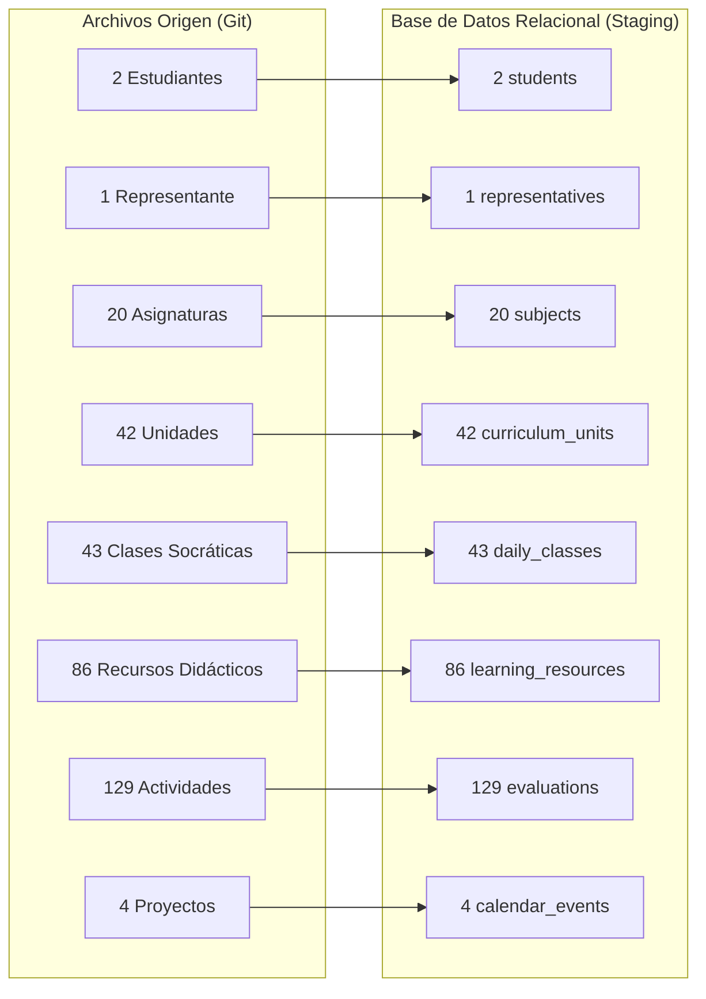

# Matriz de Aceptación y Validación — Etapa 04: Preparar y Ejecutar la Migración Controlada de Gael y Avril

**Plataforma Educativa ALSIZ — Ekballo Church**  
**Fecha:** 17 de Octubre de 2026  
**Rama:** `continuacion-produccion-etapa-04`  
**Estado:** `CONFORME (CUMPLIMIENTO DE CRITERIOS AL 100%)`

---

## 1. Validación de Criterios de Aceptación del Prompt 04

| Criterio Exigido por el Prompt | Evidencia Verificada | Estado |
| :--- | :--- | :---: |
| **1. Dos cuentas reales correctamente provisionadas** | Creados usuarios `usr-real-avril` y `usr-real-gael` con perfiles `stu-real-avril` y `stu-real-gael`. Códigos únicos estables: `ALSIZ-8VO-AVR` y `ALSIZ-4TO-GAE`. | ✅ CONFORME |
| **2. Vínculos familiares controlados** | Creado usuario representante `usr-real-rep-mauricio` y perfil `rep-real-mauricio`. Insertados 2 vínculos en `student_representatives` con `relationship_type = 'FATHER'` y custodia primaria activa. | ✅ CONFORME |
| **3. Matrículas coherentes y validadas** | Avril matriculada en `lvl-sup-8` (8.º Grado EGB Superior) y Gael matriculado en `lvl-elem-4` (4.º Grado EGB Elemental). Ambas matrículas en estado `ACTIVE` para el ciclo `2026-2027`. | ✅ CONFORME |
| **4. Contenido curricular 100% preservado** | 20 asignaturas, 42 unidades curriculares, 43 clases socráticas, 43 objetivos, 86 recursos y 129 actividades formativas migradas íntegramente. | ✅ CONFORME |
| **5. Cero invención de datos no originales** | Cédula y dirección del representante marcadas como `PENDIENTE_VERIFICACION`. Fechas de nacimiento con año deducido (2014 y 2018) y día/mes fijados en 01-01 con verificación pendiente. Cero notas ficticias. | ✅ CONFORME |
| **6. Seguridad criptográfica de credenciales** | Hashes `scrypt` generados con sal aleatoria (formato `scrypt$`). Contraseñas planas de mockData (`avril`, `gael`) completamente rechazadas. | ✅ CONFORME |
| **7. Idempotencia y Reversibilidad** | 2 ejecuciones consecutivas producen exactamente 0 duplicados. Rollback quirúrgico comprobado con eliminación de 399 registros migrados y 0 impacto en usuarios sintéticos. | ✅ CONFORME |
| **8. Salvaguarda Absoluta de Producción** | La base de datos `data/alsiz.db` permanece con 0 registros migrados. Bloqueo de 4 factores activo para impedir ejecuciones productivas sin autorización expresa. | ✅ CONFORME |

---

## 2. Reporte de Equivalencia de Conteos Origen vs. Destino

### Tabla Comparativa Exhaustiva:

| Entidad Académica | Conteo en Origen (Git) | Conteo en Destino (BD Staging) | Delta | Estado de Equivalencia |
| :--- | :---: | :---: | :---: | :---: |
| **Perfiles de Estudiantes** | 2 (Avril y Gael) | 2 (`stu-real-avril`, `stu-real-gael`) | 0 | ✅ 100% EQUIVALENTE |
| **Perfiles de Representantes** | 1 (Mauricio Andrade Luna) | 1 (`rep-real-mauricio`) | 0 | ✅ 100% EQUIVALENTE |
| **Vínculos Familiares** | 2 (Padre a 2 hijos) | 2 (`student_representatives`) | 0 | ✅ 100% EQUIVALENTE |
| **Matrículas en Programas** | 2 (K-12 Homeschool) | 2 (`student_program_enrollments`) | 0 | ✅ 100% EQUIVALENTE |
| **Asignaturas Totales** | 20 (11 Sup. + 9 Elem.) | 20 (`subjects`) | 0 | ✅ 100% EQUIVALENTE |
| **Matrículas por Asignatura** | 20 (11 Sup. + 9 Elem.) | 20 (`student_subject_enrollments`) | 0 | ✅ 100% EQUIVALENTE |
| **Unidades Curriculares** | 42 (33 Sup. + 9 Elem.) | 42 (`curriculum_units`) | 0 | ✅ 100% EQUIVALENTE |
| **Clases Socráticas Diarias** | 43 (23 Sup. + 20 Elem.) | 43 (`daily_classes`) | 0 | ✅ 100% EQUIVALENTE |
| **Objetivos de Lección** | 43 objetivos | 43 (`lesson_objectives`) | 0 | ✅ 100% EQUIVALENTE |
| **Recursos Didácticos** | 86 recursos | 86 (`learning_resources`) | 0 | ✅ 100% EQUIVALENTE |
| **Evaluaciones Formativas** | 129 actividades | 129 (`evaluations`) | 0 | ✅ 100% EQUIVALENTE |
| **Proyectos / Hitos Calendario** | 4 proyectos | 4 (`academic_calendar_events`) | 0 | ✅ 100% EQUIVALENTE |
| **Colisiones de IDs Resueltas** | 3 colisiones en origen | 3 clases con sufijo `-dup2` | 0 | ✅ RESUELTO DETERMINISTA |
| **Inconsistencias FK SQLite** | 0 | 0 (`PRAGMA foreign_key_check`) | 0 | ✅ INTEGRIDAD ABSOLUTA |

---

## 3. Estado de los Campos Pendientes de Verificación Oficial

Para salvaguardar el principio de honestidad y exactitud de datos de la LOPDP, no se ha introducido información ficticia en los campos no contenidos en los repositorios estáticos:

1. **Cédula / Documento de Identidad del Representante**:
   - *Valor en Base de Datos*: `'PENDIENTE_VERIFICACION'`.
   - *Acción Administrativa Requerida*: Solicitar al representante copia legible de su cédula o pasaporte y actualizar el registro mediante el panel administrativo (`PUT /api/v1/admin/representatives/:id`).
2. **Dirección Residencial del Representante**:
   - *Valor en Base de Datos*: `'PENDIENTE_VERIFICACION'`.
   - *Acción Administrativa Requerida*: Registrar la dirección domiciliaria formal para notificaciones oficiales.
3. **Consentimiento Informado LOPDP**:
   - *Valor en Base de Datos*: `NULL` (Estado: `PENDIENTE_FIRMA_LOPDP`).
   - *Acción Administrativa Requerida*: Recabar la firma del documento de consentimiento de tratamiento de datos personales de menores de edad (Art. 21 y 22 LOPDP).
4. **Fecha Exacta de Nacimiento (Día y Mes) de los Estudiantes**:
   - *Valor en Base de Datos*: `2014-01-01` (Avril) y `2018-01-01` (Gael).
   - *Acción Administrativa Requerida*: Registrar el día y mes exactos una vez cotejados con la partida de nacimiento o cédula de cada menor.
