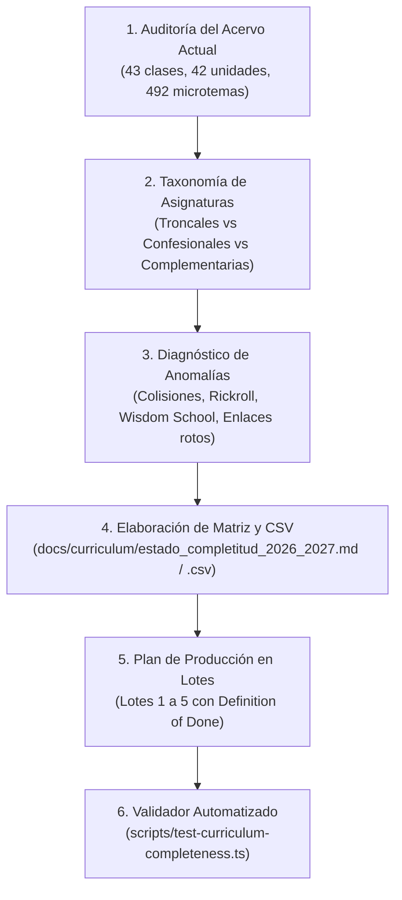

# Plan de Trabajo — Etapa 05: Auditoría de Completitud de la Malla Curricular y Calendario Anual

**Plataforma Educativa ALSIZ — Ekballo Church**  
**Fecha:** 17 de Octubre de 2026  
**Rama de Trabajo:** `continuacion-produccion-etapa-05`  
**Commit Inicial:** `1bc8469 docs(etapa-04): documentacion de cierre y evidencias de migracion controlada`  
**Repositorio Remoto:** `https://github.com/rpmministry/plataforma-educativa-alsiz`  
**Estado:** `PLANIFICADO Y EJECUTADO (AUDITORÍA EXHAUSTIVA)`

---

## 1. Contexto y Objetivos

### 1.1 Objetivo General
Determinar con precisión matemática y pedagógica el estado real de completitud de la malla curricular para **Gael** (4.º Grado EGB Elemental) y **Avril** (8.º Grado EGB Superior) frente al calendario escolar de 200 días laborables (Año Lectivo 2026-2027), contrastando las fuentes oficiales vigentes del Ministerio de Educación del Ecuador (MINEDUC), los estándares internacionales de referencia (Virginia SOL / MCER) y la cosmovisión doctrinal de Ekballo Church, **antes de autorizar cualquier generación masiva de contenido**.

### 1.2 Principio Rector: Bloqueo Preventivo de Contenido Masivo
Bajo ninguna circunstancia se generarán lecciones masivas sintéticas sin contar previamente con:
1. Una matriz de correspondencia verificada que aísle las anomalías de la línea base (colisiones de claves primarias, enlaces rotos, placeholders y dominios extintos).
2. Un calendario validado que contraste el horario adaptativo de homeschooling (25 sesiones semanales) con los requisitos formales del MINEDUC (30 a 35 horas pedagógicas).
3. Un validador automatizado reproducible que certifique la cobertura y que falle de manera estricta ante ausencias curriculares.

---

## 2. Alcance y Tareas Planificadas

### Tarea 1: Diagnóstico Cuantitativo del Acervo Legado
- Inspeccionar exhaustivamente `src/data/mockData.ts`, `dailyClassesAvril.ts`, `dailyClassesGael.ts`, `gaelCurriculumDataPart*.ts` y `avrilCurriculumDataPart*.ts`.
- Contabilizar asignaturas, unidades, microcurrículos, clases diarias socráticas, actividades formativas y recursos.

### Tarea 2: Taxonomía y Separación Rigurosa de Materias
- Clasificar formalmente las materias en tres categorías sin sustitución indebida:
  - **Troncales Obligatorias MINEDUC** (7 materias por subnivel).
  - **Formación Cristiana Institucional** (*Relación con Dios* — Ekballo Church).
  - **Complementarias Siglo XXI** (*Software*, *Ciencias Políticas*, *Administración y Marketing*).

### Tarea 3: Auditoría Técnica de Anomalías y Clasificación de Recursos
- Identificar colisiones de ID en clases diarias y recursos.
- Clasificar los recursos en los 5 estados canónicos: `CONSERVAR`, `REEMPLAZAR`, `REGENERAR`, `RETIRAR` o `REVISIÓN HUMANA`.

### Tarea 4: Construcción de la Matriz y CSV de Seguimiento
- Generar el informe integral `docs/curriculum/estado_completitud_2026_2027.md`.
- Generar el CSV estructurado `docs/curriculum/matriz_seguimiento_curriculo_2026_2027.csv` con trazabilidad fila por fila de cada sesión, unidad, objetivo, recurso, estado y fuente oficial.

### Tarea 5: Plan de Producción de Contenido en Lotes
- Dividir la producción futura en 5 lotes manejables (Saneamiento Línea Base, Malla Macro 4.° EGB, Trimestre 1 restante, Trimestre 2 completo y Trimestre 3 de cierre).
- Definir criterios de aceptación de calidad (Definition of Done) para cada lote.

### Tarea 6: Validador Automatizado de Brechas
- Desarrollar `scripts/test-curriculum-completeness.ts` para verificar cobertura, unicidad, fechas, recursos y competencias, asegurando que la prueba falle de forma estricta ante inconsistencias no resueltas.

