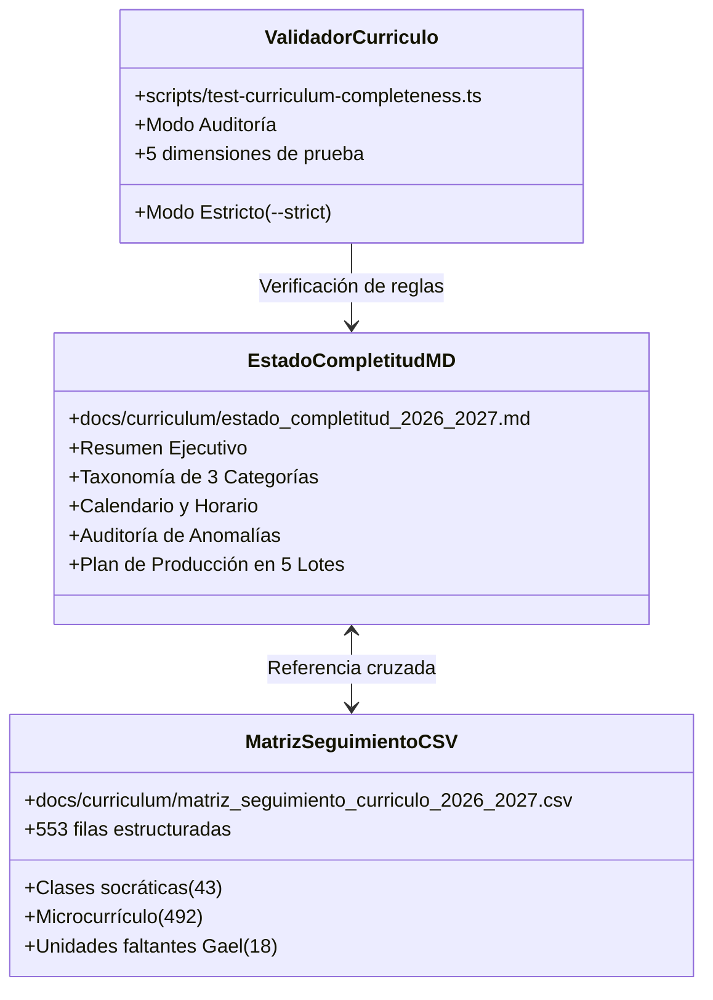

# Registro de Cambios — Etapa 05: Auditoría de Completitud Curricular y Calendario Anual

**Plataforma Educativa ALSIZ — Ekballo Church**  
**Fecha:** 17 de Octubre de 2026  
**Rama:** `continuacion-produccion-etapa-05`  
**Commit Inicial:** `1bc8469`

---

## 1. Resumen de Archivos Creados y Modificados

En estricto cumplimiento del principio de no realizar refactorizaciones oportunistas ni generar lecciones masivas antes de la aprobación humana de la auditoría, los cambios de esta etapa se circunscriben al análisis, catalogación, generación de matrices y herramientas de validación:

---

## 2. Inventario Detallado de Artefactos Creados

### 2.1 Documentación y Matrices Curriculares

1. **[`docs/curriculum/estado_completitud_2026_2027.md`](file:///c:/Users/Alsiz/Documents/plataforma%20educativa%20ALSIZ/docs/curriculum/estado_completitud_2026_2027.md)**:
   - Diagnóstico integral de la malla curricular para 4.º EGB Elemental (Gael) y 8.º EGB Superior (Avril).
   - Taxonomía explícita de las tres categorías: Troncales MINEDUC (7 asignaturas), Formación Cristiana (1 asignatura) y Complementarias Siglo XXI (1 en Gael, 3 en Avril).
   - Contraste de carga horaria: 25 bloques semanales (horario socrático adaptativo de homeschool) vs. 30-35 horas formales MINEDUC.
   - Diagnóstico de anomalías técnicas (3 colisiones de clase, 6 de recursos, 43 PDFs de dominio extinto, 35 enlaces temáticos a `wisdomschool.ec`, 25 placeholders Rickroll y 9 anclajes rotos).
   - Clasificación de 578 recursos didácticos bajo las 5 decisiones oficiales: `CONSERVAR` (74), `REEMPLAZAR` (25), `REGENERAR` (78), `RETIRAR` (9) y `REVISIÓN HUMANA` (392).
   - Plan de Producción de Contenido dividido en 5 Lotes con criterios verificables de calidad (Definition of Done).

2. **[`docs/curriculum/matriz_seguimiento_curriculo_2026_2027.csv`](file:///c:/Users/Alsiz/Documents/plataforma%20educativa%20ALSIZ/docs/curriculum/matriz_seguimiento_curriculo_2026_2027.csv)**:
   - Archivo CSV con 553 filas y 16 columnas estandarizadas:
     - `estudiante_grado`: Grado y nombre del menor.
     - `materia`: Nombre de la asignatura.
     - `codigo_materia`: Clave alfanumérica única (`LEN-401`, `MAT-801`, etc.).
     - `categoria_materia`: `TRONCAL_MINEDUC`, `FORMACION_CRISTIANA` o `COMPLEMENTARIA_SIGLO_XXI`.
     - `trimestre`: 1, 2 o 3.
     - `unidad`: Título de la unidad macrocurricular.
     - `semana`: Posición semanal en el año escolar (Semanas 1 a 40).
     - `fecha_o_posicion_temporal`: Fecha calendario ISO (`2026-09-07`) o posición ordinal de sesión.
     - `objetivo_curricular`: Meta formativa de aprendizaje.
     - `tipo_clase`: `CLASE_SOCRATICA_DIARIA`, `MICROCURRICULO_SESION` o `UNIDAD_MACRO_FALTANTE`.
     - `recurso`: Recurso didáctico asociado (título, plataforma y URL).
     - `decision_recurso`: Decisión pedagógica formal (`CONSERVAR`, `REEMPLAZAR`, `REGENERAR`, `RETIRAR`, `REVISIÓN HUMANA`, `SIN_RECURSO`).
     - `idioma`: Español, Inglés o Bilingüe.
     - `estado`: `COMPLETA`, `PARCIAL_SIN_DCD`, `RECURSO_INVALIDO`, `ID_DUPLICADO`, `PENDIENTE_GENERACION`.
     - `fuente_oficial`: Estándar oficial aplicable (MINEDUC DCD, Virginia SOL, Ekballo Church).
     - `evidencia_pendiente`: Acciones pendientes y requerimientos de validación.

### 2.2 Scripts de Auditoría y Validación

3. **[`scripts/test-curriculum-completeness.ts`](file:///c:/Users/Alsiz/Documents/plataforma%20educativa%20ALSIZ/scripts/test-curriculum-completeness.ts)**:
   - Suite automatizada ejecutable mediante `npx tsx scripts/test-curriculum-completeness.ts`.
   - Modos de ejecución: modo auditoría (diagnóstico informativo con guardado de evidencias) y modo estricto (`--strict`, finaliza con código de salida `1` al detectar fallos).
   - Valida 12 reglas en 5 dimensiones:
     1. Cobertura de asignaturas, unidades trimestrales y lecciones frente a los 200 días lectivos.
     2. Unicidad absoluta de identificadores de clases y recursos.
     3. Coherencia de fechas de calendario, día de semana y rango temporal.
     4. Calidad de recursos web (detección de placeholders `dQw4w9WgXcQ` y dominios obsoletos).
     5. Asignación de fuentes oficiales y destrezas con criterio de desempeño (DCD).

4. **Scripts de Inspección Especializada**:
   - `scripts/generate-curriculum-audit-matrix.ts`: Generador reproducible de la matriz CSV de 553 filas.
   - `scripts/audit-curriculum-deep.ts`: Analizador en profundidad de anomalías en clases diarias y recursos.
   - `scripts/audit-classify-resources.ts`: Clasificador masivo de recursos en las 5 categorías oficiales.

### 2.3 Carpeta de Evidencias y Documentación de Cierre
- `docs/ejecucion/continuacion-produccion/ETAPA-05/`:
  - `00_PLAN.md`
  - `01_CAMBIOS.md`
  - `02_PRUEBAS.md`
  - `03_VALIDACION.md`
  - `04_RIESGOS_Y_DECISIONES.md`
  - `05_REVERSA.md`
  - `06_CIERRE.md`
  - `evidencias/01_auditoria_completa_output.txt`
  - `evidencias/02_validador_curriculo_output.txt`
  - `evidencias/03_recursos_clasificacion_audit.txt`

