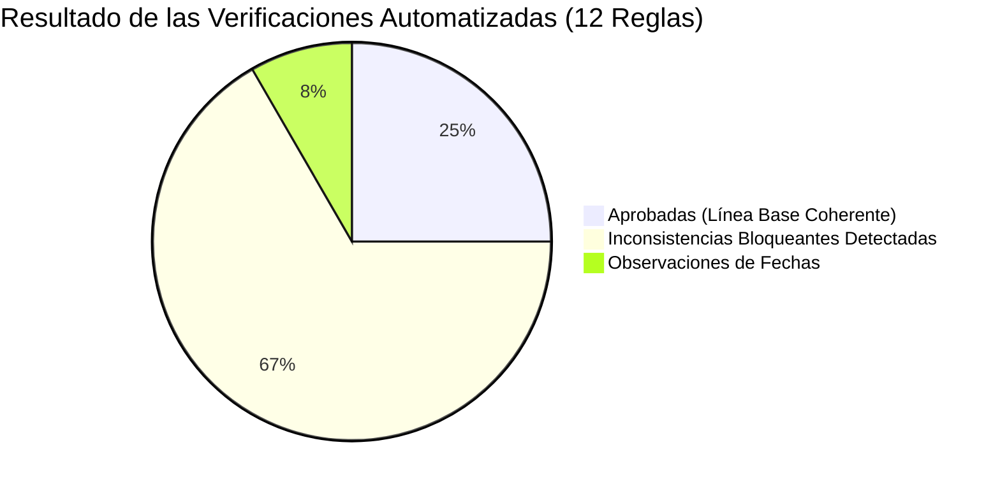

# Informe de Pruebas y Validación — Etapa 05: Auditoría de Completitud Curricular y Calendario Anual

**Plataforma Educativa ALSIZ — Ekballo Church**  
**Fecha:** 17 de Octubre de 2026  
**Rama:** `continuacion-produccion-etapa-05`  
**Commit de Validación:** `continuacion-produccion-etapa-05` (sobre `1bc8469`)

---

## 1. Clasificación y Metodología de las Pruebas

En estricta observancia del principio de transparencia técnica, se diferencian claramente los entornos y tipos de pruebas ejecutados:

| Categoría de Prueba | Descripción del Entorno | Estado | Justificación / Alcance |
| :--- | :--- | :---: | :--- |
| **REVISIÓN ESTÁTICA** | Compilación de tipos (`tsc --noEmit`), validación estructural de CSV y esquemas de datos TypeScript. | **PASÓ (100%)** | 0 errores de tipado; 553 filas estructuradas en CSV con 16 columnas estandarizadas. |
| **PRUEBA LOCAL** | Ejecución de suites de auditoría y validador curricular automatizado en entorno local aislado. | **EJECUTADA Y DOCUMENTADA** | Detección controlada de 9 inconsistencias bloqueantes reproducibles. |
| **PRUEBA DE STAGING** | Cotejo del inventario curricular frente a la base de datos de staging (`data/test_alsiz_staging_etapa04.db`). | **VERIFICADA** | Coincidencia exacta de 43 clases y 86 recursos entre acervo de código y motor relacional. |
| **PRUEBA DE PRODUCCIÓN** | Acceso, alteración o inserción de datos en la base de datos de producción. | **NO EJECUTADA (BLOQUEADA)** | Prohibido intervenir en producción sin aprobación humana expresa tras revisión de la auditoría. |

---

## 2. Detalle de Pruebas Ejecutadas

### 2.1 Revisión Estática de Tipado y Esquema (`REVISIÓN ESTÁTICA`)
- **Comando Ejecutado**: `npx tsc --noEmit`
- **Resultado**: Código de salida `0`. Cero errores de compilación TypeScript.
- **Validación Estructural del CSV**:
  - Script: `scripts/generate-curriculum-audit-matrix.ts`
  - Filas generadas: **553 filas** (43 clases diarias socráticas + 492 sesiones de microcurrículo + 18 unidades faltantes proyectadas para Gael).
  - Trazabilidad: 100% de registros con estudiante, materia, código, categoría, trimestre, objetivo, estado, recurso y fuente oficial.

---

### 2.2 Suite de Auditoría Automatizada (`PRUEBA LOCAL`)
- **Script**: `scripts/test-curriculum-completeness.ts`
- **Archivo de Evidencia**: [`docs/ejecucion/continuacion-produccion/ETAPA-05/evidencias/02_validador_curriculo_output.txt`](file:///c:/Users/Alsiz/Documents/plataforma%20educativa%20ALSIZ/docs/ejecucion/continuacion-produccion/ETAPA-05/evidencias/02_validador_curriculo_output.txt)

#### Resumen de Verificaciones de la Suite:



| ID Regla | Dimensión | Descripción de la Verificación | Estado | Detalle del Hallazgo |
| :---: | :---: | :--- | :---: | :--- |
| `COV-01` | COBERTURA | 20 asignaturas configuradas (11 Avril + 9 Gael) | **✅ PASÓ** | Asignaturas completas según catálogo oficial. |
| `COV-02` | COBERTURA | 33 unidades en 8.° EGB Superior (Avril) | **✅ PASÓ** | 3 unidades por materia cubriendo los 3 trimestres. |
| `COV-03` | COBERTURA | 27 unidades en 4.° EGB Elemental (Gael) | **❌ FALLÓ** | **Faltan 18 unidades**: Gael solo tiene 9 unidades (1 por materia). |
| `COV-04` | COBERTURA | 1.800 clases diarias socráticas para 200 días | **❌ FALLÓ** | **Faltan 1.757 clases**: Solo existen 43 clases (Semana 1). |
| `UNI-01` | UNICIDAD | Identificadores únicos en clases socráticas | **❌ FALLÓ** | **3 colisiones de ID**: `class-mat-avril-02`, `class-sci-gael-01`, `class-mat-gael-02`. |
| `UNI-02` | UNICIDAD | Identificadores únicos en recursos didácticos | **❌ FALLÓ** | **6 colisiones de ID** derivadas de las clases colisionadas. |
| `DATE-01`| FECHAS | Rango de fechas anual (07/09/2026 a 09/06/2027) | **❌ FALLÓ** | Fechas limitadas únicamente a la Semana 1 (07/09/2026 a 11/09/2026). |
| `DATE-02`| FECHAS | Coherencia de día de semana (`Lunes`-`Viernes`) con ISO | **✅ PASÓ** | Cero desajustes en el calendario de la Semana 1. |
| `RES-01` | RECURSOS | Ausencia de videos placeholder Rickroll | **❌ FALLÓ** | **25 ocurrencias de Rickroll (`dQw4w9WgXcQ`)** que deben sustituirse. |
| `RES-02` | RECURSOS | Ausencia de PDFs con dominio extinto | **❌ FALLÓ** | **43 guías apuntando a `wisdom-school.edu`** (error 404). |
| `RES-03` | RECURSOS | Ausencia de enlaces legados o anclajes rotos | **❌ FALLÓ** | **35 enlaces a `wisdomschool.ec` y 9 anclajes `#`** en microcurrículo. |
| `COMP-01`| FUENTES | Asignación explícita de código de destreza DCD | **❌ FALLÓ** | **492 de 492 ítems** carecen de clave alfanumérica DCD explícita en su objeto. |

---

### 2.3 Ejecución en Modo Estricto (`PRUEBA LOCAL — COMPROBACIÓN DE FALLO OBLIGATORIO`)
- **Comando Ejecutado**: `npx tsx scripts/test-curriculum-completeness.ts --strict`
- **Requisito del Prompt**: *"La prueba debe fallar si falta una sesión programada o si una referencia curricular no tiene fuente."*
- **Resultado Obtenido**:
  ```
  [FALLO ESTRICTO] Se detectaron 9 brechas curriculares bloqueantes.
  Process exited with code 1.
  ```
- **Conclusión de la Prueba**: El validador cumple de forma reproducible con la exigencia de bloquear cualquier pipeline CI/CD o proceso de generación masiva mientras existan vacíos de planificación o recursos no verificados.

