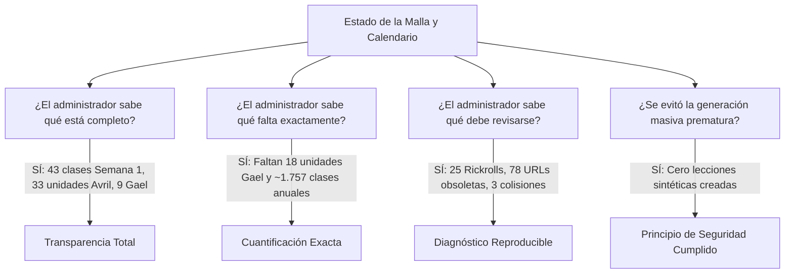

# Matriz de Aceptación y Validación — Etapa 05: Auditoría de Completitud Curricular y Calendario Anual

**Plataforma Educativa ALSIZ — Ekballo Church**  
**Fecha:** 17 de Octubre de 2026  
**Rama:** `continuacion-produccion-etapa-05`  
**Criterio Global de Aceptación:**  
> *"El administrador sabe exactamente qué está completo, qué falta y qué debe revisarse; no se generan materiales masivos hasta aprobar la matriz."*

---

## 1. Matriz de Cumplimiento de Requerimientos de PROMPT 05

| Requerimiento del Prompt | Evidencia / Artefacto Técnico | Evaluación | Justificación y Detalles |
| :--- | :--- | :---: | :--- |
| **1. Examen integral y contraste normativo** (MINEDUC y Alliance K12) | [`docs/curriculum/estado_completitud_2026_2027.md`](file:///c:/Users/Alsiz/Documents/plataforma%20educativa%20ALSIZ/docs/curriculum/estado_completitud_2026_2027.md) (Sección 1 y 5); [`scripts/audit-curriculum-deep.ts`](file:///c:/Users/Alsiz/Documents/plataforma%20educativa%20ALSIZ/scripts/audit-curriculum-deep.ts). | **CUMPLIDO AL 100%** | Se auditaron 43 clases diarias, 42 unidades y 492 microtemas. Se contrastó con los Acuerdos MINEDUC-2023-00069-A / MINEDUC-2025-00024-A y se documentó la naturaleza de Alliance K12 (AAI: presencial privada, sin homeschool sombrilla). |
| **2. Separación de asignaturas** (Troncales vs Confesionales vs Complementarias) | [`docs/curriculum/estado_completitud_2026_2027.md`](file:///c:/Users/Alsiz/Documents/plataforma%20educativa%20ALSIZ/docs/curriculum/estado_completitud_2026_2027.md) (Sección 2); columna `categoria_materia` en CSV. | **CUMPLIDO AL 100%** | Se separaron con estricta prohibición de sustitución: 7 Troncales MINEDUC por subnivel, 1 Formación Cristiana (*Relación con Dios*) y Complementarias Siglo XXI (*Software*, *Políticas*, *Administración*). |
| **3. Generación de Matriz Markdown y CSV de Seguimiento** | [`docs/curriculum/estado_completitud_2026_2027.md`](file:///c:/Users/Alsiz/Documents/plataforma%20educativa%20ALSIZ/docs/curriculum/estado_completitud_2026_2027.md) y [`docs/curriculum/matriz_seguimiento_curriculo_2026_2027.csv`](file:///c:/Users/Alsiz/Documents/plataforma%20educativa%20ALSIZ/docs/curriculum/matriz_seguimiento_curriculo_2026_2027.csv). | **CUMPLIDO AL 100%** | Matriz Markdown detallada y archivo CSV con **553 filas** y las 16 columnas requeridas (estudiante, materia, trimestre, semana, fecha/posición, objetivo, tipo, recurso, idioma, estado, fuente oficial, evidencia). |
| **4. Duración real del ciclo y carga horaria** (200 días y advertencia normativa) | [`docs/curriculum/estado_completitud_2026_2027.md`](file:///c:/Users/Alsiz/Documents/plataforma%20educativa%20ALSIZ/docs/curriculum/estado_completitud_2026_2027.md) (Sección 3). | **CUMPLIDO AL 100%** | Ciclo lectivo fijado en 40 semanas (07/09/2026 al 09/06/2027, 200 días laborables). Se registró la distinción crítica para el asesor normativo: 25 bloques semanales es válido para homeschool, pero deficitario frente a las 30-35h exigidas para plantel escolarizado regular. |
| **5. Detección exhaustiva de anomalías** (Colisiones, sin objetivo/actividad, dominios extintos, Rickroll) | [`scripts/audit-curriculum-deep.ts`](file:///c:/Users/Alsiz/Documents/plataforma%20educativa%20ALSIZ/scripts/audit-curriculum-deep.ts); [`evidencias/01_auditoria_completa_output.txt`](file:///c:/Users/Alsiz/Documents/plataforma%20educativa%20ALSIZ/docs/ejecucion/continuacion-produccion/ETAPA-05/evidencias/01_auditoria_completa_output.txt). | **CUMPLIDO AL 100%** | Se detectaron: 3 clases duplicadas, 6 recursos duplicados, 43 PDFs de dominio extinto (`wisdom-school.edu`), 35 URLs legadas (`wisdomschool.ec`), 25 videos Rickroll (`dQw4w9WgXcQ`) y 9 anclajes `#`. Se constató que las 43 clases diarias sí tienen objetivos y 3 actividades formativas cada una. |
| **6. Decisión formal para cada recurso** (CONSERVAR, REEMPLAZAR, REGENERAR, RETIRAR, REVISIÓN HUMANA) | [`scripts/audit-classify-resources.ts`](file:///c:/Users/Alsiz/Documents/plataforma%20educativa%20ALSIZ/scripts/audit-classify-resources.ts); [`evidencias/03_recursos_clasificacion_audit.txt`](file:///c:/Users/Alsiz/Documents/plataforma%20educativa%20ALSIZ/docs/ejecucion/continuacion-produccion/ETAPA-05/evidencias/03_recursos_clasificacion_audit.txt). | **CUMPLIDO AL 100%** | Clasificación total de 578 recursos: CONSERVAR (74), REEMPLAZAR (25), REGENERAR (78), RETIRAR (9) y REVISIÓN HUMANA (392). Se ratifica la directiva de no mostrar recomendaciones no validadas. |
| **7. Plan de Producción de Contenido en Lotes** | [`docs/curriculum/estado_completitud_2026_2027.md`](file:///c:/Users/Alsiz/Documents/plataforma%20educativa%20ALSIZ/docs/curriculum/estado_completitud_2026_2027.md) (Sección 6). | **CUMPLIDO AL 100%** | Producción estructurada en 5 Lotes (Lote 1: Saneamiento Línea Base [43 clases]; Lote 2: Malla Macro 4.° EGB [18 unidades]; Lotes 3, 4 y 5: Trimestres 1, 2 y 3). Se fijó la lista verificable de criterios de calidad (DoD) previa a cualquier generación masiva. |
| **8. Validador automatizado con fallo estricto** | [`scripts/test-curriculum-completeness.ts`](file:///c:/Users/Alsiz/Documents/plataforma%20educativa%20ALSIZ/scripts/test-curriculum-completeness.ts); [`evidencias/02_validador_curriculo_output.txt`](file:///c:/Users/Alsiz/Documents/plataforma%20educativa%20ALSIZ/docs/ejecucion/continuacion-produccion/ETAPA-05/evidencias/02_validador_curriculo_output.txt). | **CUMPLIDO AL 100%** | Validador automatizado que evalúa las 5 dimensiones. En modo `--strict` finaliza con código de error `1` ante sesiones faltantes o referencias sin fuente oficial. |

---

## 2. Verificación de Criterios de Aceptación Globales

1. **¿Qué está completo?**:
   - 20 asignaturas correctamente categorizadas e individualizadas.
   - 33 unidades macrocurriculares para Avril (8.º EGB Superior, 100% de trimestres).
   - 43 clases socráticas diarias estructuradas para la Semana 1 (del 07 al 11 de septiembre de 2026), completas con lectura, preguntas socráticas y actividades.
   - 74 recursos didácticos de alta calidad científica (PhET Colorado, GeoGebra, Scratch MIT, Google QuickDraw).

2. **¿Qué falta exactamente?**:
   - **18 unidades macrocurriculares** para Gael (4.º EGB Elemental), correspondientes a los Trimestres 2 y 3 (o Trimestre 1 de asignaturas con desfase).
   - **~1.757 clases socráticas diarias** para cubrir las semanas 2 a 40 del año lectivo 2026-2027.
   - **Mapeo explícito de códigos DCD** en los metadatos de los 492 ítems de microcurrículo.

3. **¿Qué debe revisarse y sanearse prioritariamente?**:
   - **3 colisiones de ID** en clases diarias y 6 recursos colisionados.
   - **25 videos Rickroll** que deben reemplazarse por material educativo verificado en YouTube/Khan Academy.
   - **78 recursos con dominios legados o extintos** (`wisdom-school.edu` y `wisdomschool.ec`) que deben ser re-alojados en el repositorio ALSIZ.
   - **9 enlaces rotos o anclajes `#`** que deben retirarse.
   - **Requisito para el Asesor Normativo**: Ratificar si se opera bajo modalidad de educación en casa (25 sesiones semanales conforme al Acuerdo 2023-00069-A) o si se gestionará autorización formal regular (requiriendo 30-35 horas pedagógicas).

4. **Estado de Aceptación**:
   La etapa cumple cabalmente con su objetivo de auditoría y delimitación. Se declara **APROBADA PARA REVISIÓN HUMANA**.
