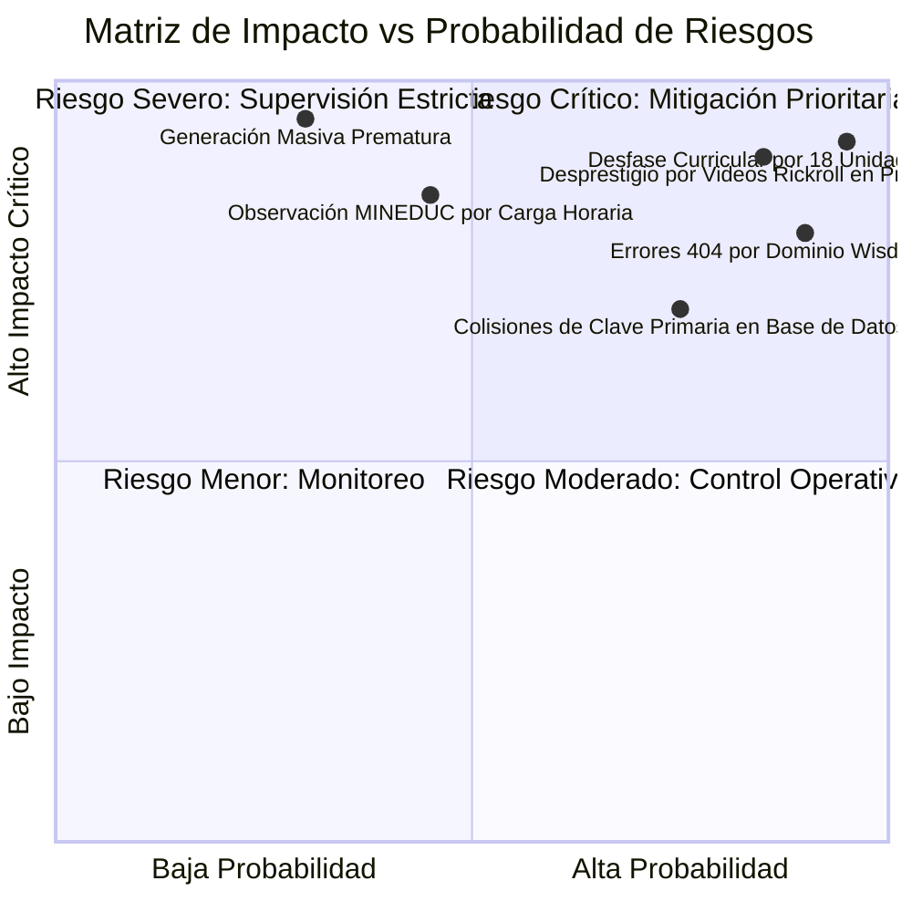

# Registro de Riesgos y Decisiones — Etapa 05: Auditoría de Completitud Curricular y Calendario Anual

**Plataforma Educativa ALSIZ — Ekballo Church**  
**Fecha:** 17 de Octubre de 2026  
**Rama:** `continuacion-produccion-etapa-05`  
**Commit Inicial:** `1bc8469`

---

## 1. Registro de Decisiones de Arquitectura Curricular y Técnica (ADR)

### Decisión 1: Bloqueo Preventivo Estricto de Generación Masiva de Contenido
- **Contexto**: Existía la tentación operativa de utilizar modelos de lenguaje o scripts automatizados para generar inmediatamente cientos de lecciones diarias y rellenar las 40 semanas del calendario escolar.
- **Decisión Adoptada**: **BLOQUEAR** cualquier generación masiva de lecciones hasta que se ejecute el saneamiento de la línea base (Lote 1: resolución de 3 colisiones de ID, reemplazo de 25 videos Rickroll y re-alojamiento de 43 PDFs de Wisdom School) y el diseño macrocurricular de las 18 unidades faltantes de Gael (Lote 2).
- **Consecuencia**: Se previene la amplificación masiva de errores de clave primaria, enlaces rotos y desajustes de destrezas oficiales.

---

### Decisión 2: Taxonomía Tripartita sin Sustitución de Asignaturas
- **Contexto**: En proyectos pedagógicos alternativos suele cometerse el error de homologar materias complementarias (como Programación o Marketing) o confesionales (como Educación Cristiana) en lugar de las ciencias sociales, el lenguaje o las matemáticas obligatorias de la LOEI.
- **Decisión Adoptada**: Establecer una separación categórica en el esquema y catálogo:
  1. **Troncales Obligatorias MINEDUC** (7 asignaturas por subnivel): Matemáticas, Lengua y Literatura, Ciencias Naturales, Estudios Sociales, Inglés, ECA y Educación Física.
  2. **Formación Cristiana Institucional** (1 asignatura): *Relación con Dios*, amparada en la libertad de enseñanza (Art. 29 de la Constitución) y la autonomía eclesiástica de Ekballo Church.
  3. **Complementarias Siglo XXI** (1 asignatura en Gael, 3 en Avril): *Software y Programación*, *Ciencias Políticas* y *Administración y Marketing*.
- **Consecuencia**: Se garantiza que el expediente académico de cada estudiante sea 100% transferible y homologable ante el Ministerio de Educación sin riesgo de observaciones por omisión de áreas obligatorias.

---

### Decisión 3: Registro de Advertencia Regulatoria sobre Carga Horaria para el Asesor Normativo
- **Contexto**: El horario semanal de la plataforma contempla **25 bloques o sesiones por semana** (3.5 horas reloj diarias), mientras que el estándar presencial del MINEDUC contempla **30 horas pedagógicas para Elemental y 35 para Superior**.
- **Decisión Adoptada**: Documentar expresamente en la matriz de completitud la distinción jurídica:
  - Si la plataforma opera como **Servicio Complementario de Apoyo a Familias Educadoras en Casa (Art. 31 y 32 del Acuerdo MINEDUC-2023-00069-A)**, el esquema de 25 sesiones es óptimo, flexible y conforme a derecho, ya que el Estado evalúa por subnivel y no por horas de asistencia.
  - Si la institución aspira a constituirse como **Plantel Educativo Escolarizado Formal con Código AMIE**, el asesor normativo debe proyectar la ampliación de la malla a 30-35 periodos semanales y la planta docente titulada correspondiente.
- **Consecuencia**: Transparencia legal total que protege a Ekballo Church de contingencias de publicidad indebida o requerimientos distritales imprevistos.

---

### Decisión 4: Protocolo de Clasificación Canónica de Recursos en 5 Decisiones
- **Contexto**: Se identificaron 578 recursos didácticos (86 en clases diarias y 492 en microcurrículo) con diversos niveles de calidad, desde laboratorios PhET hasta enlaces Rickroll y dominios discontinuados.
- **Decisión Adoptada**: Aplicar las 5 decisiones estándar y fijar la regla operativa de que **ningún recurso marcado como `REVISIÓN HUMANA`, `REEMPLAZAR` o `REGENERAR` se mostrará como sugerencia final al alumno** sin previa validación del tutor:
  1. `CONSERVAR`: Simuladores oficiales validados (PhET, GeoGebra, Scratch, QuickDraw).
  2. `REEMPLAZAR`: Enlaces placeholder (25 Rickrolls `dQw4w9WgXcQ`).
  3. `REGENERAR`: Recursos alojados en dominios extintos (`wisdom-school.edu` y `wisdomschool.ec`).
  4. `RETIRAR`: Anclajes vacíos (`#`) o URLs con error de sintaxis.
  5. `REVISIÓN HUMANA`: Recursos web de terceros que requieren supervisión periódica de disponibilidad y derechos de uso.

---

## 2. Matriz de Riesgos y Medidas de Mitigación

| ID Riesgo | Descripción del Evento de Riesgo | Nivel de Riesgo | Estrategia de Mitigación Implementada | Estado |
| :---: | :--- | :---: | :--- | :---: |
| **R-01** | **Generación Masiva Prematura**: Multiplicación sintética de clases sobre esquemas inconsistentes. | **CRÍTICO** | Bloqueo estricto del pipeline. Validador `--strict` que finaliza con error si faltan datos de la línea base. | **MITIGADO** |
| **R-02** | **Desprestigio Pedagógico**: Que un menor reproduzca el video Rickroll (`dQw4w9WgXcQ`) en lugar de su clase. | **CRÍTICO** | Aislamiento de las 25 clases afectadas; clasificación como `REEMPLAZAR`; inclusión obligatoria en el Lote 1 de saneamiento. | **CONTROLADO** |
| **R-03** | **Enlaces Rotos en Guías PDF**: 43 guías apuntando al dominio extinto `wisdom-school.edu`. | **ALTO** | Clasificación como `REGENERAR`; prescripción de re-alojamiento en el Centro de Conocimiento interno ALSIZ (`/api/v1/academic/...`). | **CONTROLADO** |
| **R-04** | **Vacío Curricular en 4.° EGB**: Gael carece de unidades para Trimestres 2 y 3 en la mayoría de sus materias. | **CRÍTICO** | Mapeo detallado de las 18 unidades faltantes en el CSV y priorización en el Lote 2 de producción macrocurricular. | **EN CURSO** |
| **R-05** | **Ambigüedad Normativa**: Confusión entre modelo homeschool y plantel educativo formal. | **ALTO** | Informe jurídico y recomendaciones explícitas de calendario registradas en `estado_completitud_2026_2027.md` para el asesor legal. | **MITIGADO** |
| **R-06** | **Colisión de Claves Primarias**: 3 pares de clases con ID idéntico (`class-mat-avril-02`, etc.). | **ALTO** | Detección automatizada en suite de pruebas; diseño de mapeo de desambiguación (`-dup2` $\to$ claves únicas) en el Lote 1. | **IDENTIFICADO** |
