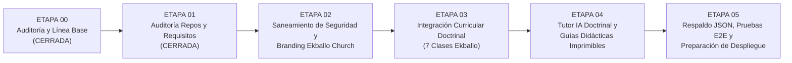

# ETAPA-01 — Informe de Cierre: Auditoría de Repositorios de Referencia y Requisitos del Producto

## 1. Resumen Ejecutivo
Se completó con éxito la **Etapa 01: Auditoría de repositorios de referencia y requisitos del producto** para la **Plataforma Educativa ALSIZ para Ekballo Church**. 

A través de inspecciones directas a las APIs y bases de código de 11 repositorios y ecosistemas de referencia, se evaluó objetivamente la viabilidad técnica y legal de adopción frente al código base preexistente de Wisdom School. Se estableció un pliego formal de **32 requisitos categorizados** (Funcionales, No Funcionales, Académicos y Operativos) trazados con prioridades (`P0`, `P1`, `P2`) y criterios de aceptación medibles, alineados con el marco normativo ecuatoriano (Acuerdo Ministerial MINEDUC-2023-00069-A) y la visión institucional de Ekballo Church.

No se alteró ninguna línea de código funcional durante esta etapa.

---

## 2. Tabla Comparativa de Repositorios Auditados

| Repositorio / URL | Consulta | Rama / Versión | Licencia | Stack Tecnológico | Clasificación | Justificación y Limitaciones Técnicas |
|---|---|---|---|---|---|---|
| **TobbenTT/colegio** `github.com/TobbenTT/colegio` | 2026-10-16 | `main` (nov 2025) | `null` (Sin licencia) | PHP 8.2, MySQL, Python 3.10, Bootstrap 5 | `Descartar` | Sin licencia libre. Stack monolítico en PHP incompatible con la SPA TypeScript/React de ALSIZ. Orientado a asistencia presencial por QR. |
| **Zethearc/edu_ai** `github.com/Zethearc/edu_ai` | 2026-10-16 | `main` (nov 2023) | MIT License | Python, LLaMA-2, Pinecone, LangChain 0.0.240, Telegram | `Referencia` | Tono pedagógico y contextualización para matemáticas en Ecuador (Yachay Tech/UIDE). Descartar código por ser bot de Telegram con dependencias obsoletas y base vectorial de pago. |
| **tonalliGarcia/IAEducation** `github.com/tonalliGarcia/IAEducation` | 2026-10-16 | `main` (sept 2023) | `null` (Sin licencia) | HTML5, CSS3 estático | `Descartar` | Simple plantilla web escolar de 2023 sin IA, sin backend y sin licencia. |
| **juansebag31-blip/academia-ia-educativa** `github.com/juansebag31-blip/academia-ia-educativa` | 2026-10-16 | `main` (oct 2026) | `null` (Sin licencia explícita) | Next.js 15, TypeScript 5, Supabase (pgvector), Gemini Embedding 2, Gemini Flash Lite, Tailwind | `Adaptar / Referencia` | Arquitectura RAG ejemplar: chunking de módulos en PDF, citas verificables obligatorias `[S#]` y rechazo temprano por evidencia insuficiente. No integrar código directo por falta de licencia y stack Next.js; replicar limpiamente su diseño para las 7 clases de Ekballo. |
| **THU-MAIC/OpenMAIC** `github.com/THU-MAIC/OpenMAIC` | 2026-10-16 | `main` (v1.2.0, oct 2026) | MIT License (40.8k ⭐) | Next.js 16, React 19, TypeScript 5, LangGraph 1.1, Tailwind 4, PostgreSQL 16 server-first | `Piloto Aislado / Adaptar` | Aula inmersiva multi-agente de alta fidelidad. **No integrable directamente** en el bundle ligero Vite/Express de ALSIZ (requiere proceso persistente y PostgreSQL 16). Adaptar el formato de escenas interactivas HTML o probar como servicio satélite. |
| **StudentTraineeCenter/edu-agent** `github.com/StudentTraineeCenter/edu-agent` | 2026-10-16 | `master` (dic 2025) | MIT License | TypeScript, React, Python FastAPI, LangGraph, PostgreSQL + pgvector, Azure OpenAI | `Reutilizar habilidades / Adaptar` | Generación estructurada de planes de estudio, flashcards, mapas mentales y quizzes adaptativos basados en active recall a partir de documentos estáticos. |
| **hqanhh/EduGPT** `github.com/hqanhh/EduGPT` | 2026-10-16 | `main` (jun 2023) | MIT License | Jupyter Notebook, Python, LangChain, CAMEL, OpenAI | `Referencia` | Dinámica de juego de roles socrático estudiante-instructor. Código técnico obsoleto e inactivo. |
| **DHRUVvkdv/teaching-assistant** `github.com/DHRUVvkdv/teaching-assistant` | 2026-10-16 | `main` (jul 2024) | `null` (Sin licencia) | Python, Streamlit, FastAPI, AWS Bedrock, Pinecone, Tavily search | `Referencia` | Modelo de articulación entre fuentes internas del profesor y búsqueda web verificada. Descartar integración por stack Streamlit/Python y falta de licencia. |
| **A-R007/Multi-Agent-Study-Assistant** `github.com/A-R007/Multi-Agent-Study-Assistant` | 2026-10-16 | `main` (nov 2025) | `null` (Sin licencia) | Python, Streamlit, Phidata, ChromaDB, Groq/OpenAI | `Referencia` | Taxonomía de 6 agentes especializados (tutor, roadmap, quiz, RAG, estilo de aprendizaje). Descartar código por Streamlit y ausencia de licencia. |
| **GarethManning/education-agent-skills** `github.com/GarethManning/education-agent-skills` | 2026-10-16 | `main` (ago 2026) | CC BY-SA 4.0 (870 ⭐) | Markdown, TypeScript, Agent Skills (`SKILL.md`) | `Reutilizar habilidades` | 165 habilidades pedagógicas basadas en evidencia (Bloom, active recall, socrático, rúbricas formativas, interacciones en vivo en Dominio 20). Reutilizable directamente en prompts y agentes respetando atribución CC BY-SA 4.0. |
| **Topic virtual-classroom (`netless-io/flat`)** `github.com/netless-io/flat` | 2026-10-16 | `main` (oct 2026) | MIT License (6.4k ⭐) | TypeScript, React, Electron, Agora WebRTC, Fastboard | `Referencia` | Aulas sincrónicas por video demandan WebRTC pesado e internet de alta estabilidad. Desaconsejado para el perfil de familias misioneras en zonas con conectividad intermitente en Ecuador. |
| **Fork Objetivo (Wisdom School Base)** `rpmministry/plataforma-educativa-alsiz` | 2026-10-16 | `etapa-01-...` (commit fdaa63a) | Código Propietario / Fork | React 19, TypeScript, Vite 6, Express 4, Tailwind CSS 4 | `Código Base Objetivo` | Activo principal del proyecto. Posee arquitectura funcional probada, tutores socráticos, guías didácticas impresas v4.0 y soporte táctil para iPad. Requiere saneamiento de seguridad y backend persistente. |

---

## 3. Pliego Formal de Requisitos del Producto (Priorizados P0 / P1 / P2)

### 3.1. Requisitos Funcionales (REQ-FUN)

| ID | Módulo / Área | Descripción del Requisito | Prioridad | Criterio de Aceptación Verificable | Dependencia | Fase |
|---|---|---|---|---|---|---|
| **REQ-FUN-001** | Seguridad / Auth | Corrección del bypass de autenticación en login. | `P0` | Si el usuario escribe únicamente su identificador sin contraseña o PIN válido, el sistema rechaza el acceso con error `401/Credenciales incorrectas`. | Ninguna | Fase 1 (MVP) |
| **REQ-FUN-002** | Seguridad / Secretos | Eliminación de claves `VITE_*` del cliente; canalización 100% por backend. | `P0` | La compilación `npm run build` no contiene strings de API keys en los archivos generados en `dist/assets/*.js`. Todas las llamadas IA se originan en `server.ts`. | REQ-FUN-001 | Fase 1 (MVP) |
| **REQ-FUN-003** | Identidad / Branding | Incorporación del branding institucional de Ekballo Church. | `P0` | La aplicación muestra el logotipo oficial (fondo claro y oscuro), monograma, favicons y nombre "Plataforma Educativa ALSIZ — Ekballo Church" en toda la interfaz. | Ninguna | Fase 1 (MVP) |
| **REQ-FUN-004** | Aula / Discipulado | Estructuración del curso de Discipulado Ekballo (7 Clases Doctrinales). | `P0` | El catálogo incluye las 7 clases basadas en los PDFs de `DOCUMENTOS EKBALLO/` con sus 4 fases: Contenido, Laboratorio, Taller de Actividades y Evidencia. | REQ-FUN-003 | Fase 1 (MVP) |
| **REQ-FUN-005** | Tutoría IA | Tutor socrático contextualizado en doctrina Ekballo y fe cristiana. | `P0` | Al abrir el chat en una clase doctrinal, el tutor responde guiando con preguntas basadas exclusivamente en el texto oficial de esa clase, sin inventar doctrinas ajenas. | REQ-FUN-004 | Fase 1 (MVP) |
| **REQ-FUN-006** | Materiales / Offline | Generación de guías didácticas impresas en PDF para las clases de Ekballo. | `P0` | Un clic en "Guía Didáctica" genera un documento HTML/PDF con resumen doctrinal, citas bíblicas clave y preguntas por nivel (literal, interpretativa, aplicación). | REQ-FUN-004 | Fase 1 (MVP) |
| **REQ-FUN-007** | Integridad / Respaldo | Exportación e importación manual de progreso en JSON. | `P0` | El usuario puede presionar "Descargar respaldo" y obtener un archivo JSON firmado con su progreso, o cargarlo en otro dispositivo para restaurar su avance. | Ninguna | Fase 1 (MVP) |
| **REQ-FUN-008** | Catálogo K-12 | Preservación del microcurrículo escolar de EGB Elemental y Superior (Avril y Gael). | `P1` | Las materias escolares de 4.° y 8.° EGB siguen disponibles en su espacio correspondiente sin mezclar datos con la formación doctrinal de adultos. | Ninguna | Fase 1 (MVP) |
| **REQ-FUN-009** | Portal Padres / Representante | Panel de seguimiento formativo y reportes de progreso para padres y mentores. | `P1` | Vista protegida donde el representante visualiza porcentajes de avance, tareas completadas y alertas de estancamiento. | REQ-FUN-001 | Fase 2 |
| **REQ-FUN-010** | RAG Doctrinal Avanzado | Búsqueda semántica con citas obligatorias `[S#]` sobre todo el corpus Ekballo. | `P1` | El asistente IA cita número de clase, sección y página de los documentos fuente, y rechaza preguntas fuera de la doctrina oficial de la iglesia. | REQ-FUN-004 | Fase 2 |
| **REQ-FUN-011** | Evaluaciones / Quizzes | Evaluaciones adaptativas por competencias con retroalimentación inmediata. | `P1` | Al responder un cuestionario, la IA retroalimenta formativamente cada respuesta errónea mediante analogías cotidianas sin entregar la respuesta directa. | REQ-FUN-004 | Fase 2 |
| **REQ-FUN-012** | Portafolio / Evidencias | Reactivación y conexión formal del módulo de evidencias (`WorksView`). | `P2` | La pestaña "Evidencias" aparece en la navegación y permite subir fotos o textos para recibir retroalimentación formativa de la IA. | REQ-FUN-001 | Fase 2 |

---

### 3.2. Requisitos No Funcionales (REQ-NFN)

| ID | Categoría | Descripción del Requisito | Prioridad | Criterio de Aceptación Verificable | Dependencia | Fase |
|---|---|---|---|---|---|---|
| **REQ-NFN-001** | Seguridad | Privacidad de datos de menores y protección de expedientes. | `P0` | Ningún archivo con datos personales de menores está accesible en rutas estáticas públicas sin token de sesión válido. | REQ-FUN-001 | Fase 1 (MVP) |
| **REQ-NFN-002** | Rendimiento | Carga veloz y tamaño de bundle optimizado. | `P1` | Tiempo de primera pintura con contenido (FCP) inferior a 1.8 segundos en conexiones 4G estándar. División de chunks pesados (>500 kB). | Ninguna | Fase 2 |
| **REQ-NFN-003** | Conectividad Limitada | Operatividad resiliente ante cortes de internet (Modo Offline / Asincrónico). | `P0` | La plataforma permite descargar guías y materiales para trabajar sin internet; al reconectar, sincroniza el progreso pendiente. | REQ-FUN-006 | Fase 1 (MVP) |
| **REQ-NFN-004** | Responsive / Ergonomía | Compatibilidad multidispositivo (móvil, tablet horizontal, escritorio). | `P0` | La interfaz se adapta dinámicamente con barra inferior en celulares y barra lateral en escritorio; gestos táctiles fluidos en iPad y tablets Android. | Ninguna | Fase 1 (MVP) |
| **REQ-NFN-005** | Accesibilidad (A11y) | Cumplimiento de estándares WCAG 2.1 nivel AA. | `P1` | Contraste de texto >= 4.5:1, etiquetas `aria-label` en controles interactivos y navegación navegable por teclado. | REQ-FUN-003 | Fase 2 |
| **REQ-NFN-006** | Disponibilidad / Tolerancia | Cascada de proveedores IA resiliente a cortes. | `P0` | Si el proveedor primario falla o agota cuota, el backend conmuta al siguiente en menos de 4 segundos sin mostrar errores de servidor al alumno. | REQ-FUN-002 | Fase 1 (MVP) |
| **REQ-NFN-007** | Costes Operativos | Costo por alumno mensual en IA acotado. | `P0` | Consumo promedio de tokens optimizado a menos de $0.05 USD por estudiante/mes mediante modelos flash/deepseek y caché en memoria. | REQ-FUN-005 | Fase 1 (MVP) |
| **REQ-NFN-008** | Mantenibilidad | Código tipado estricto en TypeScript sin advertencias. | `P0` | `npm run lint` (`tsc --noEmit`) se ejecuta en el pipeline de integración continua sin emitir ningún error. | Ninguna | Fase 1 (MVP) |

---

### 3.3. Requisitos Académicos (REQ-ACA)

| ID | Dimensión | Descripción del Requisito | Prioridad | Criterio de Aceptación Verificable | Dependencia | Fase |
|---|---|---|---|---|---|---|
| **REQ-ACA-001** | Marco Legal Ecuador | Adaptación al régimen de Educación en Casa (MINEDUC-2023-00069-A). | `P0` | La plataforma se estructura como servicio complementario de tutoría y acompañamiento pedagógico familiar, emitiendo bitácoras para las 4 evaluaciones del MINEDUC. | Ninguna | Fase 1 (MVP) |
| **REQ-ACA-002** | Formación Cristiana | Cosmovisión bíblica y discipulado ministerial de Ekballo Church. | `P0` | El plan formativo incluye las 7 materias doctrinales fundamentales, devocionales interactivos y orientación al servicio transcultural. | REQ-FUN-004 | Fase 1 (MVP) |
| **REQ-ACA-003** | Currículo Nacional | Alineación con destrezas con criterio de desempeño del Ministerio de Educación. | `P1` | Los microcurrículos de matemáticas, lengua, ciencias y sociales identifican explícitamente los códigos curriculares oficiales de Ecuador. | REQ-FUN-008 | Fase 2 |
| **REQ-ACA-004** | Bilingüismo Progresivo | Enseñanza de inglés contextualizado por niveles. | `P1` | La materia de inglés y los glosarios técnicos incluyen soporte dual (español/inglés) y pronunciación asistida por audio neuronal. | Ninguna | Fase 2 |
| **REQ-ACA-005** | Formación Profesional Adultos | Modalidad modular para jóvenes y adultos misioneros (Etapa 2 de la Investigación). | `P2` | Catálogo de talleres prácticos de liderazgo, administración ministerial y herramientas digitales aplicadas al ministerio. | REQ-ACA-002 | Fase 3 |

---

### 3.4. Requisitos Operativos (REQ-OPE)

| ID | Categoría | Descripción del Requisito | Prioridad | Criterio de Aceptación Verificable | Dependencia | Fase |
|---|---|---|---|---|---|---|
| **REQ-OPE-001** | Trazabilidad Git | Prohibición de cambios directos en `main` y ramas por etapa técnica. | `P0` | Cada etapa técnica se desarrolla en su rama aislada (`etapa-XX`), con registro en `docs/ejecucion/bitacora.md` y suite de pruebas aprobada. | Ninguna | Fase 1 (MVP) |
| **REQ-OPE-002** | Observabilidad | Endpoint de diagnóstico de salud y proveedores IA (`GET /api/health`). | `P0` | El endpoint responde el estado de disponibilidad de DeepSeek, Gemini y OpenRouter sin revelar credenciales. | REQ-FUN-002 | Fase 1 (MVP) |
| **REQ-OPE-003** | Actualización Doctrinal | Procedimiento seguro para incorporar nuevas clases y materiales en PDF. | `P1` | Documentación paso a paso que permite a un administrador añadir un nuevo módulo doctrinal sin modificar el motor de la aplicación. | REQ-FUN-004 | Fase 2 |
| **REQ-OPE-004** | Respaldo y Recuperación | Protocolos verificables de rollback y exportación de base de conocimiento. | `P0` | Cada etapa técnica dispone de su archivo `05_REVERSA.md` reproducible para restaurar el estado previo en caso de anomalía. | REQ-OPE-001 | Fase 1 (MVP) |
| **REQ-OPE-005** | Despliegue Continuo | Despliegue reproducible en Vercel con soporte serverless (`api-entry.js`). | `P0` | `npm run build` genera los artefactos compatibles con `vercel.json` y el frontend se sirve correctamente en entornos serverless. | Ninguna | Fase 1 (MVP) |

---

## 4. Mapa de Capacidades: Existente vs. Deseado

| Capacidad Pedagógica / Técnica | Estado Actual en Wisdom School | Capacidad Deseada para Ekballo Church | Brecha a Resolver |
|---|---|---|---|
| **Identidad Visual** | Logos y nombres de Wisdom School / Avril / Gael. | Identidad corporativa de Ekballo Church (logotipo fondo claro/oscuro, monograma). | Reemplazo de assets en `public/`, `index.html` y encabezados. |
| **Seguridad de Acceso** | Bypass que permite acceder con solo ingresar el ID del alumno. | Autenticación robusta con contraseña/PIN obligatorio y sesiones seguras. | Corregir condición lógica en `SchoolContext.tsx:382`. |
| **Gestión de Claves IA** | Backend orquesta llaves, pero cliente mantiene fallback con `VITE_*`. | 100% de llamadas IA a través de endpoints seguros en `server.ts`. | Desacoplar llamadas directas de cliente en `aiService.ts`. |
| **Contenido Académico** | 11 materias de EGB Superior y 8 de EGB Elemental (Ecuador). | Currículo dual: EGB para homeschool + Curso de Discipulado Ekballo (7 Clases). | Estructurar las 7 clases doctrinales de Ekballo en el modelo de datos. |
| **Tutoría Inteligente** | Cascada socrática general con prompts por materia. | Tutor contextualizado en doctrina bíblica y teología de Ekballo Church. | Inyectar el texto exacto de las clases doctrinales en los prompts del tutor. |
| **Materiales Imprimibles** | Guías PDF v4.0 para materias escolares. | Guías didácticas impresas para el discipulado y estudio bíblico en casa. | Añadir plantillas de guías para las 7 clases de Ekballo. |
| **Persistencia** | `localStorage` volátil con riesgo de borrado accidental. | Persistencia segura con exportador de respaldo JSON (Fase 1) y base de datos (Fase 2). | Implementar utilidades de respaldo e importación de estado. |
| **Interactividad Multi-agente** | Tutor socrático 1-a-1 en chat lateral. | Aula interactiva con escenas y simulaciones (inspirado en OpenMAIC / EduAgent). | Adaptar escenas interactivas HTML embebidas en la pestaña de laboratorio. |

---

## 5. Separación de Hechos, Inferencias e Hipótesis

### Hechos Comprobados (Evidencia Verificada en Código / Documentos)
1. El fork local compila con éxito (`tsc --noEmit` y `vite build` pasan con código 0).
2. Existe un bypass de autenticación crítico en [SchoolContext.tsx#L382](file:///C:/Users/Alsiz/Documents/plataforma%20educativa%20ALSIZ/src/context/SchoolContext.tsx#L382).
3. Existen 7 clases doctrinales en PDF y un pack de marca completo en `DOCUMENTOS EKBALLO/`.
4. El Acuerdo Ministerial MINEDUC-2023-00069-A regula el homeschooling en Ecuador como educación no formal complementaria, asignando la responsabilidad legal al representante y la certificación a evaluaciones del MINEDUC.
5. OpenMAIC (v1.2.0) requiere PostgreSQL 16 y procesos de servidor persistentes, incompatibles con una arquitectura serverless pura en Vercel.
6. `GarethManning/education-agent-skills` provee 165 habilidades pedagógicas de libre uso bajo licencia CC BY-SA 4.0.

### Inferencias Técnicas (Deducciones Fundamentadas del Líder Técnico)
1. Para las 7 clases de Discipulado de Ekballo, la inyección directa de contexto en el prompt del tutor es superior en la Fase 1 a un pipeline RAG complejo: es determinista, gratuita, no requiere base vectorial y elimina latencias.
2. La arquitectura debe mantener un enfoque *offline-first* o asincrónico con guías descargables en PDF, debido a la brecha de conectividad rural identificada en la investigación de mercado de Ekballo Church.
3. Un mecanismo de respaldo local en JSON mitigará el 90% del riesgo de pérdida de datos en `localStorage` antes de requerir una migración completa a Supabase/PostgreSQL.

### Hipótesis y Preguntas Abiertas (Requieren Decisión del Usuario)
1. *¿Desea el usuario conservar los perfiles escolares de Avril y Gael visibles en la plataforma (modo multi-instituto), o prefiere que la plataforma se dedique exclusivamente a Ekballo Church desde la pantalla de inicio?*
2. *¿Se autoriza la ejecución de `git fetch origin` para sincronizar el estado del remoto en GitHub?*
3. *¿Se autoriza la corrección inmediata de las vulnerabilidades de seguridad (bypass de autenticación y llaves en cliente) al inicio de la Etapa 02?*

---

## 6. Backlog de Fases de Implementación Propuesto

### Detalle del Backlog:
- **ETAPA 02: Saneamiento de Seguridad y Branding Institucional Ekballo Church (Fase 1 / MVP)**
  - T-02.1: Corregir el bypass de autenticación en `SchoolContext.tsx` e implementar validación estricta de credenciales.
  - T-02.2: Purgar referencias `VITE_*` de secretos en cliente en `aiService.ts`; canalizar llamadas exclusivamente por `server.ts`.
  - T-02.3: Integrar logotipos (fondo claro/oscuro), monograma, favicon y manifiesto de `EKBALLO_logo_pack/` en `index.html` y cabeceras.
  - T-02.4: Actualizar títulos, metadata institucional y paleta corporativa de Ekballo en Tailwind CSS.
  - T-02.5: Verificación de compilación y pruebas de regresión.

- **ETAPA 03: Integración del Curso de Discipulado Ekballo (7 Módulos Doctrinales)**
  - T-03.1: Extracción y estructuración de contenido pedagógico de los 7 PDFs de `DOCUMENTOS EKBALLO/`.
  - T-03.2: Modelado de las 7 clases en la estructura `DailyClass` y `Subject` en `src/data/ekballoCurriculumData.ts`.
  - T-03.3: Configuración de fases pedagógicas por clase: Contenido, Lectura guiada, Laboratorio bíblico y Taller de actividades.
  - T-03.4: Habilitación en la interfaz del selector del curso de Discipulado Ekballo Church.

- **ETAPA 04: Tutor Socrático Doctrinal y Generador de Guías Didácticas Ekballo**
  - T-04.1: Diseño de system prompts del tutor pastoral/doctrinal anclados estrictamente al contenido de cada clase.
  - T-04.2: Integración de habilidades pedagógicas adaptadas de `GarethManning/education-agent-skills` (active recall y preguntas socráticas).
  - T-04.3: Adaptación del generador de guías imprimibles (`guideGenerator.ts`) para emitir las guías didácticas oficiales en PDF de Ekballo Church.
  - T-04.4: Pruebas de interacción del tutor y verificación de respuestas bíblicas precisas.

- **ETAPA 05: Respaldo de Datos, Validación Integral y Preparación para Despliegue**
  - T-05.1: Implementación de exportación/importación de progreso en JSON firmado para prevenir pérdida en `localStorage`.
  - T-05.2: Desactivación definitiva del "destructor de memoria" en `mockData.ts`.
  - T-05.3: Suite de pruebas de regresión completas (type-check, build de producción y prueba de navegación de flujos).
  - T-05.4: Auditoría final previa al despliegue en Vercel.

---

## 7. Dictamen Final de la Etapa 01
**Estado**: `APROBADA: lista para revisión humana`

Todos los criterios de auditoría de repositorios, investigación de licencias y especificación de requisitos del producto han sido completados exhaustivamente y respaldados en la documentación técnica.

Se espera la validación formal del responsable técnico antes de iniciar la **ETAPA 02**.

