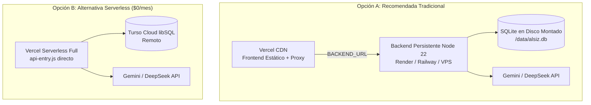

# Guía Operativa de Creación, Colocación y Rotación de Claves API
## Plataforma Educativa ALSIZ para Ekballo Church

- **Documento:** `docs/operacion/guia_configuracion_apis_piloto.md`
- **Versión:** 1.0.0 (Piloto de Producción)
- **Fecha:** 17 de octubre de 2026
- **Audiencia:** Administrador de Sistemas, Director de Tecnología y Coordinación Académica
- **Clasificación de Seguridad:** Protocolo de Operación Confidencial (P0 Seguridad)

---

> [!CAUTION]
> ### REGLAS FUNDAMENTALES DE SEGURIDAD P0 Y PRIVACIDAD LOPDP
> 1. **NUNCA comparta, pegue ni escriba claves API, contraseñas, secretos de sesión ni archivos `.env` en conversaciones con asistentes de IA, tickets de soporte ni canales de mensajería pública.**
> 2. **Esta guía está diseñada para que el administrador humano configure y verifique el sistema de forma totalmente autónoma, sin revelar los valores secretos al asistente.**
> 3. **Los archivos `.env`, `.env.local` y `.env.production` NUNCA se suben al repositorio Git (están estrictamente ignorados en `.gitignore`).**
> 4. **Las claves de IA NUNCA deben tener el prefijo `VITE_`. Todo secreto con prefijo `VITE_` se compila directamente en el código JavaScript del navegador, haciéndose público para cualquier usuario o estudiante.**
> 5. **Para pruebas de entrega de correo electrónico o alertas didácticas, utilice ÚNICAMENTE cuentas sintéticas de prueba creadas por el administrador. Queda prohibido usar correos o datos de estudiantes reales para pruebas operativas.**

---

## 1. Google Gemini API (Proveedor Primario Recomendado)

Google Gemini proporciona los modelos de lenguaje primarios para los 8 profesores tutores del catálogo socrático de la plataforma (ej. `gemini-3.8-flash` con presupuesto de razonamiento controlado `thinkingBudget: 0` para una latencia de respuesta pedagógica inferior a 2 segundos).

### 1.1. Portal Oficial y Creación de la Clave
1. Ingrese a la documentación oficial y portal de claves de Google:
   - **Documentación oficial:** [https://ai.google.dev/gemini-api/docs/api-key](https://ai.google.dev/gemini-api/docs/api-key)
   - **Consola de Google AI Studio:** [https://aistudio.google.com/apikey](https://aistudio.google.com/apikey)
2. Inicie sesión con la cuenta de Google institucional autorizada de Ekballo Church.
3. Haga clic en **"Create API Key"** (Crear clave de API).
4. Seleccione un **Proyecto de Google Cloud** existente (o cree uno nuevo denominado `ekballo-alsiz-produccion`).
5. Copie la clave generada y guárdela inmediatamente en su gestor seguro de contraseñas (ej. Bitwarden, 1Password, Vault).

> [!IMPORTANT]
> **Distinción Crítica de Tipos de Credencial:**  
> **NO use un "OAuth 2.0 Client ID" como clave Gemini.**  
> - El *OAuth Client ID* (`VITE_GOOGLE_CLIENT_ID`) se usa únicamente en el frontend para el botón de "Iniciar sesión con Google".  
> - La *Gemini API Key* es una clave alfanumérica de servidor (formato que suele iniciar con `AIza...`) que autoriza peticiones HTTP hacia `generativelanguage.googleapis.com`.

### 1.2. Restricciones de Seguridad en Google Cloud Console
Para evitar cargos inesperados o uso no autorizado en caso de filtración accidental:
1. Abra la consola de Google Cloud: [https://console.cloud.google.com/apis/credentials](https://console.cloud.google.com/apis/credentials).
2. Seleccione el proyecto de la plataforma y localice la clave API recién creada.
3. Ingrese a **"Edit API key"** (Editar clave de API).
4. En **"API restrictions"** (Restricciones de API):
   - Marque **"Restrict key"** (Restringir clave).
   - En la lista desplegable, marque **ÚNICAMENTE**: `Generative Language API` (o `Gemini API`).
   - Guarde los cambios (**Save**).
5. En **"Application restrictions"** (Restricciones de aplicación):
   - Si su backend persistente tiene una IP fija de salida, restrinja la clave por **IP addresses** (Direcciones IP del servidor). Si utiliza un entorno serverless con IPs dinámicas, mantenga la restricción de API estricta.

### 1.3. Colocación en el Entorno Backend
- **Nombre exacto de la variable:** `GEMINI_API_KEY`
- **Ubicación:** Servidor Backend (Servicio en Render, Railway, VPS o panel de variables de Vercel si usa arquitectura serverless).
- **Modelo predeterminado opcional:** `GEMINI_MODEL=gemini-3.8-flash`

### 1.4. Comprobación de Presencia sin Mostrar la Clave
Para auditar que el servidor reconoce la variable sin exponer su contenido:

1. **Desde la terminal del servidor (script de auditoría booleana):**
   ```bash
   npx tsx scripts/test-ai-providers-config.ts
   ```
   *Salida esperada (nótese que NUNCA imprime el valor):*
   ```text
   🟢 [OBLIGATORIA] GEMINI_API_KEY      : CONFIGURADA
        Propósito: Proveedor Primario LLM (Google AI Studio Free Tier / gemini-3.8-flash)
   ```

2. **Mediante el endpoint de diagnóstico de salud (vía curl o navegador):**
   ```bash
   curl -s http://localhost:3000/api/ai/health
   ```
   *Respuesta JSON sanitizada:*
   ```json
   {
     "success": true,
     "status": "HEALTHY",
     "activeProvider": "GOOGLE_GEMINI",
     "providers": [
       {
         "name": "GOOGLE_GEMINI",
         "status": "CONFIGURED",
         "model": "gemini-3.8-flash",
         "priority": 1,
         "isPrimary": true,
         "isFallback": false
       }
     ]
   }
   ```

3. **Prueba de conexión real con prompt sintético (sin exponer credenciales):**
   ```bash
   npx tsx scripts/test-ai-providers-live.ts
   ```
   *Salida esperada:*
   ```text
   [GOOGLE_GEMINI]
     Modelo:  gemini-3.8-flash
     Estado:  SUCCESS
     Latencia: 1450ms
     Respuesta: CONECTADO
   ```

### 1.5. Procedimiento de Rotación de Clave Gemini
1. Acceda a [Google AI Studio](https://aistudio.google.com/apikey) y cree una **segunda clave API**.
2. Aplique las mismas restricciones de `Generative Language API` en Google Cloud Console.
3. Actualice el valor de `GEMINI_API_KEY` en el panel de variables del backend.
4. Reinicie el backend (o despliegue en Vercel).
5. Ejecute `npx tsx scripts/test-ai-providers-live.ts` para verificar la conectividad.
6. Una vez confirmado el correcto funcionamiento, ingrese a Google AI Studio y **elimine la clave antigua**.

---

## 2. DeepSeek Platform API (Proveedor de Respaldo Recomendado)

DeepSeek (`deepseek-chat` / `deepseek-flash`) actúa como el respaldo secundario automático e inmediato. Si la cuota gratuita diaria de Gemini se agota (código 429) o Google experimenta una degradación de red, el gestor central [`ProviderManager`](file:///server/agents/providers/providerManager.ts) salta a DeepSeek sin interrumpir la lección del alumno.

### 2.1. Portal Oficial y Facturación
1. Ingrese a la plataforma oficial de desarrolladores de DeepSeek:
   - **Portal de claves:** [https://platform.deepseek.com/api_keys](https://platform.deepseek.com/api_keys)
   - **Documentación de API:** [https://api-docs.deepseek.com/api/create-chat-completion/](https://api-docs.deepseek.com/api/create-chat-completion/)
2. Cree o inicie sesión en su cuenta institucional.
3. **Gestión de Saldo y Facturación:**  
   - DeepSeek opera bajo modelo de saldo prepagado (*Pay-as-you-go*).
   - Diríjase a **"Top up"** y recargue un saldo inicial moderado (ej. $5.00 a $10.00 USD son suficientes para cientos de miles de interacciones socráticas en el piloto debido a su costo extremadamente reducido).
   - Configure un límite de alerta de saldo bajo para notificación oportuna.
4. En la sección **"API Keys"**, haga clic en **"Create new API key"**.
5. Asigne un nombre identificador (ej. `alsiz-backend-piloto`). Copie la clave generada y almacénela de forma segura.

### 2.2. Colocación en el Entorno Backend
- **Nombre exacto de la variable:** `DEEPSEEK_API_KEY`
- **Ubicación:** Servidor Backend.
- **Variables complementarias opcionales:**
  - `DEEPSEEK_MODEL=deepseek-chat` (o `deepseek-flash` para menor latencia)
  - `DEEPSEEK_BASE_URL=https://api.deepseek.com/v1`

### 2.3. Comprobación de Presencia y Prueba en Vivo
1. **Comprobar presencia:**
   ```bash
   npx tsx scripts/test-ai-providers-config.ts
   ```
   *Debe indicar `DEEPSEEK_API_KEY: CONFIGURADA`.*

2. **Prueba de llamada corta al endpoint oficial:**
   ```bash
   npx tsx scripts/test-ai-providers-live.ts
   ```
   *Salida esperada:*
   ```text
   [DEEPSEEK_API]
     Modelo:  deepseek-chat
     Estado:  SUCCESS
     Latencia: 1025ms
     Tokens:  Prompt: 28 | Completion: 3
     Respuesta: CONECTADO
   ```

### 2.4. Verificación de Cascada (Fallback Gemini → DeepSeek → Simulador)
Para comprobar que el sistema conmuta automáticamente sin exponer secretos:
1. En un entorno de staging o prueba local, configure temporalmente en `.env.local` la variable de prioridad forzando primero un proveedor no disponible o simulando el agotamiento de Gemini:
   ```env
   AI_PROVIDER_PRIORITY=DEEPSEEK,GEMINI,SIMULATED_LOCAL
   ```
2. Ejecute una consulta docente a través de la suite de agentes:
   ```bash
   npx tsx scripts/test-etapa-08-unified.ts
   ```
3. Compruebe en los logs del servidor que el sistema reporta:
   ```text
   [ProviderManager] Invocando proveedor DEEPSEEK_API... Éxito (isFallback: false)
   ```
4. Si apaga deliberadamente todas las claves externas, el sistema debe responder con el tutor socrático local:
   ```text
   [ProviderManager] Activando degradación elegante a SIMULATED_LOCAL. (isFallback: true)
   ```
   *Garantía pedagógica:* La pantalla del estudiante nunca mostrará un error 500 en blanco; el profesor IA siempre responderá con preguntas guiadas basadas en el currículo local.

### 2.5. Rotación de Clave DeepSeek
1. Genere una nueva clave en [DeepSeek Platform](https://platform.deepseek.com/api_keys).
2. Actualice `DEEPSEEK_API_KEY` en el entorno backend.
3. Ejecute la prueba en vivo `npx tsx scripts/test-ai-providers-live.ts`.
4. En el panel de DeepSeek, presione **"Delete"** sobre la clave anterior.

---

## 3. Estado Técnico de OpenRouter y OpenCode

### 3.1. OpenRouter API (Proveedor Terciario Integrado)
- **Estado de Integración:** **CONECTADO E INTEGRADO** en [`ProviderManager`](file:///server/agents/providers/providerManager.ts) vía [`OpenRouterProvider`](file:///server/agents/providers/openRouterProvider.ts).
- **Rol:** Tercer escalón de respaldo opcional. Permite acceder a modelos gratuitos o de ultra-bajo costo (como `nvidia/nemotron-3.5-lightning:free` o `meta-llama/llama-3.3-70b-instruct:free`).
- **Portal Oficial:** [https://openrouter.ai/settings/keys](https://openrouter.ai/settings/keys).
- **Variables de Entorno:**
  - `OPENROUTER_API_KEY`
  - `OPENROUTER_MODEL=nvidia/nemotron-3.5-lightning:free`
- **Recomendación para el Piloto:** Solo configure esta variable si desea un respaldo adicional tras DeepSeek. Si no se configura, el gestor simplemente la omite y pasa al simulador local.

### 3.2. OpenCode (Catálogo Honesto — NO Conectado en Runtime)
- **Estado Técnico:** **NO INTEGRADO / DESACTIVADO EN RUNTIME**.
- **Diagnóstico:** El adaptador de OpenCode (`opencode.ai/zen`) fue evaluado en la fase de prototipado y descartado debido a que bloquea peticiones fuera de su entorno de desarrollo y carece de SLAs educativos.
- **Instrucción Estricta para el Administrador:**
  - **NO cree cuentas en OpenCode.**
  - **NO active facturación ni genere claves para OpenCode.**
  - **NO agregue `OPENCODE_API_KEY` a los entornos de producción o staging.**
  - El sistema reporta contractualmente `ProviderManager.isProviderAvailable('OPENCODE') === false` y lo rechaza en el health check para mantener un catálogo honesto y transparente.

---

## 4. Diccionario Exhaustivo de Variables de Entorno del Backend

La siguiente tabla resume todas las variables leídas efectivamente por el código del backend (`server.ts`, `server/agents/`, `server/email/`, `server/db/`).

| Variable | Tipo | Requerida | Entorno | Propósito y Formato Seguro |
|---|---|:---:|:---:|---|
| `NODE_ENV` | String | **Sí** | Backend | Modo de ejecución del servidor: `production`, `staging`, `development` o `test`. En producción activa optimizaciones de rendimiento y seguridad estricta de cookies. |
| `PORT` | Número | Opcional | Backend | Puerto TCP en el que escucha Express (ej. `3000` o `8080`). En proveedores PaaS como Render o Railway se inyecta automáticamente. |
| `APP_URL` | URL | **Sí** | Backend | URL canónica pública de la plataforma (ej. `https://educacion.ekballochurch.org`). Utilizada para enlaces de correo y validación de orígenes CORS. |
| `DATABASE_PATH` | Ruta | Condicional | Backend | Ruta al archivo SQLite con WAL en el disco persistente (ej. `/data/alsiz.db`). Obligatoria en la Arquitectura Recomendada (Opción A). |
| `SESSION_SECRET` | String | **Sí** (Prod) | Backend | Cadena criptográfica de alta entropía (mínimo 64 caracteres hex) para firmar y cifrar tokens de sesión. **NUNCA reutilice el valor de ejemplo.** |
| `SESSION_TTL_HOURS`| Número | Opcional | Backend | Duración de la sesión autenticada en horas. Predeterminado: `72` (3 días de acceso continuo para la jornada de los alumnos). |
| `GEMINI_API_KEY` | String | **Sí** (Piloto) | Backend | Clave de Google AI Studio para los tutores socráticos primarios. |
| `DEEPSEEK_API_KEY`| String | Opcional | Backend | Clave de DeepSeek Platform para contingencia inmediata ante cuota agotada. |
| `OPENROUTER_API_KEY`| String| Opcional | Backend | Clave de OpenRouter para acceso a modelos libres de respaldo. |
| `EMAIL_USER` | Email | Condicional | Backend | Cuenta de correo para transporte SMTP secundario (Nodemailer, ej. cuenta de servicio Gmail o SMTP institucional). |
| `EMAIL_PASS` | Secret | Condicional | Backend | Contraseña de aplicación para SMTP (en Gmail: contraseña de 16 letras de Google App Password, nunca la contraseña personal de la cuenta). |
| `RESEND_API_KEY` | Secret | Condicional | Backend | Clave de la API de [Resend.com](https://resend.com) (transporte primario HTTP de alta tasa de entrega para PIN táctil y recuperación). |
| `EMAIL_FROM` | Email | Opcional | Backend | Remitente de los correos transaccionales (ej. `Plataforma ALSIZ <notificaciones@ekballochurch.org>`). |
| `AI_PROVIDER_PRIORITY`| CSV | Opcional | Backend | Lista ordenada de proveedores IA en cascada. Predeterminado: `GEMINI,DEEPSEEK,OPENROUTER,SIMULATED_LOCAL`. |
| `AI_TIMEOUT_MS` | Número | Opcional | Backend | Tiempo límite máximo en milisegundos por llamada a un proveedor de IA. Predeterminado: `30000` (30s). |
| `AI_MAX_RETRIES` | Número | Opcional | Backend | Reintentos seriales máximos antes de saltar al siguiente proveedor. Predeterminado: `1`. |
| `AI_STUDENT_MAX_DAILY_REQUESTS`| Número | Opcional | Backend | Límite diario de consultas por estudiante para protección presupuestaria y de salud digital (LOPDP). Predeterminado: `100`. |
| `BACKEND_URL` | URL | Condicional | Vercel | URL del backend persistente hacia donde el proxy serverless de Vercel reenvía `/api/*` (ej. `https://alsiz-backend.onrender.com`). |
| `TURSO_DATABASE_URL`| URL | Condicional | Vercel/Back| URL libSQL remota de Turso (ej. `libsql://alsiz-db-ekballo.turso.io`). Solo si se utiliza la Arquitectura Alternativa Serverless. |
| `TURSO_AUTH_TOKEN`| JWT | Condicional | Vercel/Back| Token de autenticación de base de datos de Turso. Solo para la Arquitectura Alternativa Serverless. |

### 4.1. Generación Segura de `SESSION_SECRET`
Para generar un secreto de sesión de alta entropía que no coincida con ningún ejemplo público:
- **En Linux / macOS / Git Bash:**
  ```bash
  openssl rand -hex 32
  ```
- **En Windows (PowerShell):**
  ```powershell
  -join ((1..64) | ForEach-Object { '{0:x}' -f (Get-Random -Max 16) })
  ```
Copie el resultado generado directamente al panel de configuración de variables del hosting.

### 4.2. Flujo de Correo Electrónico, PIN y Restablecimiento
El servicio [`server/email/emailService.ts`](file:///server/email/emailService.ts) gestiona el envío del PIN de acceso táctil de los alumnos y las alertas a tutores:
1. **Prioridad 1 (Recomendada):** `RESEND_API_KEY` (utiliza HTTPS, no requiere abrir puertos SMTP 587/465).
2. **Prioridad 2 (Respaldo SMTP):** `EMAIL_USER` y `EMAIL_PASS` (transporte Nodemailer estándar).
3. **Prioridad 3 (Modo Simulado / Fallback):** Si ninguna variable está configurada, el servicio opera en modo `SIMULATED` (registra el evento en logs sin fallar la petición web, ideal para staging o pruebas locales).

> [!WARNING]
> **Pruebas de Correo en Staging:**  
> Realice pruebas de envío configurando una dirección de correo administrada por el equipo técnico (ej. `soporte-pruebas@ekballochurch.org`). **Nunca utilice direcciones reales de los alumnos o sus representantes para pruebas de entrega.**

### 4.3. Reglas de Versionado y Ciclo de Despliegue en Vercel
- El archivo `.env.example` contiene únicamente las declaraciones de variables con comentarios explicativos y valores en blanco; es el único archivo de entorno que se versiona en Git.
- Los archivos `.env`, `.env.local` y `.env.production` **nunca se suben al repositorio**.
- **Regla Crítica de Vercel (Redeployment Obligatorio):**  
  De acuerdo con la [documentación oficial de Vercel sobre Variables de Entorno](https://vercel.com/docs/environment-variables), las variables de entorno se inyectan en el momento de compilación (*build time*) y al iniciar los contenedores serverless.  
  **Cualquier cambio, adición o eliminación de variables en el panel de Vercel requiere realizar un nuevo despliegue ("Redeploy") para que las funciones serverless y el bundle cliente tomen los nuevos valores.**

---

## 5. Mapeo de Variables por Arquitectura de Despliegue

La plataforma soporta dos opciones arquitectónicas documentadas en `docs/operacion/guia_instalacion_despliegue.md`. La colocación de variables depende estrictamente del modelo adoptado.



---

### 5.1. Arquitectura Recomendada (Opción A: Frontend Vercel + Backend Persistente)
En esta arquitectura, el frontend estático se sirve desde la CDN global de Vercel y un proxy inverso transparente (`api-entry.js`) reenvía todas las peticiones `/api/*` hacia el backend Node 22 que mantiene SQLite en un volumen de almacenamiento persistente.

#### En el Panel de Vercel (`Vercel > Project > Settings > Environment Variables`):
Configure **ÚNICAMENTE** las siguientes variables no secretas para los entornos `Production` y `Preview`:
1. `BACKEND_URL`: URL pública del servicio backend persistente (ej. `https://alsiz-backend.onrender.com`).
2. `VITE_GOOGLE_CLIENT_ID` (Opcional): Si se habilita el botón de Google Sign-In en el navegador.

> [!CAUTION]
> **Aislamiento de Secretos en Opción A:**  
> **NO configure `GEMINI_API_KEY`, `DEEPSEEK_API_KEY`, `SESSION_SECRET` ni `DATABASE_PATH` en Vercel.**  
> Estas claves deben residir EXCLUSIVAMENTE en el servidor backend persistente. Vercel no debe almacenar ni empaquetar ninguna base SQLite local en su bundle serverless efímero.

#### En el Panel del Backend Persistente (Render, Railway, Fly.io o VPS Linux):
Configure todas las variables secretas y operativas:
- `NODE_ENV=production`
- `PORT=3000` (o el asignado por el PaaS)
- `APP_URL=https://educacion.ekballochurch.org`
- `DATABASE_PATH=/data/alsiz.db` (en la ruta del volumen montado)
- `SESSION_SECRET=<clave_aleatoria_64_hex>`
- `SESSION_TTL_HOURS=72`
- `GEMINI_API_KEY=<clave_de_google_ai_studio>`
- `GEMINI_MODEL=gemini-3.8-flash`
- `DEEPSEEK_API_KEY=<clave_de_deepseek_platform>` (si se activa)
- `RESEND_API_KEY` o `EMAIL_USER`/`EMAIL_PASS` (para correos y PIN)

---

### 5.2. Arquitectura Alternativa (Opción B: Vercel Serverless + Turso Cloud libSQL)
En esta alternativa, la plataforma opera a costo inicial cero ($0/mes). Vercel ejecuta las funciones API directamente y la persistencia reside en la base de datos remota de Turso Cloud sobre HTTP/2.

#### En el Panel de Vercel (`Vercel > Project > Settings > Environment Variables`):
Debe configurar las variables diferenciando explícitamente entre el entorno de **Production** y el entorno de **Preview**:

| Variable | Alcance en Vercel | Valor en Producción | Valor en Preview (Staging / PRs) |
|---|---|---|---|
| `NODE_ENV` | Production, Preview | `production` | `production` (o `staging`) |
| `TURSO_DATABASE_URL` | Production, Preview | `libsql://alsiz-db-prod.turso.io` | `libsql://alsiz-db-staging.turso.io` |
| `TURSO_AUTH_TOKEN` | Production, Preview | Token de BD Producción | Token de BD Staging |
| `SESSION_SECRET` | Production, Preview | Secreto único Prod (64 hex) | Secreto único Staging (64 hex) |
| `SESSION_TTL_HOURS` | Production, Preview | `72` | `24` |
| `GEMINI_API_KEY` | Production, Preview | Clave Gemini Prod | Clave Gemini Staging (con cuota estricta) |
| `DEEPSEEK_API_KEY` | Production, Preview | Clave DeepSeek Prod | Clave DeepSeek Staging (opcional) |
| `RESEND_API_KEY` | Production, Preview | Clave Resend Prod | Clave Resend Test o vacío (simulador) |
| `EMAIL_FROM` | Production, Preview | `notificaciones@ekballochurch.org` | `onboarding@resend.dev` |

#### Protocolo de Verificación para Opción B:
1. Guarde las variables en el panel de Vercel.
2. Vaya a la pestaña **Deployments** en Vercel, haga clic en los tres puntos del último commit y elija **"Redeploy"** (desmarcando la casilla de caché para forzar reconstrucción limpia).
3. Una vez culminado el despliegue, realice un **Smoke Test de Salud**:
   ```bash
   curl -s https://educacion.ekballochurch.org/api/health
   curl -s https://educacion.ekballochurch.org/api/ai/health
   ```
4. Verifique que `database.connected` sea `true` y `ai.activeProvider` sea `GOOGLE_GEMINI` (o el configurado).
5. **No afirme que las variables están instaladas hasta que el administrador verifique la pantalla de variables y el smoke test devuelva código HTTP 200.**

---

## 6. Lista de Verificación (Checklist) para el Administrador

Utilice este checklist para validar la instalación sin revelar ninguna credencial:

| Paso | Acción del Administrador | Método de Comprobación | Estado |
|:---:|---|---|:---:|
| 1 | Clave Gemini creada en Google AI Studio y restringida a `Generative Language API`. | Revisión visual en [Google Cloud Console](https://console.cloud.google.com/apis/credentials). | [ ] |
| 2 | Variable `GEMINI_API_KEY` guardada en el backend (sin prefijo `VITE_`). | `test-ai-providers-config.ts` reporta `CONFIGURADA`. | [ ] |
| 3 | Conectividad de Gemini validada mediante llamada sintética. | `test-ai-providers-live.ts` reporta `SUCCESS` y latencia en ms. | [ ] |
| 4 | Clave DeepSeek creada y saldo recargado (opcional). | Panel oficial de DeepSeek reporta saldo positivo. | [ ] |
| 5 | Variable `DEEPSEEK_API_KEY` guardada en el backend. | `test-ai-providers-config.ts` reporta `CONFIGURADA`. | [ ] |
| 6 | Confirmado que OpenCode NO fue configurado (Catálogo honesto). | `ProviderManager.isProviderAvailable('OPENCODE')` es `false`. | [ ] |
| 7 | Secreto de sesión de alta entropía generado y asignado a `SESSION_SECRET`. | Generado con comando OpenSSL / PowerShell de 64 caracteres. | [ ] |
| 8 | Variables de correo/PIN asignadas y probadas con cuenta sintética de prueba. | Email de prueba recibido en buzón del administrador. | [ ] |
| 9 | En Vercel se ejecutó un "Redeploy" tras guardar las variables de entorno. | Despliegue completado con estado "Ready" en dashboard de Vercel. | [ ] |
| 10 | Smoke test final ejecutado en `/api/health` y `/api/ai/health`. | Código HTTP 200, `database.connected: true`, cero claves en JSON. | [ ] |

---

*Fin de la Guía de Configuración de Claves API — Plataforma Educativa ALSIZ*

